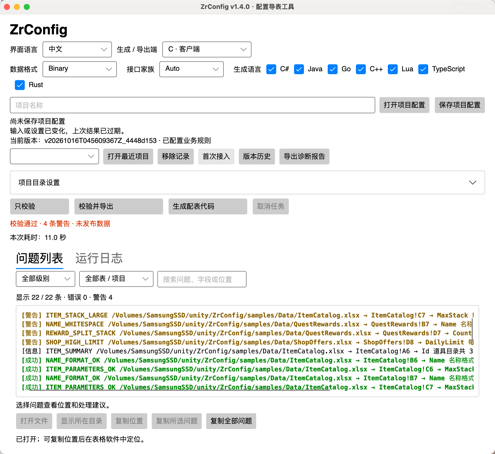

# ZrConfig

面向 Unity 与游戏服务器的强类型 Excel 配置工具：读取工作簿、生成 C#、C++、Go、Java、Lua、TypeScript、Rust 表代码，执行校验并导出二进制或 JSON 版本数据。运行时支持配置快照、数据更新、主键/分组查询和跨表对象引用。

采用 [MIT 许可证](LICENSE)。仓库包含工具源码、构建与打包入口、使用文档、Excel 示例及可运行的 Unity 工程。

当前工程版本为 **1.4.0**。源码在桌面配表、发布管理和 Unity 异步资源读取的基础上，已加入七语言生成、JSON 导出与独立的 `server-v1` 服务器接口。接入见 [多语言生成与运行时](docs/server-generation.md)；已有候选包与各轮源码验证的覆盖范围分别见 [验收记录](docs/release-and-acceptance.md#验收与团队试用记录)。

**旧版升级**：本次源码更新不保证与上一 GitHub 版本的生成接口兼容；Excel 统一使用五行表头，升级时需同步核对工作簿、生成代码、运行库与数据。已知 API 基线检查结果见 [本轮验收记录](docs/release-and-acceptance.md#文档与公开源码复验2026-10-16)。



图中为 1.4.0 的 macOS 中文界面，展示生成/导出端、数据格式、接口家族及七种生成语言选项。示例上次只校验通过，0 错误、4 条预期业务警告，尚未发布数据；当前状态提示输入或设置已变化，上次结果已过期。问题列表支持筛选、搜索、定位与复制，截图中的本机路径仅作演示。

## 核心亮点

- **可编程后置检查**：用 C# 编写逐行、整表和跨表业务规则，把原本运行时才发现的配表错误提前到导出阶段。
- **日常修表与发布管理**：只校验、可操作诊断、实时进度与取消、结构预览、版本差异及兼容回滚，见 [使用与验收](docs/release-and-acceptance.md)。
- **支持断点调试**：后置检查可在 Visual Studio / Rider 中设置断点、单步调试。
- **数据结构丰富**：支持数组、字典、自定义对象、多态、嵌套多行列表、组合主键和跨表引用。
- **多语言与双格式**：七种语言共用解析、校验和发布流程，支持 Binary、JSON 和双格式；C / S 字段筛选与生成语言独立。
- **服务器快照与接口保护**：提供全量、选择依赖闭包和按行加载，保留旧快照；公开 API 变化须通过显式迁移验收。
- **一套流程，两种入口**：桌面 App 与 CLI 共用项目配置、生成、校验和导出逻辑。
- **按需加载与版本切换**：同步/异步读取、按行加载、引用缓存，支持关键数据预热和全量验证后切换。

## 环境要求

| 用途 | 需要准备 |
| --- | --- |
| 使用已打包 App / CLI | 对应架构的 Windows 或 macOS 自包含包；无需另装 .NET |
| 从源码构建工具 | .NET SDK 10，具体选择由 [global.json](global.json) 控制；首次还原需联网 |
| 运行 Unity 示例 | Unity **6000.3.26f1**，版本以 [ProjectVersion.txt](unity/ZrConfig.Sample/ProjectSettings/ProjectVersion.txt) 为准 |
| 接入 C# / Unity 运行时源码 | .NET Standard 2.1、C# 9；Unity 直接编译 Assets 下的源码 |
| 接入其他语言运行时 | Java 17、Go 1.19、C++17、Lua 5.4、TypeScript 5.8 / Node 22、Rust 1.70 起；详见 [生成物与依赖](docs/server-generation.md#生成物与依赖) |

工具读取 `.xlsx`、`.xls` 不依赖 Microsoft Excel；编辑工作簿仍需表格软件。源码下载不包含安装包、已导出数据或 Unity Library，按下面的步骤准备即可。发布包由维护者构建，命令和产物位置见 [打包与安装](docs/development.md#打包与安装)。

## 运行 Unity 示例

克隆或解压完整仓库，安装 .NET SDK 10，在仓库根目录执行：

```bash
bash scripts/maintain.sh unity-sample
```

Windows：

```powershell
powershell -File scripts/maintain.ps1 unity-sample
```

完成后，用 Unity Hub 打开 `unity/ZrConfig.Sample`，使用工程记录的 Unity 版本，打开 `Assets/ZrConfigSample.unity` 并 Play。准备命令会生成代码并导出数据，Unity 直接编译 Assets 中的框架和业务源码；首次运行需要联网还原依赖。完整步骤见 [Unity 示例](samples/README.md#unity-可运行示例)。

成功时得到九张表、10,024 条记录、0 错误和 4 条预期警告。Editor 读取 `samples/Output`，桌面 Player 读取准备命令部署的 `Assets/StreamingAssets/ZrConfig`。如果只想体验配表和导出，可直接启动下方 App，无需先打开 Unity。

## 启动配表工具

macOS：

```bash
bash scripts/dotnet.sh run --project src/ZrConfig.App -p:NuGetAudit=false -p:UsedAvaloniaProducts=
```

Windows：

```powershell
dotnet run --project src/ZrConfig.App -p:NuGetAudit=false -p:UsedAvaloniaProducts=
```

在 App 打开 `samples/project.zrconfig.json`，保存 Excel 后点击“只校验”检查问题，准备发布时点击“校验并导出”。首次或表结构变化时，根据提示确认生成清单。共用示例已选择七语言、Binary + JSON 和 C 端。修正报错后，交付 `current.json` 与它引用的全部 `.bytes` / `.json` 数据，保留版本相对路径；诊断和差异快照留在工具侧。安装包构建见 [源码构建与升级](docs/development.md)。

## 命令行生成与导出

在仓库根目录运行，一步完成必要的生成、业务校验与导出：

```bash
bash scripts/dotnet.sh run --project src/ZrConfig.Cli -p:NuGetAudit=false -- export --generate --project samples/project.zrconfig.json
```

Windows：

```powershell
dotnet run --project src/ZrConfig.Cli -p:NuGetAudit=false -- export --generate --project samples/project.zrconfig.json
```

项目配置保存相对路径，可以随完整项目一起移动。退出码 0 表示成功，1 表示生成或导出检查未通过，2 表示命令用法或执行异常，3 表示只校验需要先生成代码，130 表示取消。普通 `export` 只使用已有代码，`codegen` 只生成代码；参数、分端和规则调试见 [CLI 教程](docs/project-development.md#13-命令行使用)。

仅检查数据时，将上述 `export --generate` 换成 `validate`；它不生成代码、不发布数据。`release --help` 查看历史、差异、回滚和清理命令。克隆后可执行 `bash scripts/maintain.sh verify-source`，Windows 使用 `powershell -File scripts/maintain.ps1 verify-source`，在临时目录复验构建、生成、校验、导出及失败保护。

## 文档

| 需要做什么 | 入口 |
| --- | --- |
| 安装、配表、生成、导出和处理报错 | [使用文档](docs/user-guide.md) |
| 版本比较、兼容回滚、清理和平台验收 | [发布管理与验收](docs/release-and-acceptance.md) |
| 查询 Excel 类型与填写格式 | [Excel 填写语法](docs/config-types.md) |
| 运行示例、查看现成工作簿 | [示例说明](samples/README.md) |
| 选择生成语言、JSON 数据与服务器加载模式 | [多语言生成与运行时](docs/server-generation.md) |
| 复验七语言契约、冻结消费方与性能 | [测试与验收](tests/README.md#公开服务器验收) |
| 定义业务类型、转换器，使用 CLI，接入 Unity | [项目开发教程](docs/project-development.md) |
| 编写字段、整表和跨表检查 | [规则开发](docs/rules-development.md) |
| 调试自己的规则与 Unity 接入 | [调试指南](docs/debugging.md) |
| 构建、打包和升级支持源码 | [源码构建与升级](docs/development.md) |
| 修改源码、复验、准备 GitHub 提交 | [提交与发布检查](docs/development.md#提交与发布检查) |

全部专题见 [文档导航](docs/README.md)。

## 示例内容

工作簿统一位于 [samples/Data](samples/Data)，配置与规则直接放在 Unity Assets 中，全部示例共用 `samples/Output`。

| 工作簿 | 内容 |
| --- | --- |
| AllTypes.xlsx | 基础值、复杂类型、数组、字典、多态与嵌套多行列表 |
| AllTypes10k.xlsx | 一万条全类型记录、跨表引用和同表引用链 |
| CompositeKeys.xlsx | 双主键、三主键及分组 |
| TableReferences.xlsx | 双向/自引用、共享对象和空引用 |
| ItemCatalog.xlsx、ShopOffers.xlsx、QuestRewards.xlsx | 道具、商店、任务奖励和业务检查 |

未修改的示例导出九张表、10024 条记录（包含一万行全类型加载用例），产生 4 条预期警告。新建表采用五行表头：字段名、类型、主键、说明、所属端；第 6 行起填写数据。全部正式工作簿均使用当前表头规范，AllTypes 的类型索引、说明页与数据行同步更新。

## 仓库结构

| 位置 | 职责 |
| --- | --- |
| `src` | Core、CLI、桌面 App，以及链接 Assets 源码的 Runtime / Validation 工程 |
| `samples/Data` | 七份正式工作簿，所有示例共用同一输入根目录 |
| `unity/ZrConfig.Sample/Assets/ZrConfig` | C# Runtime、Validation、Unity 适配器与六种原生运行库模板的唯一源码 |
| `unity/ZrConfig.Sample/Assets/HotUpdate/Config` | 手写类型、序列化支持和统一生成代码 |
| `unity/ZrConfig.Sample/Assets/Editor/ConfigRules` | 逐行、整表和跨表业务检查 |
| `scripts` | 跨平台维护、示例准备和打包入口 |
| `tests` | 公开服务器验收工程和四份共享契约夹具 |
| `.github/workflows/ci.yml` | Windows/macOS 源码验证，以及 Windows/Linux/macOS 七语言最低/当前工具链矩阵 |
| `docs` | 使用与开发文档，截图和练习附件在 `docs/assets` |
| `samples/Output`、`artifacts` | 执行导出和打包后生成，不随 Git 提交 |

公开源码的目录职责、生成文件归属及验证入口见 [公开源码与目录](docs/development.md#公开源码与目录)。

## 数据与运行时

App 与 CLI 支持 Windows/macOS，读取 `.xlsx` 和 `.xls`，无需安装 Excel。生成代码后，项目使用对应语言的独立运行库加载二进制或 JSON 配置；工具界面与 Excel 解析库不进入游戏运行时。

导出先生成完整数据版本，再切换清单。Unity 现有 C# 接口默认只读取清单，生成查询直接提供各表 Codec，首次访问时校验结构，并按主键同步/异步加载记录，引用属性访问时才加载目标行，失败不发布半成品。需要全量验证后切换时提供 `TableCodecs.Registry` 并显式使用 ReloadAll / ReloadAllAsync。远端部署也应先上传完整版本数据再更新清单。

同步入口调用资源源的 `Read`，异步入口调用 `ReadAsync`；AB 适配层负责资源请求的合并、调度和句柄，配表负责按行解码和对象缓存。Unity 默认策略下，成功重载后旧快照查询与旧行引用失效，业务统一获取新对象。独立 `server-v1` 接口保留业务已持有的快照和安全句柄，支持显式 Prepare / Commit；两套接口的生命周期见 [服务器接入](docs/server-generation.md#服务器契约家族与显式加载)。

模型结构变化需要同步生成代码、Runtime 与数据。Unity 示例的 Runtime、Validation、适配器、查看器和业务模型全部位于 Assets，以源码编译；具体接入见 [Unity 教程](docs/project-development.md#14-unity-运行时如何使用)。

当前提供配置数据更新，不包含 C# 热更新框架、旧结构自动迁移、增量导出或 Excel 写回。Android / iOS / WebGL 可使用内置 `StreamingAssetsConfigSource`；具体设备、IL2CPP、AB / 热更新框架仍需按目标项目验证，接入边界见 [使用范围](docs/development.md#使用范围)。

## 反馈问题

反馈时提供工具版本、系统、Unity 版本（如涉及）、实际操作或 CLI 命令、第一条错误以及最小复现。固定日志位于 `Output/Logs/export.log` 和 `diagnostics.json`，独立历史记录位于 `Output/Logs/<运行编号>/`；也可从 App 导出诊断报告，并移除不适合公开的业务数据和路径。贡献代码前参考 [提交与发布检查](docs/development.md#提交与发布检查)。

## 许可

本项目源码、文档、示例及生成模板采用 MIT，允许商用、修改和再分发，分发时保留许可声明。使用者自己的工作簿、业务代码和游戏数据由使用者决定授权方式。

第三方组件遵循各自许可证，声明见 [第三方许可](src/ZrConfig.App/Licenses/ThirdPartyNotices.txt)。
