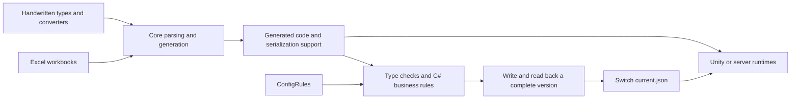

# Building from source and upgrading

[中文](development.md) | **English**

This guide covers launching from source, packaging, upgrades, and format conventions. See the [user guide](user-guide.en.md) for Excel operations and [project development](project-development.en.md) for types, rules, and Unity integration.

## Public source and layout

GitHub and `package-source` include the tool, complete Unity sample, official Excel files, public tutorials, and attachments. Preserve the full layout when cloning/extracting; do not take only `src`, since Runtime/Validation link the sole source files under Unity Assets.

| Path | Maintained content |
| --- | --- |
| `src/ZrConfig.Core` | Excel reading, type parsing, generation, dynamic rule compilation, validation, and publication |
| `src/ZrConfig.Cli`、`src/ZrConfig.App` | CLI and Avalonia desktop entry points sharing Core |
| `src/ZrConfig.Runtime`、`src/ZrConfig.Validation` | .NET project files linking corresponding Assets source |
| `unity/ZrConfig.Sample/Assets/ZrConfig` | Runtime, Validation, Unity/Runtime, Unity/Editor, and Native runtime templates |
| `unity/ZrConfig.Sample/Assets/HotUpdate/Config` | Handwritten CustomTypes, Serialization support/converters, and Generated code |
| `unity/ZrConfig.Sample/Assets/Editor/ConfigRules` | Shared pure C# business rules, Editor only |
| `samples/Data` | Sole official Excel root, with optional category subdirectories |
| `samples/project.zrconfig.json` | Shared App/CLI paths, relative to this file |
| `scripts` | .NET maintenance, Bash/PowerShell wrappers, packaging |
| `tests/ZrConfig.Server.Tests` | Public seven-language contracts, frozen consumers, and performance acceptance, linking four fixtures in `tests/ZrConfig.Tests` |
| `docs`、`docs/assets` | Documentation, README screenshot, standalone tutorial ZIP |

All official samples share Config, Rules, and `samples/Output`, with one generated `TableCodecs`. Do not copy Data/Config/Rules/Output per feature. Maintain business types/converters in the locations above; keep handwritten logic out of Generated.

Commit generated code, `Config/.generation.json`, `Config/.schema.json`, `Serialization/.support.json`, and matching Unity `.meta` files. New generation transactions write .schema.json. Exclude samples/Output, artifacts, bin/obj, Unity Library/Temp/Logs/UserSettings, locks, and caches per .gitignore. Prepared Player deployment under StreamingAssets/ZrConfig is also untracked.

Public CI runs verify-source on Windows/macOS and seven-language contracts/frozen consumers on minimum/current Windows/Linux/macOS toolchains. GitHub/source ZIP include tests/README.md, ZrConfig.Server.Tests, and four shared fixtures; see [public acceptance](../tests/README.en.md#public-server-acceptance). Other internal tests, workbook rebuilds, linked sample projects, and local measurements are private. Optional scripts/ZrConfig.Development.props is unnecessary for public builds. The launch/export/verification/packaging steps here depend only on public files. Public source omits local commands smoke, check-layout, check-style, and samples all.

## Architecture and data flow



App/CLI share `ProjectWorkflow`. Generation creates a read-only preview, then applies confirmed changes. Export compiles project/rules, reads Excel, validates, writes, and reads back before switching the manifest. Warnings permit publication; errors block it. Generation/export are separate commits: failed business validation does not undo already generated code, but preserves the old data manifest.

`ValidateAsync` first checks code/schema consistency, then compiles, validates, and reads back in system temp without writing Config/Output. `WorkflowOperation` carries progress, run ID, and cancellation. `ProjectInputSnapshot` rechecks input content before publication; `SchemaSummary` supplies previews/summaries; `ReleaseHistory` manages per-version manifests, differences, compatible rollback, and cleanup. `OperationReport` stores explicitly exported reports. File watchers only mark results stale, never replace content verification.

Runtime references neither Core/App nor Excel libraries. Unity Validation, rules, and viewer Editor assemblies are Editor-only through asmdef. Runtime use needs Runtime, Unity adapters, and models/codecs. `IConfigSource` / `ISyncConfigSource` abstract resource reads. AB frameworks manage downloads/handles; Runtime validates, decodes, caches, and manages snapshots.

## Environment and building

Install .NET SDK 10, preserve layout, and run from the root. Initial builds restore NuGet over the network; global.json selects a stable .NET 10 SDK.

macOS:

```bash
bash scripts/dotnet.sh build ZrConfig.slnx -p:NuGetAudit=false -p:UsedAvaloniaProducts=
bash scripts/dotnet.sh run --project src/ZrConfig.App -p:NuGetAudit=false -p:UsedAvaloniaProducts=
```

Windows:

```powershell
dotnet build ZrConfig.slnx -p:NuGetAudit=false -p:UsedAvaloniaProducts=
dotnet run --project src/ZrConfig.App -p:NuGetAudit=false -p:UsedAvaloniaProducts=
```

App/CLI share Core; Runtime/Validation target .NET Standard 2.1, tools .NET 10. Export compiles selected project configuration/rules, so changing business types requires no generic-tool rebuild.

Check the actual SDK with `bash scripts/dotnet.sh --info` (`dotnet --info` on Windows). Bash searches DOTNET_BIN, PATH, DOTNET_ROOT, then user SDKs; PowerShell uses DOTNET_BIN or PATH. NuGetAudit=false disables only this vulnerability-metadata query; dependencies still restore. Review release dependencies separately.

Do not use --no-restore on first build or after bin/obj cleanup: missing project.assets.json causes NETSDK1004. To stop build servers and diagnose IDE/CLI differences:

```bash
bash scripts/dotnet.sh build ZrConfig.slnx --disable-build-servers -m:1 -p:UseSharedCompilation=false -p:NuGetAudit=false -p:UsedAvaloniaProducts=
```

On Windows replace `bash scripts/dotnet.sh` with `dotnet`. Trust current build output and Unity Console. For IDE-only errors, reload the corresponding solution, regenerate Unity IDE projects, then inspect cache state; see [IDE versus compilation](debugging.en.md#ide-diagnostics-versus-actual-compilation).

## C# conventions

Public unity/ZrConfig.Sample/.editorconfig defines Unity/generated formatting. Tool source, maintenance code, and Core/Templates/*.cs.txt follow:

| Item | Rule/example |
| --- | --- |
| Types, namespaces, public members, constants | PascalCase: ConfigManager, MaxCount; interfaces prefixed I: ITableCodec |
| Private/internal instance fields | `_camelCase`: `_reader` |
| Private/internal static fields, including static readonly | `s_camelCase`: `s_codec` |
| Parameters/locals | camelCase: tableName; local constants PascalCase |
| Generic parameters | T or T-prefixed PascalCase: TRow |
| Async methods | Async suffix; callbacks, entry points, and implementations follow their contracts |
| Formatting | UTF-8, LF, 4 spaces, Allman braces; braces on control statements; one declaration/statement per line |
| Type expressions | Built-in int/string keywords; var when obvious from the right side, otherwise explicit types |
| Member declarations | Explicit accessibility; readonly where possible; avoid redundant this. |
| Using/namespace | System first, remove unused imports; file-scoped for tools, C# 9 block namespaces for Assets/templates |

.editorconfig cannot judge naming meaning, plurality, thread-static attributes, or every asynchronous return type; review these manually. Preserve storage/external contracts: Unity JsonUtility manifest fields keep lowercase names with nearby naming exceptions; ordinary JSON models use explicit JSON names. Update serialized scene fields when renaming Inspector fields.

JSON/XML projects use four-space indentation. Maintenance text uses UTF-8, LF, and a final newline without trailing spaces. Preserve meaningful Markdown breaks and original Unity-serialized/third-party-license structure. Shared Assets must respect Unity's compile context; newer tool C# features must not leak into Runtime/templates.

Change generators/templates first, then regenerate formatting. Core/Templates owns the four shared support files. Review generated differences and run public verification below; do not patch Generated to hide generator defects.

## Generated file organization

Each C# table generates one Generated/XxxConfig.g.cs containing XxxConfig record, XxxConfigTable query type, XxxConfigTableAccess extensions, then XxxConfigCodec. Type names, namespaces, queries, static codec initialization, and binary format are independent of file layout. One TableCodecs.g.cs remains shared; do not copy Serialization into each table.

Generator components append declarations to one StringBuilder, emitting one header/using/namespace and formatting once per table. This changes source organization only, not runtime queries/indexes/caches; fewer files do not imply runtime speed gains.

Old three-file layouts migrate on next generation. Preview lists XxxConfigCodec.g.cs, XxxConfigTable.g.cs, and matching .meta deletions, committed transactionally with the merged file after confirmation. Preserve XxxConfig.g.cs GUID, handwritten code, and unrelated metadata. Failure rolls source/metadata back; cancellation changes nothing. After review use `codegen --accept-changes` or `export --generate --accept-changes`. Never compile both layouts. API protection is separate: API_CHANGE_REQUIRED needs [explicit consumer-verified migration](server-generation.en.md#public-api-protection-and-explicit-migration); --accept-changes cannot approve API changes.

Other languages use subdirectories under the same Generated root, tracked by .native-files.json; see [outputs/dependencies](server-generation.en.md#outputs-and-dependencies).

## Index and single-table loading responsibilities

A single-field primary key and its same-field group share the read-only dictionary from CreateUniqueGroupIndex, built in one preallocated pass. Each group still owns a capacity-1 `List<T>`. Get/TryGet/group queries share row/group objects, misses share Empty, and direct enumeration uses `List<T>`.Enumerator. Composite keys, other groups, metadata, SchemaHash, and binary format remain unchanged. Deploy new Runtime helpers with new generated code; old generated code still compiles.

ConfigLazyLoader owns catalog, codec resolution, resource reads, scheduling, snapshot identity, and global statistics. Its private TableState encapsulates reader, row cache, full table, and table lock, performing hash/index checks, decoding, reference binding, and table construction. CommitReader/CommitRow/CommitTable recheck cancellation/snapshot validity under the publication lock before updating caches/statistics. Full tables commit only after all rows/indexes succeed; failures preserve existing rows and allow retries.

Lock order is table lock → publication lock. Catalog locks coordinate lookup/registration without decoding. Publication locks never read resources, decode, or wait for table locks. Invalidate old snapshots first, then clean outside the publication lock; busy tables use delayed thread-pool cleanup without blocking new Current. Cache fast paths, post-background rechecks, and source coalescing responsibilities stay unchanged, without new commit closures on hot paths.

## Unity sample

Every table generates XxxConfigTable with explicit static constructor/fields and ordinary GetCodec(). Synchronous/asynchronous row, table, and reference queries pass target codecs directly, without central type routing. The sole TableCodecs generates catalog segments of at most 128 tables, used only for export/explicit full validation. Ordinary queries pass a codec and build no full routing dictionary. Initialization may omit the catalog and validate only manifest format; table schemas are checked on first access. Full acceptance requires the catalog and ReloadAll. Related generated comments currently use Chinese; no CodecHolder or captured anonymous functions are generated. See [loading/references](project-development.en.md#14-unity-runtime-integration).

Run `bash scripts/maintain.sh unity-sample` from the root, or `powershell -File scripts/maintain.ps1 unity-sample`. It generates/exports sample data; Runtime, Validation, and adapters compile directly from Assets/ZrConfig. Open unity/ZrConfig.Sample in Unity Hub, open the scene, and Play. See [sample steps](../samples/README.en.md#runnable-unity-sample).

## Verify public source

Start with `bash scripts/maintain.sh verify-source`, or its PowerShell equivalent. It rechecks build, generation, validation-only, nine-table export, and failure protection in temp, without changing official workbooks/releases. See [release acceptance](release-and-acceptance.en.md) for real Players, release hashes, and supported scope.

The following works after GitHub cloning or source-ZIP extraction. Run from the source root; existing Output alone is not proof of this run's success.

macOS:

```bash
bash scripts/dotnet.sh build ZrConfig.slnx -p:NuGetAudit=false -p:UsedAvaloniaProducts=
bash scripts/maintain.sh check-portability
bash scripts/dotnet.sh run --project src/ZrConfig.Cli -p:NuGetAudit=false -- --help
bash scripts/maintain.sh unity-sample
```

Windows:

```powershell
dotnet build ZrConfig.slnx -p:NuGetAudit=false -p:UsedAvaloniaProducts=
powershell -File scripts/maintain.ps1 check-portability
dotnet run --project src/ZrConfig.Cli -p:NuGetAudit=false -- --help
powershell -File scripts/maintain.ps1 unity-sample
```

Continue only after each step succeeds. Build must have no errors. check-portability checks public source, workbooks/tutorial attachments for local paths, relative project settings, required files, and Unity platform credentials; it does not inspect screenshot text. CLI help checks only the entry point; unity-sample performs generation/export. Expect nine tables, 10,024 records, 0 errors, and 4 business warnings; see [counts](../samples/README.en.md#what-to-check-after-success). Preparation updates Generated, Output, and StreamingAssets while preserving Excel/history; ensure no unsaved workbook edits.

Open the scene with the specified Unity version, wait for Console compilation, then use Tools → ZrConfig → 验证示例数据 (Validate sample data) and 验证 AB 同步与异步 (Validate sync/async AB). Alternatively close the interactive Editor and batch-verify with the same executable version.

macOS: set UNITY_EDITOR to the actual Editor executable; logs go to system temp.

```bash
"$UNITY_EDITOR" -batchmode -nographics -quit -projectPath "$PWD/unity/ZrConfig.Sample" -executeMethod ZrConfig.Sample.Editor.SampleProject.VerifyData -logFile "${TMPDIR:-/tmp}/zrconfig-verify-data.log"
"$UNITY_EDITOR" -batchmode -nographics -projectPath "$PWD/unity/ZrConfig.Sample" -executeMethod ZrConfig.Sample.Editor.SampleProject.VerifyAbLoading -logFile "${TMPDIR:-/tmp}/zrconfig-verify-ab.log"
```

Windows: set UNITY_EDITOR to the matching Unity.exe path.

```powershell
& $env:UNITY_EDITOR -batchmode -nographics -quit -projectPath "$PWD/unity/ZrConfig.Sample" -executeMethod ZrConfig.Sample.Editor.SampleProject.VerifyData -logFile "$env:TEMP/zrconfig-verify-data.log"
& $env:UNITY_EDITOR -batchmode -nographics -projectPath "$PWD/unity/ZrConfig.Sample" -executeMethod ZrConfig.Sample.Editor.SampleProject.VerifyAbLoading -logFile "$env:TEMP/zrconfig-verify-ab.log"
```

VerifyAbLoading is asynchronous and exits when done; do not add -quit. Both checks use real Unity Editor to verify assemblies, shared/desktop data, sync/async reads, lazy references, caches, composite keys, and reload. Manually Play afterward to inspect UI. Editor checks do not replace Player, IL2CPP, or third-party SDK acceptance.

Public projects in ZrConfig.slnx have no test adapter; dotnet test cannot replace generation/export/Unity checks above. Record actual commands, environment, results, and untested platforms; historical performance numbers are not current acceptance results.

## Packaging and installation

| Command | Purpose |
| --- | --- |
| `bash scripts/package-macos.sh arm64` | Apple Silicon App; use x86_64 for Intel Mac |
| `powershell -File scripts/package-windows.ps1` | Windows x64 App/CLI; add -RuntimeIdentifier win-arm64 for ARM64 |
| `bash scripts/maintain.sh package-unity` | Export source to artifacts/unity/ZrConfig-source/Assets/ZrConfig; no DLL/package.json; specify a new output if it exists |
| `bash scripts/maintain.sh package-rules-sdk` | Extract Runtime/Validation for rule development from a built Release App |
| `bash scripts/maintain.sh package-source` | Package public source, docs, Excel, Unity; refuses existing ZIP overwrite |
| `bash scripts/maintain.sh install-source <zip-file> <new-directory>` | Extract source, including GitHub ZIP; refuses existing directories |
| `bash scripts/clean.sh` | Clean build caches, retaining exported data/packages |

Windows uses `powershell -File scripts/maintain.ps1 <command>`. Build src/ZrConfig.App -c Release before packaging the SDK, or explicitly supply tool DLL/new output directories. Source, Unity source, and SDK outputs live under artifacts.

macOS App: artifacts/macos/osx-arm64/ZrConfig.app; Windows package: artifacts/windows/win-x64/ZrConfig. Distribute complete folders. Self-contained packages require no separate .NET. Scripts preserve the previous valid build. macOS uses local ad-hoc signing; production distribution needs developer signing/notarization. Windows scripts do not sign code. See [installation/upgrades](user-guide.en.md#12-installation-and-upgrades).

`bash scripts/maintain.sh install-source <source-zip> <new-directory>` extracts source, not App installation. Normal cleanup retains valid data; clean --outputs deletes samples/Output and artifacts, including valid packages, so use deliberately.

## Field target sides

All tables require explicit C/S/CS on row 5, with data from row 6. Blanks are errors; headerRows configuration is unnecessary. Existing headerRows: 5 is valid; other values fail. Generated source carries ConfigTableLayout(5); update Runtime/generated code together. See [markers](config-types.en.md#client-and-server-fields) and [automation](project-development.en.md#generateexport-by-side).

Rules compilation cache is optional acceleration. Read failure/corruption reports RULE_CACHE_READ_FAILED and recompiles. Save failure reports RULE_CACHE_WRITE_FAILED while retaining this run's compiled result; temporary cleanup issues join that warning. Source errors, assembly load failures, and business errors still block publication without old-rule fallback.

## Generation consistency and failure recovery

Previews capture workbook lists, valid sheets/five headers, handwritten types/converters, Tables.json, and target side. Confirmation rechecks inputs/output; schema/source changes return GENERATION_CHANGED and require another preview. Data rows are outside the schema fingerprint, so value-only edits may proceed; export reads current data.

Generated code, managed support, .schema.json including API contracts, .support.json, and .generation.json update in one rollback-capable transaction; standalone support uses the same mechanism. Staging/backups use system temp and locks follow generation → support. Report support-upgrade success only after full commit. Handwritten files and retained-script .meta are not overwritten/deleted. Only retired generated-script metadata appears in preview and deletes/rolls back with its script; unrelated orphan metadata is untouched.

Generation also checks accepted public APIs. Ordinary confirmation/--accept-changes cannot approve API removal/signature changes. Review impact, obtain consumer evidence with codegen --verify-api, then explicitly migrate using `codegen --accept-api-change <digest> --migration-receipt <receipt-file>`. Missing/mismatched API baselines beside existing generated code stop writes; restore matching source/.schema.json. When copying fresh handwritten input, exclude both Generated and its baseline; copying an existing project must preserve both. See [API protection](server-generation.en.md#public-api-protection-and-explicit-migration) for scope, conservative limits, and codes.

Write exceptions return GENERATION_WRITE_FAILED and roll back. If rollback fails, GENERATION_ROLLBACK_FAILED lists unrestored files, backup directory, and files.json; restore these before regenerating. Success/full rollback cleans staging. This does not provide automatic recovery after power loss/forced termination or instantaneous multi-file invisibility to Unity watchers.

## Support-source upgrades


Shared support remains source-distributed without duplicate Runtime/project implementations. ConfigSourceLayout records each template's SHA-256 content version, ignoring newline differences, in Serialization/.support.json:

- Content equals recorded template: generation may upgrade automatically.
- Content already equals current template: adopt its version without rewriting.
- Missing file: generation supplies it.
- Handwritten changes, unrecognized old content, or corrupt records: preserve files and report SUPPORT_MERGE_REQUIRED or similar with file/content versions. Special converters are outside template ownership and never overwritten.

ExportPipeline and CLI export without --generate only check support versions, never write source. App/export --generate preview read-only through the shared workflow, then generate/export after confirmation policy passes. SUPPORT_UPDATE_REQUIRED blocks direct export; generate to upgrade. SUPPORT_MERGE_REQUIRED is a warning requesting custom-content review.

Support source can also be maintained independently without compilable Excel/rules:

```bash
bash scripts/dotnet.sh run --project src/ZrConfig.Cli -- support unity/ZrConfig.Sample/Assets/HotUpdate/Config
```

For manual merge, choose an empty temporary Config, run `support <temporary-config>` to obtain templates, compare/merge each reported file, preserve handwritten content, confirm type/codec contracts, then regenerate/export/synchronize Unity. Remove temporary references afterward; keep only one support set in the real project.

Version .support.json with source. If missing/corrupt, adopt only files matching known templates; preserve others as unmanaged, never overwrite by timestamp. Core/Templates is the sole source for four shared files. Handwritten MoneyConverter and similar converters are not templates.

## Headers and indexes

Only five-row headers are supported. Put literal 主键 in key fields on row 3, descriptions on row 4, explicit C/S/CS on mandatory row 5, and data from row 6. Missing/invalid key markers block generation/export. Layouts are not inferred and workbooks are not automatically modified.

Config/Tables.json accepts only optional headerRows (5 only) and groups. Keys come exclusively from Excel; JSON key is unsupported. Each key field automatically gets ByFieldName grouping. Add non-key/composite groups, for example:

```json
{
  "AllTypes": { "groups": { "ByQuality": ["QualityValue"] } }
}
```

Custom groups cannot override automatic key groups with different fields. Regenerate/export matching data after header/group changes; existing valid releases remain.

## Third-party dependencies and distribution

See [LICENSE](../LICENSE). Third-party copyright/licenses/NOTICE are centralized in [ThirdPartyNotices.txt](../src/ZrConfig.App/Licenses/ThirdPartyNotices.txt); versions are in [ThirdPartyPackages.json](../src/ZrConfig.App/Licenses/ThirdPartyPackages.json).

App/CLI builds include project/third-party licenses; packaging checks actual dependencies against declarations. Unity source, rules SDK, and tutorial attachments include LICENSE. Retain notices on redistribution and check corresponding licenses when upgrading dependencies.

## Contribution and release checks

GitHub stores source; packaging writes installers/source ZIPs into artifacts. In the intended commit workspace:

1. Run public verification above; inspect current export logs, nine-table counts, and Unity compilation. For rule changes, introduce errors only in temp to verify locations/old-version protection, never in official Data.
2. Review git status --short, git diff --stat, and git diff --check. New Runtime source, generated models, .meta, official workbooks, and documentation images should be staged. Keep caches, exported data, and internal records ignored; never force-add them publicly.
3. Verify new links/anchors against public files. Put README images in docs/assets with relative links. For new public docs/attachments update docs/README.md and scripts/ReleaseFiles.cs so source ZIP matches GitHub.
4. Run package-source to a nonexistent ZIP, extract into system temp, rebuild, and run unity-sample. Clean extracted success proves no dependency on private tests/caches.
5. Package App/CLI from current source; verify version, architecture, project/third-party licenses. Run check-package-licenses <directory> for every release folder and launch on target OS. macOS ad-hoc signing does not replace developer signing/notarization.
6. Explain purpose, user behavior, actual checks, and untested scope in the commit. For schema/API/binary changes state which code/data must update together. Preserve the previous valid release; do not overwrite old ZIPs or clear valid Output for tidiness.

The full local workspace additionally runs layout/full smoke per collaboration conventions. These tools/records do not expand public scope; public users follow this page.

Issue reports should include version/source, OS, SDK/Unity versions, exact command/button operation, first error, expected/actual results, and a publishable minimal workbook/types/rules set. Logs are retained per run; export sanitized diagnostic reports from the App when useful.

## Scope

Tools support Windows/macOS; the sample uses ProjectSettings/ProjectVersion.txt's Unity version. App version appears in project metadata/title. Runtime/Validation have one source set in unity/ZrConfig.Sample/Assets/ZrConfig, linked by .NET projects restricted to C# 9/.NET Standard 2.1. The sample needs no separate ZrConfig package; repository updates synchronize framework APIs.

Data updates require matching Runtime, generated code, and schema. Regenerate/export/synchronize game code after schema changes. No C# hot-update framework, automatic schema migration, incremental export, or Excel write-back is supplied. Accept Players, IL2CPP, mobile, WebGL, Odin, and resource systems in your target environment.

Unity provides UnityWebRequest-based StreamingAssetsConfigSource, used with CoalescingConfigSource in Android/iOS/WebGL samples. Public CI covers Windows/macOS builds, validation-only, export protection, source packaging, and a seven-language Windows/Linux/macOS matrix. Actual results belong to the commit's Actions checks. Real GUI/Player/device/signing/team-trial evidence is recorded separately in [release acceptance](release-and-acceptance.en.md).
