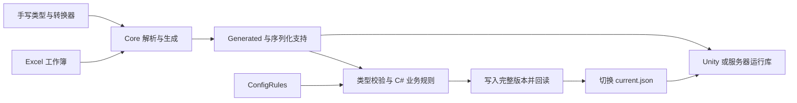

# 源码构建与升级

**中文** | [English](development.en.md)

本文介绍从源码启动工具、打包、升级与格式约定。Excel 操作见 [使用文档](user-guide.md)，业务类型、规则和 Unity 接入见 [项目开发教程](project-development.md)。

## 公开源码与目录

GitHub 仓库与 `package-source` 源码包包含工具、完整 Unity 示例、正式 Excel、公开教程与附件。克隆或解压时保留完整目录，不单独取出 `src`，因为 Runtime / Validation 工程会链接 Unity Assets 中的唯一源码。

| 路径 | 维护内容 |
| --- | --- |
| `src/ZrConfig.Core` | Excel 读取、类型解析、代码生成、动态规则编译、校验和版本发布 |
| `src/ZrConfig.Cli`、`src/ZrConfig.App` | 命令行与 Avalonia 桌面入口，共用 Core |
| `src/ZrConfig.Runtime`、`src/ZrConfig.Validation` | .NET 工程文件，链接 Assets 中的对应源码 |
| `unity/ZrConfig.Sample/Assets/ZrConfig` | Runtime、Validation、Unity/Runtime、Unity/Editor 与 Native 多语言运行库模板 |
| `unity/ZrConfig.Sample/Assets/HotUpdate/Config` | CustomTypes 手写类型、Serialization 支持源码与转换器、Generated 生成代码 |
| `unity/ZrConfig.Sample/Assets/Editor/ConfigRules` | 共用的纯 C# 业务规则，仅进入 Unity Editor |
| `samples/Data` | 正式 Excel 唯一根目录，允许分类子目录 |
| `samples/project.zrconfig.json` | App / CLI 共用目录配置，路径相对于该文件 |
| `scripts` | .NET 维护程序、Bash / PowerShell 包装和打包入口 |
| `tests/ZrConfig.Server.Tests` | 公开七语言契约、冻结消费方与性能验收程序；链接 `tests/ZrConfig.Tests` 的四份共享夹具 |
| `docs`、`docs/assets` | 文档、README 截图和独立练习 ZIP |

全部正式示例共用一套 Config、Rules 和 `samples/Output`，所有表只生成一份 `TableCodecs`。不要按功能复制 Data/Config/Rules/Output；业务类型和转换器在上表位置维护，Generated 不放手写逻辑。

生成代码、`Config/.generation.json`、`Config/.schema.json`、`Serialization/.support.json` 和对应 Unity `.meta` 随源码保存；`.schema.json` 由新版生成事务写入。`samples/Output`、`artifacts`、bin/obj、Unity Library/Temp/Logs/UserSettings、运行锁和编译缓存不提交，依照 `.gitignore` 排除。`StreamingAssets/ZrConfig` 是示例准备命令生成的 Player 部署内容，也不提交。

公开 CI 在 Windows/macOS 执行 `verify-source`，另以 Windows/Linux/macOS 的最低与当前工具链执行七语言服务器契约和冻结消费方验收。GitHub 与源码 ZIP 均包含 `tests/README.md`、`ZrConfig.Server.Tests` 和四份共享夹具，命令见 [公开服务器验收](../tests/README.md#公开服务器验收)。其余内部测试、工作簿重建脚本、示例链接编译工程与本机测量记录不在公开范围。`scripts/ZrConfig.Development.props` 是可选的本地扩展，缺失时不影响公开解决方案构建。本文列出的启动、导出、验证和打包步骤均只依赖公开文件；公开源码不提供本地扩展命令 `smoke`、`check-layout`、`check-style` 或 `samples all`。

## 架构与数据流程



App 与 CLI 调用同一套 `ProjectWorkflow`。生成阶段先创建只读预览，再按确认策略应用代码变更；导出阶段编译项目代码和规则、读取当前 Excel、执行校验，成功写入并回读后才切换清单。Warning 可以发布，Error 阻止发布。生成和导出是两个提交阶段：已经成功生成代码后，业务校验失败不会自动恢复旧代码，但会保留旧数据清单。

`ValidateAsync` 先检查代码是否与当前结构一致，再在系统临时目录编译、校验和回读，不写项目 Config/Output。`WorkflowOperation` 为每轮操作携带进度、运行编号与取消令牌；`ProjectInputSnapshot` 在发布前复核输入内容，`SchemaSummary` 提供生成预览与结构摘要，`ReleaseHistory` 管理独立版本清单、差异、兼容回滚和清理。`OperationReport` 保存用户主动导出的诊断报告。文件监听只提示结果过期，不能替代内容复核。

Runtime 不引用 Core、App 或 Excel 解析库。Unity 的 Validation、规则与查看器编辑器程序集通过 asmdef 限定 Editor；运行时只需 Runtime、Unity 适配层及模型/Codec。资源读取通过 `IConfigSource` / `ISyncConfigSource` 接入，AB 框架负责下载和资源句柄，Runtime 负责数据校验、解码、缓存与快照生命周期。

## 环境与构建

安装 .NET SDK 10，保持仓库目录结构，在根目录执行。首次构建需要联网还原 NuGet 依赖；`global.json` 选择稳定的 .NET 10 SDK。

macOS：

```bash
bash scripts/dotnet.sh build ZrConfig.slnx -p:NuGetAudit=false -p:UsedAvaloniaProducts=
bash scripts/dotnet.sh run --project src/ZrConfig.App -p:NuGetAudit=false -p:UsedAvaloniaProducts=
```

Windows：

```powershell
dotnet build ZrConfig.slnx -p:NuGetAudit=false -p:UsedAvaloniaProducts=
dotnet run --project src/ZrConfig.App -p:NuGetAudit=false -p:UsedAvaloniaProducts=
```

App 和 CLI 共用 Core；Runtime 与 Validation 面向 .NET Standard 2.1，工具面向 .NET 10。App/CLI 导出时编译指定项目的配置与规则，使用者修改业务类型后无需重新构建通用工具。

`bash scripts/dotnet.sh --info`（Windows：`dotnet --info`）用于确认实际 SDK。Bash 包装器依次检查 `DOTNET_BIN`、PATH、`DOTNET_ROOT` 和用户目录中的 SDK；PowerShell 使用 `DOTNET_BIN` 或 PATH 中的 dotnet。`NuGetAudit=false` 只关闭此次漏洞元数据查询，仍会正常还原依赖；发行前的依赖审查单独进行。

首次构建或清理 bin/obj 后不要加 `--no-restore`，否则会出现缺少 `project.assets.json` 的 NETSDK1004。需要关闭构建服务器、排查 IDE 与命令行差异时可执行：

```bash
bash scripts/dotnet.sh build ZrConfig.slnx --disable-build-servers -m:1 -p:UseSharedCompilation=false -p:NuGetAudit=false -p:UsedAvaloniaProducts=
```

Windows 将 `bash scripts/dotnet.sh` 替换为 `dotnet`。以这次实际构建输出和 Unity Console 为准；仅 IDE 报红时，先重新加载对应解决方案，Unity 工程由 Unity 重新生成 IDE 项目，再检查缓存状态，见 [IDE 诊断与真实编译](debugging.md#ide-诊断与真实编译)。

## C# 代码规范

公开的 `unity/ZrConfig.Sample/.editorconfig` 定义 Unity 源码与生成代码的格式；工具源码、维护程序和 `Core/Templates/*.cs.txt` 模板遵循下表约定。

| 项目 | 规则与例子 |
| --- | --- |
| 类型、命名空间、公开成员、常量 | PascalCase：`ConfigManager`、`MaxCount`；接口使用 `I` 前缀：`ITableCodec` |
| 私有和内部实例字段 | `_camelCase`：`_reader` |
| 私有和内部静态字段，包括 static readonly | `s_camelCase`：`s_codec` |
| 参数、局部变量 | camelCase：`tableName`；局部常量使用 PascalCase |
| 泛型参数 | `T` 或 `T` 开头的 PascalCase：`TRow` |
| 异步方法 | 使用 `Async` 后缀；框架回调、入口、接口实现遵守原契约 |
| 排版 | UTF-8、LF、4 空格、Allman 大括号，控制语句始终加括号；一条声明/语句占一行 |
| 类型表达 | 内置类型写 `int`、`string`；类型从右侧明显可见时使用 `var`，其余使用显式类型 |
| 成员声明 | 明确访问级别，能只读的字段使用 `readonly`；避免多余的 `this.` |
| using 与命名空间 | System 在前，移除无用 using；工具工程使用文件作用域，Unity Assets 和生成模板保留 C# 9 的块作用域 |

`.editorconfig` 不能判断名称含义、单复数、线程静态特性或所有异步返回类型，这些规则仍需代码审查。存储格式和外部 API 必须兼容：Unity `JsonUtility` 使用的清单字段保留原有小写名称，并就近标明命名检查例外；普通 JSON 模型通过显式 JSON 名称保留数据契约。Unity Inspector 字段重命名时同步更新仓库内场景的序列化字段。

JSON、XML 工程文件使用四空格缩进；维护文本使用 UTF-8、LF 和末尾换行，避免行尾空白。Markdown 保留有意义的换行，Unity 序列化资源和第三方许可原文保留自身结构。共享 Assets 以 Unity 编译上下文为准，不能因工具工程启用了较新 C# 语法，就把同样语法写入 Runtime 或生成模板。

修改生成格式时先改生成器或模板，再重新生成。四份共享支持文件以 Core/Templates 为维护来源；生成后检查差异并执行下方公开验证流程，不直接修补 Generated 来掩盖生成器问题。

## 生成文件组织

C# 每张数据表只生成一个 `Generated/XxxConfig.g.cs`，文件内依次为记录类型 `XxxConfig`、索引查询类型 `XxxConfigTable`、扩展访问入口 `XxxConfigTableAccess`、编解码器 `XxxConfigCodec`。类名、命名空间、查询 API、静态 Codec 初始化和二进制格式保持独立于文件布局。共用注册表仍为唯一的 `TableCodecs.g.cs`，Serialization 支持源码不复制到各表。

生成器各部分向同一个 StringBuilder 追加类型声明，每张表统一输出文件头、using 和命名空间，并在完成后格式化一次。此调整只改变源码组织，不改变运行时查询、索引或缓存实现，也不据文件数量减少宣称运行性能提升。

旧三文件布局在下次生成时迁移：预览列出要删除的 `XxxConfigCodec.g.cs`、`XxxConfigTable.g.cs` 及其配套 `.meta`，确认后与合并文件在同一事务中更新。保留 `XxxConfig.g.cs` 的原 GUID、手写源码及其他资源元数据；失败时回滚源码和配套元数据，取消不修改文件。CLI 核对清单后使用 `codegen --accept-changes`，组合导出使用 `export --generate --accept-changes`。不要把新旧生成文件混在一起编译。公开接口保护独立于文件迁移确认，出现 `API_CHANGE_REQUIRED` 时须先按 [显式 API 迁移](server-generation.md#公开接口保护与显式迁移) 验证消费方；`--accept-changes` 不能批准接口变化。

其他语言的生成文件位于同一 Generated 根目录下的语言子目录，文件列表由 `.native-files.json` 管理，详见 [生成物与依赖](server-generation.md#生成物与依赖)。

## 索引与单表加载职责

单字段主键与同字段单字段分组共用 `CreateUniqueGroupIndex` 建立的只读字典，一次遍历并按表行数预分配；每个分组仍持有容量为 1 的 `List<T>`。`Get/TryGet` 与分组查询共享行和分组对象，缺失分组使用共享 Empty，直接枚举继续返回 `List<T>.Enumerator`。组合主键、其他分组、索引元数据、SchemaHash 和二进制格式不变；新增 Runtime 辅助方法须与新生成代码一起部署，旧生成代码仍可编译。

`ConfigLazyLoader` 负责表目录、Codec 解析、资源读取、调度、快照身份和全局统计；同文件内的私有 `TableState` 封装读取器、行缓存、完整表及单表锁，执行哈希/索引检查、解码、引用绑定与整表构建。读取器、行、完整表分别经 `CommitReader`、`CommitRow`、`CommitTable` 提交，在发布锁中重新检查取消和快照有效性，然后更新缓存与统计。整表所需行及索引全部成功后才提交，失败保留已有行，可再次尝试。

锁顺序固定为单表锁 → 发布锁。目录锁只协调查找和登记，不进入表内解码；发布锁内不读取资源、不解码、不等待单表锁。旧快照先失效，再在发布锁外清理；忙碌的旧表沿用线程池延迟清理，不阻塞新 Current。缓存命中快速路径、后台返回后的复核和 Source 的资源请求合并职责保持不变，不增加热路径提交闭包。

## Unity 示例

运行时生成规则：所有表统一生成 `XxxConfigTable`，使用显式静态构造函数、静态字段和普通 `GetCodec()` 方法提供 Codec。生成的同步/异步行、整表及跨表引用查询直接传入目标 Codec，不依赖中央类型路由。唯一的 `TableCodecs` 自动生成分段目录，每段最多 128 表，仅供导出和显式全量校验枚举；普通查询必须传入目标表 Codec，不建立完整类型路由字典。普通初始化可以不传目录，仅校验清单格式，各表结构在首次访问时检查；完整验收须传入目录并使用 `ReloadAll`。生成的相关注释使用中文，不生成 CodecHolder 或匿名捕获函数。接入说明见 [按行加载与引用](project-development.md#14-unity-运行时如何使用)。

在仓库根目录执行 `bash scripts/maintain.sh unity-sample`；Windows 使用 `powershell -File scripts/maintain.ps1 unity-sample`。该命令生成配置并导出示例数据；Runtime、Validation、Unity 适配器直接编译 Assets/ZrConfig 中的源码。随后用 Unity Hub 打开 `unity/ZrConfig.Sample`，打开示例场景并 Play，完整步骤见 [示例说明](../samples/README.md#unity-可运行示例)。

## 验证公开源码

推荐先运行 `bash scripts/maintain.sh verify-source`；Windows 使用 `powershell -File scripts/maintain.ps1 verify-source`。它在临时目录复验构建、生成、只校验、九表导出和失败保护，不修改正式工作簿或发布目录。真实 Player、发行哈希记录和支持范围见 [发布与验收](release-and-acceptance.md)。

下面是 GitHub 克隆或源码 ZIP 解压后可直接复验的流程。命令从源码根目录执行，不能只凭已有 Output 文件判断本次成功。

macOS：

```bash
bash scripts/dotnet.sh build ZrConfig.slnx -p:NuGetAudit=false -p:UsedAvaloniaProducts=
bash scripts/maintain.sh check-portability
bash scripts/dotnet.sh run --project src/ZrConfig.Cli -p:NuGetAudit=false -- --help
bash scripts/maintain.sh unity-sample
```

Windows：

```powershell
dotnet build ZrConfig.slnx -p:NuGetAudit=false -p:UsedAvaloniaProducts=
powershell -File scripts/maintain.ps1 check-portability
dotnet run --project src/ZrConfig.Cli -p:NuGetAudit=false -- --help
powershell -File scripts/maintain.ps1 unity-sample
```

每一步成功再继续。构建应没有错误；`check-portability` 检查公开源码与工作簿/练习附件中的本机路径、相对项目配置、必要文件和 Unity 平台凭据，不检查截图中的可见文字。CLI 帮助只验证入口，真正生成和导出由 `unity-sample` 执行。正式示例预期九张表、10,024 条记录、0 错误、4 条业务警告，逐表记录数见 [示例验收](../samples/README.md#成功后核对什么)。准备命令会更新 Generated、Output 和 StreamingAssets，保留 Excel 与历史版本；确认当前没有未保存的工作簿改动。

接着用工程指定的 Unity 版本打开场景，等待 Console 编译完成，通过 `Tools → ZrConfig → 验证示例数据` 和 `验证 AB 同步与异步` 菜单检查数据与资源入口。也可关闭该工程的交互 Editor 后，用同一版本的可执行文件批处理验证。

macOS：先将 `UNITY_EDITOR` 设为实际 Unity Editor 可执行文件路径；日志写入系统临时目录。

```bash
"$UNITY_EDITOR" -batchmode -nographics -quit -projectPath "$PWD/unity/ZrConfig.Sample" -executeMethod ZrConfig.Sample.Editor.SampleProject.VerifyData -logFile "${TMPDIR:-/tmp}/zrconfig-verify-data.log"
"$UNITY_EDITOR" -batchmode -nographics -projectPath "$PWD/unity/ZrConfig.Sample" -executeMethod ZrConfig.Sample.Editor.SampleProject.VerifyAbLoading -logFile "${TMPDIR:-/tmp}/zrconfig-verify-ab.log"
```

Windows：将 `UNITY_EDITOR` 环境变量设为对应 `Unity.exe` 路径。

```powershell
& $env:UNITY_EDITOR -batchmode -nographics -quit -projectPath "$PWD/unity/ZrConfig.Sample" -executeMethod ZrConfig.Sample.Editor.SampleProject.VerifyData -logFile "$env:TEMP/zrconfig-verify-data.log"
& $env:UNITY_EDITOR -batchmode -nographics -projectPath "$PWD/unity/ZrConfig.Sample" -executeMethod ZrConfig.Sample.Editor.SampleProject.VerifyAbLoading -logFile "$env:TEMP/zrconfig-verify-ab.log"
```

`VerifyAbLoading` 是异步入口，由验证完成后自行退出，不能添加 `-quit`。两项检查使用真实 Unity Editor，分别检查源码程序集、共享输出/桌面部署数据，以及同步/异步资源读取、按需引用、缓存、组合键和重载。之后仍需手动 Play 检查界面；Editor 验证不能代替目标 Player、IL2CPP 或第三方 AB SDK 验收。

`ZrConfig.slnx` 的公开工程没有测试适配器，执行 `dotnet test` 不能代替上述生成、导出与 Unity 验证。提交时记录实际运行的命令、环境、结果和未验证平台，避免把历史性能数字作为当前版本验收结论。

## 打包与安装

| 命令 | 用途 |
| --- | --- |
| `bash scripts/package-macos.sh arm64` | Apple Silicon App；Intel Mac 使用 x86_64 |
| `powershell -File scripts/package-windows.ps1` | Windows x64 App 与 CLI；ARM64 添加 `-RuntimeIdentifier win-arm64` |
| `bash scripts/maintain.sh package-unity` | 导出 `artifacts/unity/ZrConfig-source/Assets/ZrConfig` 源码；无 DLL、无 package.json，已有目录须另指定新输出目录 |
| `bash scripts/maintain.sh package-rules-sdk` | 从已构建的 Release App 提取规则开发所需的 Runtime/Validation |
| `bash scripts/maintain.sh package-source` | 打包公开源码、文档、Excel 与 Unity 示例；拒绝覆盖已有 ZIP |
| `bash scripts/maintain.sh install-source <ZIP文件> <新目录>` | 展开源码，支持 GitHub ZIP，拒绝覆盖已有目录 |
| `bash scripts/clean.sh` | 清理构建缓存，保留导出数据和发布包 |

Windows 可用 `powershell -File scripts/maintain.ps1 <命令>` 执行相同维护命令。规则 SDK 打包前先构建 `src/ZrConfig.App -c Release`，也可显式传入工具 DLL 目录和新的输出目录。源码包、Unity 源码分发和 SDK 输出均在 `artifacts` 下。

macOS App 位于 `artifacts/macos/osx-arm64/ZrConfig.app`，Windows 包位于 `artifacts/windows/win-x64/ZrConfig`。发布文件夹需要整体分发；自包含包无需使用者另装 .NET。脚本保留上一份有效构建；macOS 采用本机临时签名，正式分发需自行完成开发者签名与公证，Windows 脚本不做代码签名。安装与升级步骤见 [使用文档](user-guide.md#12-安装与升级)。

`bash scripts/maintain.sh install-source <源码ZIP> <新目录>` 是源码解压入口，不负责安装 App。普通清理保留有效数据，`clean --outputs` 会删除 `samples/Output` 和 `artifacts`，包括其中的有效发布包，请按实际需要使用。

## 字段分端

所有表固定保留第 5 行所属端，每个字段必须明确声明 C、S 或 CS，留空报错，第 6 行起读取数据；无需配置 `headerRows`。已有 `headerRows: 5` 继续有效，其他值报错。生成源码带有 `ConfigTableLayout(5)`，接入时同步本版本 Runtime 与生成代码。具体标记见 [客户端与服务端字段](config-types.md#客户端与服务端字段)，自动化参数见 [按端生成和导出](project-development.md#按端生成和导出)。

规则编译缓存是可选加速：缓存读取失败或损坏会重新编译并报告 `RULE_CACHE_READ_FAILED`；保存失败报告 `RULE_CACHE_WRITE_FAILED`，继续使用本次已成功编译的结果。缓存临时文件清理问题附在写入警告中。源码错误、程序集加载失败及业务检查错误仍阻止发布，不回退到旧规则。

## 生成一致性与失败恢复

生成预览记录当次读取的工作簿清单、有效工作表与五行表头、手写类型和转换器源码、Tables.json 及目标端。确认后先复核输入和生成目录；结构或源码变化会返回 `GENERATION_CHANGED`，需重新预览。数据行不参与结构指纹，确认期间只改数值仍可继续，导出读取当前数据。

生成代码、受工具管理的支持源码、`.schema.json`（含 API 契约）、`.support.json` 和 `.generation.json` 采用同一次可回滚更新；独立 `support` 入口也使用相同机制。暂存内容和原文件备份在系统临时目录，按“生成锁 → 支持源码锁”协调写入。支持升级成功提示只在完整提交后报告；手写文件和保留脚本的 Unity `.meta` 不参与覆盖或删除。仅随生成脚本退役的配套 `.meta` 会列入预览，并与脚本一起删除或回滚，不清理其他孤立元数据。

生成前还会检查已接受的公开接口。普通生成确认与 `--accept-changes` 不能批准 API 删除或签名改变；必须先审阅影响，再通过 `codegen --verify-api` 取得消费方凭据，最后使用 `codegen --accept-api-change <摘要> --migration-receipt <凭据文件>` 显式迁移。已有生成源码缺少或不符合 API 基线时停止写入，应恢复源码与 `.schema.json` 的匹配版本。复制“全新项目的手写输入”时同时排除 Generated 和它的基线，复制“已有项目”时必须一起保留。具体保护范围、保守检查限制及错误码见 [公开接口保护](server-generation.md#公开接口保护与显式迁移)。

写入异常时返回 `GENERATION_WRITE_FAILED` 并回滚。若回滚也失败，`GENERATION_ROLLBACK_FAILED` 列出未恢复文件、备份目录和 `files.json`，应先据此恢复再重新生成。正常成功或完整回滚后自动清理暂存目录。这不提供断电／强制终止后的自动恢复，也不保证多文件更新对 Unity 文件监视器瞬间不可见。

## 支持源码升级


通用支持仍采用源码分发，不新增 Runtime/项目两套同名实现。ConfigSourceLayout 通过 Serialization/.support.json 记录各工具模板的 SHA-256 内容版本（忽略换行差异）：

- 当前内容等于已记录模板：生成时可自动升级为当前工具模板。
- 当前内容等于当前模板：直接接管版本记录，不重复写源码。
- 缺少文件：生成时补齐。
- 手写修改、旧项目无法识别的内容或损坏的版本记录：保留文件，给出 SUPPORT_MERGE_REQUIRED 等提示，列明文件与内容版本。特殊转换器不在工具模板清单中，不会被覆盖。

底层 ExportPipeline 与不带 --generate 的 CLI export 仅检查支持版本，不写项目源码。App 与 export --generate 先经过共享流程的只读生成预览，确认策略通过后再生成和导出。SUPPORT_UPDATE_REQUIRED 会阻止直接导出，先生成代码即可升级；SUPPORT_MERGE_REQUIRED 为警告，提醒维护者审查自定义内容。

也可独立维护支持源码，不需要 Excel 或规则能编译：

```bash
bash scripts/dotnet.sh run --project src/ZrConfig.Cli -- support unity/ZrConfig.Sample/Assets/HotUpdate/Config
```

遇到人工合并提示，在系统临时目录选一个空 Config，执行 `support <临时Config>` 取得当前模板，再按提示逐文件对比合并；保留项目手写内容，确认类型、编解码约定后重新生成、导出和同步 Unity。临时对照文件完成后删除，不在正式项目中留下第二套支持源码。

.support.json 应随源码版本管理；缺失或损坏时，只接管内容匹配已知工具模板的文件，其余作为未受工具管理的文件保留，不凭时间戳覆盖文件。Core/Templates 是四份通用支持文件的唯一维护来源。MoneyConverter 等手写转换器不属于模板。

## 表头与索引约定

只支持五行表头。第 3 行在主键字段填写“主键”，第 4 行是说明，第 5 行明确声明 C/S/CS，缺失标记报错。第 5 行不能省略，数据始终从第 6 行开始。缺失或错误的主键标记会阻止生成和导出，不推断格式、不自动修改工作簿。

`Config/Tables.json` 仅接受 `headerRows`（可省略，仅允许 5）与可选的 `groups`。主键统一来自 Excel，不再支持 JSON 的 `key`。各主键字段自动生成 By字段名 分组；可为非主键或组合字段声明额外分组，例如：

```json
{
  "AllTypes": { "groups": { "ByQuality": ["QualityValue"] } }
}
```

自定义分组不能用不同字段覆盖自动主键分组。修改表头或分组后重新生成并导出匹配数据，已有有效发布版本保持不变。

## 第三方依赖与发行说明

项目许可见 [LICENSE](../LICENSE)。第三方版权、许可和 NOTICE 统一保存在 [ThirdPartyNotices.txt](../src/ZrConfig.App/Licenses/ThirdPartyNotices.txt)，对应版本见 [ThirdPartyPackages.json](../src/ZrConfig.App/Licenses/ThirdPartyPackages.json)。

App/CLI 构建会携带项目和第三方许可文件；打包时检查实际依赖是否在声明中。Unity 源码分发、规则 SDK 和教程附件携带项目 LICENSE。分发时保留这些声明；升级依赖时同步核对对应版本的许可证。

## 提交与发布检查

GitHub 保存源码，安装包与源码 ZIP 由打包命令写入 `artifacts`。在准备提交的工作区确认下列事项：

1. 运行上方公开验证流程，核对本次导出日志、九张表的记录数和 Unity 编译结果。修改规则时在临时项目制造错误，确认错误定位和旧版本保护；不要把错误样例写入正式 Data。
2. 查看 `git status --short`、`git diff --stat` 和 `git diff --check`。新增 Runtime 源码、生成模型、Unity `.meta`、正式工作簿与文档图片都应出现在待提交清单中；本机缓存、导出数据和内部资料继续遵守 `.gitignore`，不要使用 `git add -f` 把它们带入公开仓库。
3. 核对每条新增文档链接和章节锚点在公开文件中可用。README 图片放 `docs/assets`，使用相对路径；新增公开文档或附件时同步 `docs/README.md` 和 `scripts/ReleaseFiles.cs` 的源码包清单，避免 GitHub 可见、下载包却缺失。
4. 运行 `package-source` 到一个尚不存在的 ZIP，再解压到系统临时目录，按本文重新构建并运行 `unity-sample`。源码包不包含本地扩展，能从干净解压目录成功运行才说明没有误依赖本机测试或编译缓存。
5. 发行 App / CLI 时从当前源码打包，核对工程中的版本、实际包架构、项目许可和第三方许可。对每个发布目录执行 `check-package-licenses <目录>`，并在目标系统启动；macOS 的本机临时签名不能代替正式开发者签名和公证。
6. 提交说明写明改动目的、使用行为、实测命令与未测范围；表结构、Runtime API 或二进制格式变化时写明需要一起更新的代码和数据。保留上一份有效发布，不覆盖旧 ZIP，也不为整理而清空有效 Output。

在完整本地维护工作区中，还需按项目协作约定运行布局检查和完整 smoke；这些维护工具及验证记录不改变公开文件范围。公开使用者按本页步骤复验即可。

反馈问题时提供：工具版本与来源、操作系统、SDK / Unity 版本、实际命令或按钮操作、第一条错误、期望和实际结果，以及可公开的最小工作簿/类型/规则。导出日志按运行编号保留，也可从 App 导出诊断报告，移除敏感内容后再提交问题。

## 使用范围

工具支持 Windows/macOS，示例工程使用 `ProjectSettings/ProjectVersion.txt` 中的 Unity 版本。App 当前版本见工程版本与窗口标题。Runtime / Validation 的唯一源码位于 `unity/ZrConfig.Sample/Assets/ZrConfig`，.NET 工程链接编译相同文件并限制为 C# 9 / .NET Standard 2.1。Unity 示例不依赖独立发布的 ZrConfig 包，更新仓库源码即可同步框架接口。

数据更新要求 Runtime、生成代码和数据结构匹配。修改表结构后重新生成、导出并同步游戏代码。项目不提供 C# 代码热更新框架、自动结构迁移、增量导出或写回 Excel。Unity Player、IL2CPP、移动平台、WebGL、Odin 和具体资源系统应在自己的目标环境验收。

Unity 适配层提供基于 UnityWebRequest 的 `StreamingAssetsConfigSource`，普通示例在 Android/iOS/WebGL 使用它和 `CoalescingConfigSource`。公开 CI 负责 Windows/macOS 的源码构建、只校验、导出保护和源码打包，并配置 Windows/Linux/macOS 七语言契约矩阵；实际结果以对应提交的 Actions 检查为准。真实 GUI、Player、设备、签名和团队试用的证据独立记录在 [发布管理与验收](release-and-acceptance.md)。
