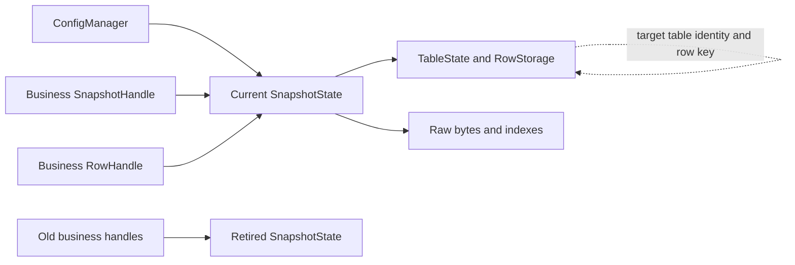

# Multilanguage Server Runtime Design and Implementation Record

[中文](server-runtime-design.md) | **English**

For maintainers of ZrConfig runtimes, generators, and server integrations, this document defines capabilities, public contracts, memory models, implementation, and acceptance for C#, Java, Go, C++, Lua, TypeScript, and Rust. The goal is consistent data meaning, version consistency, and errors while retaining idiomatic language APIs.

**Design order: establish reliable full runtimes before table selection and row decoding. References, cycles, validation, failure rollback, and safe lifetimes are required. Individual row unloading, automatic eviction, incremental mutation, and distributed version coordination are outside the core for now.**

**Long-term constraint: generated classes, methods, and imports are public business dependencies. Data updates, regeneration, generator upgrades, and internal optimizations must not require mass changes to callers. Freeze existing contracts before extending capabilities. Block writes when compatibility cannot be established; bumping a version does not substitute for compatible implementation.**

Status as of October 16, 2026. This is a design/implementation record, not an integration tutorial. The table below records progress; section 1 preserves the original October 15, 2026 baseline; sections 2–29 specify design requirements and acceptance gates. Read “current” and “not yet” in that context. Integration and migration commands are in [Multilanguage generation and JSON](server-generation.en.md). Acceptance is not complete; skipped checks are never passes.

## Reading order

- Long-term business stability: [contract boundaries](#25-long-term-generated-public-contracts), [automatic protection](#26-api-baselines-and-generation-protection), [change handling](#27-schema-and-api-evolution), [consumer acceptance](#28-real-consumer-compatibility-acceptance), and [release governance](#29-compatible-release-and-implementation-gates).
- Scope: [implementation baseline](#1-implementation-baseline-and-identified-gaps), [priorities](#2-scope-and-priorities), [invariants](#3-required-system-invariants), and [terminology](#4-concepts-and-terminology).
- Generators/public APIs: [naming](#5-naming-and-generation-rules), [APIs](#6-public-api-contract), and [compatibility identities](#7-catalog-and-data-compatibility).
- Runtime core: [lifetimes](#8-lifetimes-and-ownership), [commit](#9-snapshot-preparation-and-commit), [loading](#10-loading-modes-and-validation-scope), [references](#11-references-and-cycles), [concurrency](#12-concurrency-and-cancellation), and [sources](#13-sources-and-format-extensions).
- Language adaptation/optimization: [language requirements](#14-language-specific-requirements), [GC](#15-gc-and-memory-budgets), [performance](#16-performance-targets-and-measurement), [diagnostics](#17-observability-and-errors), [extensions](#18-extensions-and-maintenance), and [integration](#19-server-integration).
- Delivery: [acceptance](#20-acceptance-matrix), [implementation](#21-implementation-order-and-ownership), [migration](#22-compatibility-and-release-policy), [defaults](#23-defaults-and-choices-requiring-measurement), and [scenarios](#24-scenarios-and-final-acceptance-questions).

## Implementation status (2026-10-16)

These are successive local implementation records. In the latest documentation revalidation, seven-language functional checks passed, but the trusted API migration chain from the previous GitHub version failed. The maintainer chose to push the current update without repairing that older migration. Commands and scope are recorded in [Public-source revalidation](release-and-acceptance.en.md#documentationpublic-source-recheck-2026-10-16).

| Original scope | Implemented | Recorded acceptance |
| --- | --- | --- |
| P0 generation stability | Actual C# declarations and compilation dependency closure; independent native declaration models and conservative summaries; stable SymbolPlan, logical identities, retired names, module isolation, source-name mapping, and fixed column order | Old consumers passed in seven languages; column movement, two renames, CLI mapping restoration, and dual-format byte equality passed. Native declaration models do not replace compiler-binding acceptance |
| P0 migration governance | Real consumer commands against temporary candidates; receipts bind tool, frozen inputs, candidate, parent contract, and diff digest; trusted-baseline migration chains; old-tool write protection | Four migrations of the official nine tables have real seven-language receipts and a complete chain in the current baseline. Latest repeat generation preserved content, timestamps, and manifests for 112 generated/record files, plus existing Unity metadata |
| P1 basic runtime | Independent server-v1 family preserves old APIs; snapshot-owning handles; Prepare/Commit, failure retention, Clear/Close; sources, deadlines, validators, budgets, identity-conflict protection | Lifecycle, barrier races, handle survival/reclamation passed in seven languages; four C# seeds covered 96 interleavings and 256 dual-format bit corruptions |
| P2 selection/scheduling | Iterative SCC/dependency closure, four loading modes, typed prewarming, independent waiter cancellation, bounded concurrency/queues, language-specific async or host scheduling | Seven languages and dual catalogs passed; minimum/current toolchains ran on macOS arm64; Go race passed |
| P3 row decoding | Pinned raw bytes/indexes; row/group coalescing, rollback, explicit reference access; complex field paths; JSON limits before allocation; index/temporary-decode budgets | Dual formats, faults, warm-query allocations, and TypeScript sync/async interleavings passed; C++ ASan/UBSan and TSan passed |
| P4 measurement/optimization | Return index workspace after success; group scans reuse cached rows; isolated-process synthetic/official-nine-table measurements with 0/1/4 retained snapshots, controlled sources, and concurrent readers | Three historical repetitions yielded 1,176 process samples; later runtime and latest Rust cold-load revisions each added 336, with separate build digests. Initialization, catalog graphs, contention, cancellation, and manager-lock sampling passed. Seven-language 10,000-table loading passed in 252 processes; C++/Rust added 84 comparison processes each and C++ 28 long-window runs: 2,296 total. Raw noise/failures remain recorded |
| Observability/delivery | Bounded events, contextual errors, resource counts, Prepare/Commit timings, full-table counts and snapshot identities; standalone public acceptance projects; cross-platform minimum/current toolchain CI | Latest local minimum/current seven-language checks, C++ ASan/UBSan and TSan, full smoke, public verify-source, and layout passed. The public package's 414-file manifest and local links passed. Source packages include standalone builds, verify-source, and minimum-toolchain acceptance, with results tied to ZIP digests. Windows/Linux/MSVC hardware results remain unavailable |

These records describe previous runtime implementation rounds. This documentation work does not rewrite official Excel files. Samples retain one Data/Config/Rules/Output set; acceptance source belongs in tests, and temporary workbooks/candidates in system temporary directories. Apply verified candidates through the generator; never hand-edit generated artifacts.

Existing measurements/local passes cover only their builds, toolchains, and fixtures. TypeScript/Lua heap deltas are not allocation counts; admission estimates are not hard heap limits. Without a same-environment older release baseline, do not claim the 10% performance-regression gate passed. Source distribution follows sections 25–29 and carries no undeclared cross-toolchain binary ABI guarantee.

### Existing large-catalog and performance acceptance records

Historical results below retain raw logs/build digests under the maintainer workspace's `artifacts`, excluded from public source. They do not imply every later commit repeated those measurements. See [Repeatable performance measurements](server-generation.en.md#repeatable-performance-measurements).

An isolated fixture passed first dual-format export of 10,000 tables, full-version activation, and repeat-generation stability for 80,275 files. Java/Go/C++ consumers compiled and linked in approximately 539/395/2,185 seconds. Initial optimized Rust compilation timed out at 3,600 seconds. After shared cold-load improvements, Rust 1.70 at the same `-O` completed in approximately 3,051 seconds with 89.6 GB peak RSS, followed by actual consumer linking. TypeScript's default Node-heap failure was retained separately; a 16 GiB compile-process limit passed in approximately 67 seconds with 7.7 GB peak RSS, while load processes retained original settings. Seven languages then completed 252 independent processes across both formats/four modes. Full loads verified 10,000 tables, 10,261 rows, and query checksums each time. Compilation and runtime configuration memory are recorded separately.

Improved native generation produced identical outputs twice: 70,271 files. Only 10,002 Rust files changed internally as expected; 290,380 public declarations across 10,006 Rust files were identical, as were the other 60,269 native files. Thousand-table compile diagnostics, minimum/current seven-language tests, and five Rust scheduling-fault regressions passed. Go's 10,000-table consumer module is fixed to `zrconfig` to avoid random absolute paths in generic symbols; arbitrary long module paths are not guaranteed within minimum-toolchain object-file limits. Rust private storage remains typed, without reflection, downcasts, or unsafe. Separate build digests identify 336 C#/C++ revision reruns, 336 latest-Rust reruns, and 252 large-catalog runs. Adding 84 controlled comparisons each for C++/Rust and 28 C++ long-window runs gives 2,296 completed historical/current processes. Concurrent-compilation timings are excluded from controlled regression judgments. Compared warm queries allocated zero; extended warmup/sampling investigated short-window C++ p95 noise without confirming a stable regression above 10%. Reports preserve all windows, aggregation methods, and memory metrics.

## 1 Implementation baseline and identified gaps

### 1.1 Capability baseline

**This table is the pre-implementation baseline, not current capabilities.** See [Server contract families and explicit loading](server-generation.en.md#server-contract-families-and-explicit-loading) for current integration and [Implementation status](#implementation-status-2026-10-16) for recorded progress.

| Capability | Original C# baseline | Original six-native-target baseline |
| --- | --- | --- |
| Binary and JSON | Supported; JSON converts to existing row-readable storage | Supported, with selected-format validation/parsing |
| Primary/composite keys and groups | Supported | Supported |
| Table references and cycles | Resolve/cache on reference access | Bind after full-table construction; cycles supported |
| Row decoding/cache | Supported | Not yet available; queries return prebuilt rows |
| Single-table/full loading | Supported | Main entry loads all generated tables |
| Async, cancellation, preload plans | Supported | No consistent public capability yet |
| Injectable sources/diagnostics | Supported | Primarily internal file readers |
| Retain current version after failed update | Supported; select appropriate API for complete prepublication validation | Supported; publish only successful full candidates |
| Use old snapshots after update | Optional; default invalidates old snapshots | Held snapshots remain usable, with language-specific ownership |
| Stop manager | Dispose invalidates current/candidates | No unified Clear/Close contract |
| Public individual row/table unloading | None | None |

C# `Reload`, `ReloadPrepared`, and `ReloadAll` validate different scopes. Full table-set comparison belongs to full loading; a readable manifest is not a fully validated data version. C# default invalidation and server retained-snapshot semantics are distinct.

Native runtimes originally share synchronous full loading. Java/Go/C++ publish atomically or with equivalent synchronization; Rust locks snapshot acquisition/publication; TypeScript/Lua switch synchronously in their execution contexts. Processes, Workers, and Lua states share no commit point.

### 1.2 Issues found before implementation and initial handling

These are startup findings and then-current fixes. Later SymbolPlan, ownership, error-classification, and API-protection progress is recorded above.

1. Native loaders previously failed to compare complete table sets; an extra Ghost table with no file could pass. Early strict-set validation was added in all six languages.
2. Naming checks missed reproduced Java `class`, Go `_Item`, and C++ `Id`/`v_Id` cases. Fixes/regressions were added; complete symbol planning was still pending then.
3. Whether retaining one row preserves its references was inconsistent. C++ raw pointers and existing Rust Weak references especially depended on the whole snapshot surviving.
4. Uninitialized access, missing queries, reload reentrancy, and closure lacked unified testable error categories.
5. SchemaSummary originally captured structure only. Independent API comparison was added transactionally to block parameter-name/overload/return-type changes; full dependencies, behaviors, and performance still needed contract/consumer acceptance.

Freeze these as automated regressions before extending lazy loading, so existing gaps do not spread into more states.

### 1.3 Source ownership

| Location | Responsibility |
| --- | --- |
| `src/ZrConfig.Core/PortableSchema.cs` | Language-independent schema |
| `src/ZrConfig.Core/NativeGenerator*.cs` | Naming plans, generated tables/catalogs, language adaptation |
| `unity/ZrConfig.Sample/Assets/ZrConfig/Native` | Sole maintained source for six native runtime libraries |
| `unity/ZrConfig.Sample/Assets/ZrConfig/Runtime` | Sole C# runtime source |
| `unity/ZrConfig.Sample/Assets/HotUpdate/Config/Generated` | Rebuildable generated artifacts |
| `tests/ZrConfig.Tests` | Shared fixtures, cross-language contracts, runtime acceptance |

Implement features in templates/generators, never directly in Generated; regeneration must reproduce results. Follow [Project layout](project-layout.en.md), without separate server Data/Rules/Output or another handwritten registry.

## 2 Scope and priorities

### 2.1 Delivery phases

| Phase | Required delivery | Boundary |
| --- | --- | --- |
| P0 correctness/contract protection | API baselines, compatibility gates, naming closure, strict table sets, behavior regressions | Freeze and preserve APIs already used by business code |
| P1 basic server runtime | Safe snapshot ownership, atomic updates, unified errors, Clear/Close, sources/diagnostics | Default full loading and validation |
| P2 selection/scheduling | Dependencies, selection closure, preload plans, cancellation isolation, language-specific async scheduling | Consistency within selected scope; no mixed versions |
| P3 row decoding | Resident indexes, row states, coalescing, explicit references, group loading | Pin raw data by default; no promise of reading only one disk row |
| P4 measured optimizations | Deferred table opening, optional group indexes, range reads, compact storage | Declare each capability, cost, and format compatibility separately |

Publish capabilities per language. Java reaching P3 does not make every target lazy-loading capable. Unsupported options fail with `UnsupportedCapability` during plan construction instead of silently becoming full loads.

### 2.2 Outside the core for now

- Mutating published records, in-place patches, or joining rows across versions.
- Forcibly reclaiming snapshots, rows, collections, or string views still held by callers.
- Automatic per-row LRU, row unloading, or out-of-band target deletion.
- Implicit network reads in property getters.
- Built-in HTTP servers, file-watch loops, polling, databases, or distributed consistency protocols.
- Automatic translation of arbitrary C# converters/business methods.
- Using GC calls, finalizers, or Weak references as the correctness mechanism for unloading.

Extensions require separate designs and demonstrated business value.

## 3 Required system invariants

1. **One snapshot per business operation.** Acquire once per request/battle/calculation; resolve every cross-table reference within it.
2. **Immutable versions.** Never overwrite bytes under one identity; identical version names with different content are errors.
3. **Invisible candidates.** Failure in manifests, data, indexes, references, or prewarming cannot change Current.
4. **One whole-snapshot commit.** Never combine Item from A with Skill from B.
5. **Read-only published values.** Lazy caches may become ready; field values cannot change with access.
6. **No partial rows.** Queries expose only fully decoded records validated at the required layer.
7. **No dangling access.** Safe objects/handles have explicit ownership; borrowed APIs document lifetimes.
8. **Null, missing, and error are distinct.** Missing nonzero references are not null; unloaded is not missing.
9. **Reads avoid the manager update lock.** Warm index queries perform no I/O, manager locking, or dynamic reflection.
10. **Bounded resources.** Limit files, rows, containers, nesting, concurrency, candidates, and load budgets.
11. **Stable failure categories.** Automation/operations use codes/context fields, never human-message parsing.
12. **Reproducible generation.** Identical inputs, targets, and options produce stable names, manifests, and source.
13. **Public contracts do not drift with internals.** Accepted types, members, parameters, returns, imports, and behaviors survive template refactors, upgrades, and unrelated tables.
14. **Stability precedes naming tidiness.** Preserve legal existing names; new conventions do not justify mass renaming.
15. **Compatibility checks cannot approve themselves.** Compare candidates against protected old contracts before writing; never overwrite baselines first.

## 4 Concepts and terminology

| Term | Definition | Distinction |
| --- | --- | --- |
| VersionId | Publisher-provided opaque version string | Lexicographic order does not establish recency |
| ManifestDigest | SHA-256 of captured raw manifest bytes; internal content identity | Not a signature or schema hash |
| Generation | Monotonically increasing manager state generation | Not VersionId; rollback increments it too |
| Catalog | Generated table/codec/dependency/schema-fingerprint directory | Does not imply loaded tables |
| Snapshot | Fixed structure, values, and caches of one version | Not a manager or future versions |
| Candidate | Unpublished snapshot/preparation progress | Never returned as Current |
| PreparedSnapshot | Candidate meeting publication conditions, awaiting commit | Cannot be retained implicitly forever |
| TableDescriptor | Static table/key/schema/dependency metadata | Not a decoded table |
| TableView | Read-only access to a table within a snapshot | May refer to an incompletely loaded table |
| RowStorage | Internal immutable values/reference identifiers | Does not strongly own other rows |
| RowHandle | Public handle retaining its snapshot | Distinct from a non-owning borrowed view |
| RowView | Borrowed view whose owner covers its usage | Cannot outlive its owner |
| Clear | Removes Current; manager can load again | Does not promise immediate memory release |
| Close | Permanently stops manager/removes Current | Does not destroy valid independent handles |
| Trim | Optional redundant-cache cleanup | Does not delete business values; not Unload |

Record three forms of laziness separately: deferred file reads, row decoding, and derived indexes. Implementing only row decoding must not be advertised as reading one disk row.

## 5 Naming and generation rules

### 5.1 Separate data names from source names

Preserve protocol table/field/type identities; keyword escaping affects generated source only. Complete one pre-generation SymbolPlan per language, shared by generators instead of ad hoc template fixes.

Inputs include original qualified identity, symbol kind, lexical scope, language, naming-policy version, and reserved generator symbols. Outputs name public types/accessors, private storage, locals, modules, files, reference helpers, and group APIs.

Enter the generation transaction only after every selected language passes planning. Errors include original/mapped names, scope, language, and source location; do not leave compiler discovery until generation is half finished.

### 5.2 Naming conventions for new API families

| Item | C# | Java | Go | C++ | Rust | TypeScript | Lua |
| --- | --- | --- | --- | --- | --- | --- | --- |
| Types | PascalCase | PascalCase | PascalCase | PascalCase | PascalCase | PascalCase | snake_case modules |
| Methods | PascalCase | camelCase | PascalCase | snake_case | snake_case | camelCase | snake_case |
| Field access | PascalCase properties | getX or explicit queries | Exported methods | snake_case methods | snake_case methods | Read-only camelCase properties | snake_case query functions |
| Packages/modules | Project namespace | Lowercase package | Lowercase package | zrconfig/configurable namespace | Lowercase modules | Explicit module exports | Explicit require prefix |
| Error codes | Stable identifiers, e.g. SchemaMismatch | Same | Same | Same | Same | Same | Same |

These conventions guide unreleased new families/projects, not mass renaming. Preserve existing legal APIs such as `ItemCatalog`, `get_ItemCatalog`, and `Get_字段名`. New members follow their family's frozen rules; upgrades cannot change default casing. Even opt-in naming changes require sections 26–29's migration flow, not a prompt followed by renaming every business entry point.

Acronym splitting is deterministic and culture-independent: `XMLHttp` → `xml_http`, `ItemID` → `item_id`. Report collisions; never append discovery-order `1`/`2`, which could change old APIs when unrelated tables are added.

### 5.3 Escaping and conflict detection

- Maintain keyword, restricted-identifier, and public-base-member lists for each minimum language version. List upgrades require regression/compatibility checks.
- Versioned rules may suffix keywords safely; recheck the complete escaped symbol set. `class` and `class_` cannot overwrite one another.
- Include reference helpers such as `PeerId`/`GetPeer`/`LoadPeer`, group `FindByX`, manager methods, constructors, and type names.
- Java: check Object final methods and type shadowing; wildcard imports do not resolve ambiguity.
- Go: check export visibility, package-level collisions, leading `_`/`.` filenames, `_test.go`, and GOOS/GOARCH build suffixes.
- C++: avoid `__` and reserved leading underscores. Put internal fields in a separately validated Storage scope; do not reuse collision-prone `v_<original>` names.
- Rust: check edition keywords, modules, associated items/helpers, and special `self`/`Self` names; raw identifiers do not support every name.
- TypeScript: check `constructor`, prototype-related names, exports, and type namespaces. Never assign arbitrary parsed fields onto ordinary object prototypes.
- Lua: check keywords, module fields, and metamethods. Access source names through controlled mappings instead of injecting them into code.
- Generate internals using stable field ordinals or isolated structures, such as Storage `field_0`. Include every symbol in scope planning; an uncommon-looking prefix is insufficient.

### 5.4 Filenames and cross-platform paths

For languages with flexible filenames, initial planning may use controlled prefixes/suffixes such as `table_item_gen.go`, avoiding `_Item`, platform suffixes, and Windows device names. Preserve legal existing filenames; fixing one invalid path must not rename unrelated tables. Java filenames match planned public class names. Use existing language directories rather than feature directories.

Check case-folded collisions, Windows devices, trailing dots/spaces, separators, and path-length budgets. `Item`/`item` must not create cross-platform collisions. Diagnose excessive lengths instead of silently truncating.

Extend existing generation metadata for name mappings; do not add handwritten maps. Version naming changes alongside public APIs without changing protocol names or schema-hash meaning.

### 5.5 Generated content

Use UTF-8, LF, stable ordering, and headers. Escape comment terminators, Unicode escapes, newlines, backslashes, and language-string boundaries; documentation comments must never become executable code.

Public accessors document table names, fields, null semantics, and lifetimes. Normal field access uses no dynamic reflection. Split complex codecs to avoid Java method limits, deeply nested compiler expressions, and giant initializers.

Package/namespace/module roots are configurable without changing protocol identity. Two generated business catalogs must coexist through namespace isolation of types/runtime libraries.

## 6 Public API contract

### 6.1 Manager

These are logical interfaces mapped by section 5; exception/async types need not be identical across languages.

| Operation | Meaning | Failures/side effects |
| --- | --- | --- |
| AcquireSnapshot | Acquire an owning handle to Current | NotInitialized before load; ManagerClosed after closure |
| TryAcquireSnapshot | Return empty for ordinary unloaded state | Still reports ManagerClosed; never swallows internal errors |
| Reload | Prepare/commit a complete candidate | Full validation by default; failure preserves Current |
| Prepare | Pin version and meet plan publication conditions | Does not change Current; one preparation per manager by default |
| Commit | Publish PreparedSnapshot once | Check manager identity, generation, closure, and candidate state |
| Clear | Remove Current and increment generation | Idempotent/reusable; stale candidates cannot publish |
| Close | Permanently stop preparation/acquisition | Idempotent; independent existing handles survive |
| GetStatus | Read state, generation, and in-flight phase | Available after closure; no mutable internal objects |

Ordinary integrations need only `Reload`, `AcquireSnapshot`, and `Close`. Prepare/Commit support loading windows, business gates, and scheduling without forcing manual two-phase publication on everyone.

Reload returns commit results and the published snapshot. Prepare returns a candidate requiring commit or release: RAII in C++/Rust, explicit cancel/release with timeout management in managed languages. Managers cannot retain unused candidates without bounds.

### 6.2 Separate queries from loading

| Operation | Cold loading allowed? | Return contract |
| --- | --- | --- |
| TryGetRow / Find | No | Empty only when validated indexes prove absence; existing unready rows report RowNotLoaded |
| GetRow | No | Same; missing keys report KeyNotFound |
| LoadRow | Yes | Load one row; missing reports KeyNotFound; no automatic reference-chain expansion |
| TryLoadRow | Yes | Empty only for absent keys; I/O/data errors still fail |
| LoadTable | Yes | All rows and required indexes ready |
| LoadAll | Yes | All tables within the snapshot's queryable allowed scope ready |
| FindGroup | No | Group index/result rows must be ready; missing returns an empty read-only view |
| LoadGroup | Yes | Prepare group index/matching rows without requiring nonmatching row objects |
| GetReference | No | Zero returns empty; unready reports RowNotLoaded; invalid nonzero target reports MissingReference |
| LoadReference | Yes | Load target in the original snapshot without recursively expanding its references |

`Try` removes only expected key absence, not unloaded state, file errors, closure, or corruption. Without an index, absence cannot be established: report TableNotLoaded.

Introduce this through a new interface version; **do not change existing C# GetRow implicit-loading behavior**. Existing find/get APIs retain their versioned semantics through compatibility adapters/documentation. Never silently turn a constant-time query into I/O within one API version.

Logical names cannot replace existing generated entry points. Adding LoadRow cannot delete GetItemCatalogAsync; safe handles cannot change an existing Get return type to RowHandle. Add separate capabilities, manager profiles, or API families while preserving old returns/behavior.

Full-mode Get/Find remain memory queries. Row mode uses explicit Load for cold paths. Getters return ready values, IDs, or read-only reference descriptors without network I/O or recursive loading.

### 6.3 Tables, keys, groups, and iteration

Prefer generated typed table APIs; dynamic table-name queries are tooling extensions. Preserve key precision, equality, and hashing. Composite keys use typed components/reusable value keys, never concatenated strings.

Groups return stable read-only views in exported logical row order; reuse safe empty views. Pagination uses row ranges or snapshot-bound cursors that reject cross-version use. Iterators explicitly distinguish loaded rows from all rows; one Count cannot mean both.

Distinguish at least `DeclaredRowCount`, `LoadedRowCount`, and `IsFullyLoaded`. Index existence does not imply row objects; reading Count cannot decode a whole table.

### 6.4 Orthogonal options

Separate runtime and generation options. Group immutable runtime options into LoadPolicy, ValidationPolicy, ResourceLimits, Diagnostics, and Scheduling; avoid accumulating positional booleans.

Preserve `preferJson` compatibility wrappers. New policies are PreferBinary, PreferJson, RequireBinary, and RequireJson. Prefer chooses among valid available formats; corruption must not trigger silent fallback.

Freeze options when Prepare begins; external mutation cannot alter in-flight loads. Cancellation token/context belongs to each operation, not shared mutable manager state.

## 7 Catalog and data compatibility

Derive Catalog from PortableSchema with protocol names, schema hashes, keys/groups, references, and capabilities. Each language package has one generated catalog; callers do not register tables individually.

Large catalogs use segments/compact static data and lazy codec initialization. Creating managers or reading manifests cannot instantiate every table; explicit full mode enumerates them.

Dependencies need explicit target identities, not inferred display type names. Runtime table ordinals are valid only within one Catalog. Persisted/cached ordinals require its fingerprint and are not stable IDs across generation.

Strict default comparison requires manifest and Catalog table sets to match, including empty tables. Partial loading changes residency, not complete-manifest checks. Missing, extra, duplicate, or target-mismatched tables fail.

Future subset-generated service packages need explicit export Profiles and manifest identities while sharing input/output management. AllowUnknownTables cannot bypass checks and hide typos or missing deployment files.

Distinguish data-format version, schema fingerprint, codec/converter semantics, generator version, runtime API version, and naming-policy version. Comments/public names must not accidentally change encoding; layout/encoding changes enter their appropriate fingerprints.

Initially retain binary v4 and current JSON. Row decoding alone does not justify protocol upgrades. Range indexes, chunk checksums, or capabilities unrepresentable in current formats need separate format/legacy-reader designs.

### 7.1 Version identity and cache keys

SnapshotIdentity includes at least SourceNamespace, VersionId, ManifestDigest, Catalog fingerprint, and load-plan fingerprint. SourceNamespace is a stable caller/adapter identity without credentials in IDs/logs. Manager Generation is separate from byte-content identity.

Initially hash captured raw manifest bytes, without reparsing/reserializing across seven JSON implementations. This avoids normalization differences and immediate export changes. Formatting-only changes under the same VersionId change identity and violate immutability. Any future semantic digest needs its own algorithm version.

Byte-cache keys also include selected format, file digest, and schema fingerprint. Binary/JSON cannot share parsed results merely because version/table names match. Rows/reference caches belong to SnapshotState and are never shared across states with equal version strings.

VersionIdentityConflict detects conflicts still remembered by managers/caches. Publishers enforce immutability across processes, restarts, and evicted history. Conflict metadata is bounded too.

### 7.2 Target and compatibility metadata

Missing identity fields can only be checked through existing structure/content contracts; do not claim detection of all structurally identical wrong-target deployments. Strict C/S, business Profile, or Catalog-family distinction requires explicit versioned manifest identity and a legacy compatibility policy.

Required fields, encodings, and digest algorithms use recognizable manifest versions/capabilities; old runtimes reject unknown requirements. Separate ignorable diagnostics from interpretation-critical fields. Validate this upgrade separately instead of coupling source-API and format changes in one commit.

## 8 Lifetimes and ownership

### 8.1 Ownership graph

Solid arrows represent ownership. Reference fields store target identities without row-to-row ownership cycles.



SnapshotState does not own Manager, avoiding old-row → old-state → manager → new-state chains. Managers retain no strong history list; monitoring uses weak references, events, or external IDs.

### 8.2 Safe handles and borrowed views

Safe row handles bind SnapshotState and row ordinal, retaining same-version references independently of Manager.Current. Keeping one handle may retain the entire snapshot; document that memory cost.

C++ handles share state; Rust handles own Arc. Internal RowStorage keeps values/target keys or ordinals, never owning RowHandles back to itself. A↔B references therefore form no shared_ptr/Arc cycle.

Java/Go/C#/TypeScript/Lua records or wrappers may hold their state. GC handles unreachable cycles; long-lived business references cause retention. Cache loaded-row wrappers in Java/TypeScript/Lua to avoid per-query allocation.

C++ borrowed views require an external SnapshotHandle throughout use and must not escape or lose owners across async tasks. Rust lifetimes bind views to snapshots; task escape needs owning handles. Distinguish safe and Borrow APIs in types/docs. Reduced reference-count costs do not justify raw pointers as the only public contract.

Collections, groups, string views, and iterators must also retain/bind their snapshots. Fixing row pointers while leaving dangling string_view/span/group iterators is insufficient. To retain a few values across versions, copy needed scalars/keys into independent DTOs.

### 8.3 Visibility after operations

| Scenario | New manager acquisition | Existing safe handles | Candidate |
| --- | --- | --- | --- |
| Before first load | NotInitialized | None | Preparation allowed |
| Preparing | Previous snapshot or NotInitialized | Valid | Invisible |
| Commit succeeds | New snapshot | Original snapshot remains readable | Published |
| Prepare fails | Previous snapshot unchanged | Valid | Private resources released |
| Clear | NotInitialized | Valid | Canceled/stale; late commit forbidden |
| Close | ManagerClosed | Valid | Canceled/stale; late commit forbidden |
| Last owner released | Other versions unaffected | State reclaimable | Not applicable |

Clear/Close remove manager ownership. They cannot report all memory released or synchronously wait for every request.

### 8.4 C# compatibility migration

Existing Unity users may depend on old-row invalidation after Reload and current-snapshot invalidation after Dispose. Preserve those interfaces/defaults instead of overwriting ConfigManager semantics.

Add an explicit server Profile or versioned manager API with retained handles. Both policies must remain visible in types/options/docs during migration. Current `retainPreviousSnapshots: true` is not equivalent: Dispose still invalidates Current, and callers manage sources.

Do not offer global forced row destruction. Applications cancel/drain old requests then release handles; runtimes cannot safely revoke arbitrary borrowed memory.

### 8.5 External resources and source lifetimes

Prefer owned immutable bytes and ordinary managed/native memory. Open/close files per read; do not permanently occupy one descriptor per resident table.

After full decoding/reference validation, release sources, parse trees, and bytes unless records borrow raw views. Zero-copy strings/ranges require SnapshotState to retain their buffers; do not return them to pools prematurely.

Initial row mode pins bytes for the allowed scope so retired snapshots can decode after old directories disappear. True deferred file reads need SourceVersionPin and deployment cooperation (section 13). Holding a source object does not prevent external deletion.

GC timing is uncontrolled. External leases need explicit release; finalizers/cleanup callbacks may only compensate for omissions with lightweight cleanup, not commit, force-unlock, or guarantee timely disk deletion.

## 9 Snapshot preparation and commit

### 9.1 Manager states

Main states are Empty, Ready, and Closed. Preparation is independent and does not block Ready reads. Closed is permanent; Clear permits later Reload.

Default to one preparation. Concurrent Reload/Prepare returns ReloadBusy. Optional async queues must be explicit and bounded instead of hiding multiple complete candidates behind a lock queue.

### 9.2 Preparation flow

1. Validate options/capabilities/cancellation/budgets; register operation ID and capture manager identity/Generation.
2. Read current once and pin VersionId/manifest content. Never reread current to choose individual table paths.
3. Validate format, paths, complete table sets, target, schemas, counts, and limits.
4. Compute selected-table dependency closure, validation scope, formats, and load plan.
5. Read pinned-version resources; validate actual bytes/digests, parse/scan, and build required indexes.
6. Decode, validate references, and prewarm per policy; run required candidate validators.
7. Recheck cancellation, deadlines, budgets, and source binding; create PreparedSnapshot.
8. In a short Commit critical section, check state/Generation, publish, and increment Generation.
9. Outside the lock, release manager ownership of the previous version, dispatch results, and return committed status.

Prepare neither writes export files nor changes publisher current.json. Runtime memory commit and exporter disk publication are independent operations with separate success states.

### 9.3 Commit point and races

Cancellation before commit returns Cancelled without changing Current. After the commit point, return Committed despite cancellation; do not imply failure after updating. Include Committed, Generation, VersionId, operation ID, and stage timings.

Clear, Close, or another successful commit invalidates older candidates' expected Generation. Late preparation only releases resources and returns StaleCandidate. Candidates commit once to their originating manager; duplicate/cross-manager commits have distinct errors.

State comparison/publication share one synchronization boundary; readers need not take the preparation lock. Use a sufficiently wide unsigned Generation with overflow checks; never wrap and accept stale candidates. VersionId is opaque; rollback also creates a new Generation.

Default reload does not skip equal versions. Optional reuse requires identical full identity, Catalog, load policy, and validation requirements. Same VersionId with different digests reports VersionIdentityConflict; string equality cannot bypass validation.

### 9.4 Callbacks and post-publication errors

Dispatch Changed/LoadCompleted outside the commit lock. Subscriber exceptions become diagnostics without rolling back or turning a successful commit into Reload failure.

Events carry generation and follow manager order. Reentrant Reload/Clear must not cause older events to appear current after a newer generation. Bound event queues and retain snapshot payloads only during delivery; slow consumers cannot retain unlimited history.

Required business checks run in precommit validators that only read candidates, without external messages/state mutation. Fallible postcommit callbacks cannot serve as prepublication gates.

### 9.5 Minimal commit pseudocode

```text
Prepare:
    Register the unique operation inside gate; capture generation and manager identity.
    Outside gate, pin the version, read, validate, and build the candidate.
    Return PreparedSnapshot; on failure, clean only this operation's resources.

Commit(prepared):
    Inside gate:
        Check closure, candidate ownership/state, generation, cancellation, and deadline.
        previous = current
        current = prepared.snapshot
        generation += 1
        Mark prepared as Committed.
        Clear this candidate's registration.
    Outside gate:
        Release the manager's ownership of previous.
        Dispatch an event carrying generation.
        Return Committed.
```

Define cancellation ordering relative to commit. Never throw cancellation/closure after a successful swap. Stale operations' finally blocks clean only their own registrations, never newer candidates. Large destructors, source release, and user code run outside gate.

## 10 Loading modes and validation scope

### 10.1 Supported combinations

Record load/validation scopes separately, but avoid arbitrary combinations with unclear states. Initially provide these presets:

| Preset | Before publication | Cold access afterward | Use case |
| --- | --- | --- | --- |
| ServerDefault | Decode all tables; validate indexes/references completely | Pure queries | Default resident server |
| SelectedTables | Strict complete-manifest checks; decode/validate selected dependency closure | TableNotSelected outside closure | Services using a subset |
| LazyRowsStrict | Pin allowed bytes; scan all values/keys/references; retain only prewarmed rows | Construct row objects lazily | Expensive objects, sparse access |
| LazyRowsOnAccess | Pin allowed bytes; validate digests/indexes; validate values on access | Cold rows may report data errors | Explicit acceptance of delayed error discovery |

LazyRowsStrict still spends startup CPU and reads bytes. It primarily saves resident row/derived objects. Scanning may create temporary values or inspect encoding directly, but cannot omit constraints and claim complete validation.

Valid digests establish agreement with manifests, not correct values/keys/references. LazyRowsOnAccess cannot claim atomic publication after full candidate validation. Diagnostics continually expose validation coverage and runtime-discovered errors.

### 10.2 Table selection and dependency closure

Tables are graph nodes; declared references form edges. Initially use conservative closure: selecting A includes B whenever a field may reference B, even if all current values are zero. Plans stay predictable without scanning all A to decide whether B is needed.

Compute strongly connected components as planning units, then process their DAG. Use iterative/bounded-stack algorithms in O(tables + edges), avoiding quadratic repeated recursion.

Cyclic table groups define selection/preparation/future release boundaries, not recursive construction of all referenced objects. Rows still resolve by identity.

Plan previews show explicit selections, automatic dependencies, expected rows, and data sizes. Outside-closure access returns TableNotSelected. Initially do not silently expand published scopes; prepare/commit a new same-version snapshot with a larger plan.

### 10.3 Row loading states

Tables distinguish Unopened, Opening, Indexed, LoadingAll, Ready, Faulted; rows distinguish Absent, Loading, Ready, Faulted. Without indexes, row ordinals are unknown; arbitrary business keys must not form an unbounded failure cache.

Concurrent requests for one snapshot/table/row share a load. Decode a complete local value before atomically publishing its slot; readers never see partially filled defaults. Warm paths read Ready slots without task allocation.

Decoding A reads only its values/reference IDs, never loads B. A→B→A therefore creates no recursive decode, lock cycle, or mutually waiting futures.

Any preparation failure discards the entire candidate. Canceling LoadTable in a published lazy snapshot may preserve valid completed rows but cannot mark the table Ready. Such caches grow monotonically without changing values.

Irrecoverable data errors become terminal table/row faults; transient I/O and cancellation may retry by policy. Structural corruption can fault a table and subsequent operations without destroying delivered immutable rows. Mark snapshot health Degraded; business code decides whether to stop/roll back, never the runtime silently switching versions.

### 10.4 Full-table loading and group indexes

LoadTable reuses completed rows instead of creating a second identity. Set IsFullyLoaded only after all rows/required indexes succeed.

Primary/reference-target indexes are fundamental. Later lazy group indexes must expose the cost of scanning relevant fields. Store row ordinals/ranges, not copied records.

LoadGroup prepares its index then matching rows. Existing formats may require a full field scan; do not claim O(matches). Large groups need pagination/iteration instead of mandatory huge temporary lists.

### 10.5 JSON-specific costs

Current JSON has no trusted independent-row offsets/chunk checksums. Row mode may parse once into internal indexed data then release the tree, or retain bounded row fragments. Choose using timing/peak-memory measurements.

Do not retain JSON text, full DOM, converted binary, and all row objects simultaneously long-term. Conversion checks duplicate members, UTF-8, integer precision, members, polymorphism, and limits. Preserve string encodings for 64-bit integers/decimal.

Native v4 readers may reuse row-index ideas but must validate indexes, ranges, bounds, and consumed lengths. Row offsets alone do not provide per-row integrity authentication.

## 11 References and cycles

### 11.1 Representation

Preserve int32 target Id references, with zero meaning null. Target indexes determine nonzero validity; do not add an implicit negative-ID prohibition. Targets still require globally unique integer Id values within the table.

Composite-key references, references inside arrays, and arbitrary object-graph references remain outside scope. Supporting them requires PortableSchema, encoding, paths, dependency scanning, and every language's tests—not one permissive generator.

Internally store target-table ordinal and Id, optionally caching validated row ordinals. Ordinals bind SnapshotState and cannot cross snapshots. Public APIs may expose raw Id, read-only descriptors, ready-only queries, and explicit loading.

### 11.2 Full mode

Prepare in three stages: create records/primary indexes, validate every nonzero reference, then finish read-only wrappers and publish. Binding never recursively copies targets or expands cycles into infinite nesting.

Reference queries resolve within the same snapshot. Null references read no target table. Missing nonzero targets report source table/key/field and target table/Id.

Compatibility layers exposing direct objects must still retain snapshots. New native storage must avoid strong reference-count cycles.

### 11.3 Row mode

LoadRow(A) completes A; LoadReference(A.Peer) completes B. B's reference back to A hits its original slot. Initial A construction never waits for B, avoiding mutually dependent publication deadlocks.

Strict preparation validates targets using indexes/scans before target objects exist. On-access mode validates nonzero targets when accessed; errors never become null.

Resolve from the row's SnapshotState, never Manager.Current inside getters. Reference caches are per snapshot, not process-global dictionaries keyed only by Id.

### 11.4 Graph traversal tools

Optional PreloadReferences/VisitReferences uses explicit queues and visited sets keyed by table/row ordinal. Bound MaxVisitedRows, MaxDepth, MaxDecodedBytes, and support cancellation/progress. Default prewarming never expands unlimited reference closure.

Debug output prints reference IDs by default without recursively dumping targets. Bound depth, collection elements, and string lengths. Equals/Hash/ToString must not recursively follow cycles either.

## 12 Concurrency and cancellation

### 12.1 Synchronization boundaries

Manager gates protect state, generation, candidate registration, and publication only. Table gates protect task registration, cache commits, and transitions. I/O, decoding, hashing, extensions, and callbacks run outside locks.

Avoid multiple locks. If nesting is necessary, order Manager → Table → Row, notify after unlocking, and never load B while holding A's lock. Recursive locks do not solve reference cycles.

Use language-appropriate safe publication for both pointers and fields. Atomic pointer writes without field visibility are insufficient. Rust RwLock acquisition and C++ shared_ptr atomics are not guaranteed lock-free.

### 12.2 Coalescing and isolated cancellation

Coalesce decode tasks by `(SnapshotIdentity, TableOrdinal, RowOrdinal)` and reads by fixed source/version/content identity. Equal filenames across versions cannot share incorrect cached content.

Canceling one waiter cancels only its wait. Policy decides whether the last departing waiter cancels underlying work. Late completion checks task generation before publishing over a newer task.

Sync/async APIs share caches/state machines, but sync uses actual synchronous sources. Never block UI/event-loop/scheduler threads on their own async work. Async-only sources report SyncNotSupported for synchronous cold loads.

Check cancellation at read-block boundaries, parsing/scanning batches, row batches, index batches, and before commit. Balance throughput/responsiveness without heavy checks per scalar. Document uninterruptible calls and reject stale results afterward.

### 12.3 Timeouts and retries

Distinguish waiter timeout, I/O timeout, preparation deadline, and service-shutdown deadline. Use monotonic clocks and distinct Cancelled, DeadlineExceeded, and SourceUnavailable errors.

Retry only explicit transient-source errors with attempt/time/backoff bounds. Never automatically retry hashes, schemas, duplicate keys, or missing references. Pin the original version; rereading current to switch versions cannot masquerade as successful retry.

### 12.4 Closure and asynchronous cleanup

Close first removes state/prevents commits, then requests cancellation. Optional CloseAsync/WaitForIdle drains tasks; timeout means cleanup remains pending, never that Ready can be restored.

Do not synchronously wait for a thread-pool task from its own callback. Remove closure cycles among tasks/candidates/waiters/subscriptions; clear cancellation registrations, callbacks, and temporary buffers on completion.

## 13 Sources and format extensions

### 13.1 Minimal source interface

Core depends on fixed-version reading: manifest capture, immutable-version binding, table bytes, cancellation, and error mapping. Sync, async, range reads, and version-pin leases are independent capabilities; empty bytes cannot mean unsupported.

Adapters document source creation/closure, byte ownership, buffer reuse, thread safety, cancellation, retry ownership, and version stability. Runtime accepts owned immutable bytes or explicit-lifetime ByteLease, never shared buffers that may be reused immediately after reading.

Supply file/memory sources by default. Network/object stores/archives/encryption/Unity AB integrate through the same boundary without SDKs in core. Existing C# adapters own request sharing; other languages must assign the same responsibility clearly, avoiding duplicate retries/caches.

### 13.2 Pinning versions

Capture version paths after manifest reading; use each manifest filename/digest. Replacement, changing lengths, short reads, and hash changes fail. Deployment publishes a complete immutable directory before switching current.

Deferred table opening requires retired snapshots to access old files. Two explicit options exist: pin every potentially accessed byte upfront, or use deployment leases spanning snapshot lifetimes. Default to pinned bytes.

Retaining the latest two versions does not protect arbitrarily long requests. Cross-process deletion needs external coordination; in-process reference counts do not protect deployment directories. Unavailable sources return SourceUnavailable, never substitute same-named new-version files.

### 13.3 Integrity and path boundaries

Hash the actual content used. Choosing one dual-format file validates that file; validating all published attachments is a separate acceptance mode. Do not claim ordinary loads read both.

SHA-256 checks content integrity, not trusted origin. If signatures are needed, add trust roots, signature versions, and key rotation in adapters/manifest authentication. Otherwise avoid imposing key management on core.

Accept controlled relative paths only; reject absolute/traversal paths, empty segments, illegal separators, and collisions. File sources handle symlink escape/replacement using controlled roots and feasible platform policies. String-prefix checks alone do not establish directory isolation.

### 13.4 Future range reads

Whole-file hashes cannot validate unread fragments. Reducing read bytes requires authenticated chunks/equivalent formats and treatment of cross-chunk rows, compression blocks, cache granularity, and offset overflow.

Range reading is separate protocol evolution requiring old-format compatibility, read-amplification measurements, and corrupt fixtures. Until then, row mode promises lower decoding/object residency, not lower disk/network bytes.

## 14 Language-specific requirements

### 14.1 C#

Preserve existing Unity, registry-free queries, codecs, custom awaitables, and sync/async source APIs. Server Profiles may add full Catalog/retained handles without making Unity preload everything by default.

Avoid key boxing, LINQ, closures, temporary arrays, and per-query async tasks on warm paths. Return ready results directly; retain compatible completion types rather than replacing ConfigOperation for cross-language visual uniformity.

Enable background decoding only with thread-safe codecs/converters that avoid Unity main-thread APIs. Preserve context restoration, WebGL limits, and adapter handles. Test actual required Unity/IL2CPP integrations; desktop .NET results are not substitutes.

### 14.2 Java

Retain minimum Java 17; do not require newer thread features. Schedule shared tasks through explicit Executor instead of unknown common pools. CompletableFuture is acceptable, with caller cancellation separate from shared work.

Publish complete objects through AtomicReference/equivalent. Records/arrays/collections need deep read-only boundaries: final prevents reassignment, not array mutation. Never expose internal writable arrays.

Warm queries use generated typed accessors/row indexes. Avoid composite-key boxing and per-query List/stream/Optional wrappers. Design ordinary misses with allocation goals, using cached empties/reusable APIs.

A cached row may retain its entire snapshot. Diagnose long-lived/old snapshots without strongly retaining all of them for statistics. Cleaner only compensates for leaked external resources; System.gc is not unloading.

### 14.3 Go

Retain Go 1.19. Publish with standard-library safe atomics or short locks. Acquire one snapshot, then query without manager locks.

Normal fallible Load/Reload/reference APIs return error, not panic for sources, bad data, or cancellation. Preserve existing Get panic semantics in compatibility APIs. New boundaries translate parser-internal panics without hiding actual programming bugs.

context.Context is per request. One waiter cannot cancel shared reads for others. Use testable task/waiter/publication state machines; the first caller's context is not everyone's lifetime.

Favor values, row ordinals, and compact slices to reduce pointers/GC scanning. Reduce interface{}, temporary maps, and reflection. Verify escape/allocation behavior through compiler output and benchmarks; structs alone do not prove zero allocation.

Public []T/maps remain mutable. Use read-only views, iteration, or explicit Copy. Copy only on request, never every Get. Avoid unsafe internal exposure for unmeasured gains.

### 14.4 C++

Retain C++17; do not require C++20 atomic<shared_ptr>, coroutines, or span. Use C++17 shared_ptr atomic functions and custom read-only ranges.

SnapshotState owns tables, rows, indexes, and required bytes. Rows store non-owning reference descriptions; safe handles retain SnapshotState. Never form SnapshotState → RowHandle → SnapshotState shared_ptr cycles.

Offer borrowed warm-query paths. Owning handles may perform atomic reference-count operations; shared_ptr copying usually creates no control block, but allocation-free does not mean cost-free. Benchmark separately.

Plan capacities before publication. vector growth must not invalidate delivered rows, string views, or indexes. Row mode uses stable slots, chunked storage, or indirection instead of appending movable records to exposed vectors.

Destructors never throw. The last request thread may destroy a large snapshot; measure tail latency. Optional deferred destruction needs bounded queues and defined executor lifetime/shutdown/draining, never permanently leaked cleanup tasks.

Preserve exception-based APIs. Exception-free Result APIs are a separate tested capability, not untested macro paths. Avoid public-header macro/global pollution and test common Windows min/max environments.

### 14.5 Rust

Retain Rust 1.70/edition 2021 without core dependencies on Tokio or other executors. Async adapters declare executor/thread boundaries; wrapping blocking reads in async fn is not nonblocking I/O.

Full reading uses Arc<SnapshotState> and borrowed views; escaping rows use Arc-owning RowHandle. RowStorage never owns an Arc back to itself. Resolve through owning state rather than treating failed Weak upgrades as null.

Existing Weak compatibility paths still require whole-snapshot retention. In safe APIs, retaining only a row must not silently turn nonzero references into None. Null uses Option; corrupt targets use Result errors.

Lazy slots support shared loading, cancellation retries, and error categories; do not permanently store cancellation in OnceLock. Full immutable slots may initialize once; lazy slots need validated states. Report poisoned locks instead of unconditional unwrap.

Avoid self-referential structures/unsafe for optimization. Express borrowing in types; Send/Sync and actual codecs establish threading support. Production and benchmarks use the same safe implementation, not a separate simplified query path.

### 14.6 TypeScript and Node

Preserve TypeScript 5.8, Node 22, and current module output. Adding ESM requires explicit exports/extensions/dual-package handling; ordinary regeneration cannot switch module systems.

Sync loading suits startup or explicitly blocking windows. Async file reads remove I/O waits, but JSON parsing, hashing, and construction may still block the event loop; measure its delay.

Options include yielding batch parsers/builders or complete consumers inside Workers. Snapshots with methods/private fields/freeze rules cannot transfer losslessly to the main thread. Define cloneable data and reconstruction costs. Workers have independent managers; business code coordinates versions.

readonly is compile-time only. Objects/arrays need runtime policies; Object.freeze(Map) does not prevent set, so wrap dictionary queries. Parse through safe own-member access and controlled construction, excluding prototype-chain members.

Keep 64-bit integers as bigint and decimals exact; do not convert to Number for easier keys. Cache row/collection views and avoid warm-path arrays, Promises, closures, or iterator intermediates. Measure allocations in Promise-returning APIs separately.

### 14.7 Lua

Target Lua 5.4 with 64-bit integers/doubles; LuaJIT/5.1 are outside compatibility claims. Module prefixes are configurable; each Lua state manages independent snapshots.

Without external scheduling, expose synchronous capabilities only. Coroutine yield does not create async file I/O. Adapters specify yield/resume ownership, cancellation propagation, and task-generation checks on resume.

Cache read-only proxies/iterators per object, never allocate a proxy per field access. Freeze/traversal/diagnostics use explicit stacks and visited sets against long chains/cycles.

Preserve NULL sentinels for array nulls; nil would alter lengths/positions. Keep ulong/decimal exact. Weak tables cannot be the sole row store, or GC would change query availability.

rawset/debug can bypass read-only policies under the host trust contract; hosts isolate untrusted scripts. Do not change global GC policy. Pausing GC for benchmarks must not enter production loading.

## 15 GC and memory budgets

### 15.1 Memory layers

Distinguish at least these quantities instead of reporting only file size:

- Raw bytes and optional mapped pages.
- Row offsets and primary/reference/group indexes.
- Decoded records, strings, arrays, dictionaries, and polymorphic objects.
- Public wrappers, handles, and task state.
- Peak temporary parsing, sorting, validation, and conversion memory.
- Current snapshots, caller-retained retired snapshots, and uncommitted candidates.
- Other application heaps, allocator reservations, and runtime overhead.

Approximate peak: `all live old states + final new candidate + preparation workspace + concurrent-load workspace + application/runtime margin`. Count each shared state once; do not multiply snapshot size by handle count.

Example: current 150 MiB + retired 80 MiB + candidate 190 MiB + workspace 120 MiB ≈ 540 MiB configuration peak. This hypothetical excludes business heaps, allocators, and uncertainty; it does not establish a universal safe heap ratio.

### 15.2 Budget types

| Budget | Check stage |
| --- | --- |
| MaxManifestBytes, MaxTables | Before/after manifest read/parse |
| MaxTableBytes, MaxBundleBytes | Declared-size precheck plus actual-byte accumulation |
| MaxRows, MaxContainerElements, MaxDepth | Before/during decoding |
| MaxDecodedRows, MaxEstimatedDecodedBytes | Reserve before row/batch allocation |
| MaxConcurrentReads, MaxConcurrentDecodes | Scheduling admission |
| MaxPreparedCandidates, MaxPendingRequests | Before candidate/waiter creation |
| MaxEstimatedLiveBytes | Candidate preparation/commit admission and diagnostics |
| MaxPreparationDuration | Monotonic deadlines and cancellation |

Reserve quotas atomically before concurrent allocations/commits; end-only accounting permits overshoot. Return reservations on failure/cancellation. Check multiplication, row conversion, and accumulated-byte overflow.

Existing format limits remain; deployments may tighten them but cannot bypass integer/structural safety. Managed object sizes are estimates, so MaxEstimatedLiveBytes is admission control, not a hard process limit. Deployment enforces container/process bounds.

### 15.3 Reduce objects and workspace

Load tables/bounded batches incrementally. Full graph validation can retain lightweight indexes/reference descriptions without simultaneous DOMs for every table. Release temporary trees/task closures promptly.

Deduplicate strings/share read-only fragments only within snapshots after measuring benefit. Global interning may permanently accumulate new strings on every update and is off by default. Optional compression of labels/keys/small integers cannot change public numeric semantics.

Pool only temporary arrays no longer referenced by records/views. Bound pooled sizes/capacity, return on exceptions/cancellation, and clear references when needed to avoid retaining old snapshots indirectly.

Avoid boxing every scalar. Future JSON optimizations may stream tokens, but must preserve strict validation.

### 15.4 Reclamation and backpressure

GC makes objects eligible after the last strong reference, without immediate collection/RSS reduction. C++/Rust destruction is deterministic, but allocators may retain pages. Inspect live objects/tracked allocations alongside RSS; unchanged RSS alone does not prove leaks.

Long requests may retain old versions. Diagnose retention or reject expensive updates instead of invalidating legal handles. Candidate budgets, minimum update intervals, and request deadlines require explicit deployment choices.

Managed runtimes cannot cheaply count all aliases exactly. Optional request leases aid observation without replacing safe handles. Document retired-snapshot count/memory estimation scope and lag; do not claim exact GC reachability.

## 16 Performance targets and measurement

### 16.1 Warm-path targets

After acquiring a snapshot, primary/composite/group/reference cache hits perform no file I/O, string-key construction, collection copying, manager locking, or decoding. Aim for zero runtime heap allocation where values/borrowed views permit it; reuse cached wrappers elsewhere.

Measure snapshot acquisition, owning-handle copies, iterators, async wrappers, and caller key construction separately. Reference counts, hashes, string comparisons, and read barriers still cost work; avoid blanket “zero GC/overhead/lock-free” claims.

Average O(1) hashing is not a worst-case guarantee. Bound collision attacks, load factors, probes, rehashing, and degradation. String/Decimal costs include length/normalization.

### 16.2 Metrics

| Category | Required metrics |
| --- | --- |
| Startup/update | Manifest/table reads, hashes, scans, decoding, indexes, references, commit, total time |
| Queries | Primary hit/miss, composite, group, reference, and snapshot-acquisition throughput plus p50/p95/p99 |
| Cold loading | First row/group, full-table completion, coalesced requests, duplicate decodes |
| Memory | Live steady state, load allocations, temporary/update peaks, raw bytes/index residency |
| Concurrency | Read/write contention, lock waits, cancellation response, slow sources/readers |
| Runtime | GC pauses/allocations, Node event-loop delay, C++/Rust last-release latency |
| Build | Generation/source size, compile time, artifact size, first type initialization |

### 16.3 Benchmark inputs

Retain the official nine-table sample/AllTypes10k. Generate narrow large tables, wide tables, long strings, nested collections, high/low-cardinality groups, long reference chains, dense cycles, 10,000 tiny tables, and sparse-access fixtures in temporary test directories. Size stress tests to environment memory rather than protocol maxima.

Compare full/selected/row modes, binary/JSON, cold/warm, zero/multiple old snapshots, single/concurrent readers, and normal/controlled-delay/failure sources.

Row mode reports 1%, 10%, and 100% access coverage, including crossover points. Accessing everything may add state/branch/cache costs; retain those results honestly.

### 16.4 Measurement requirements

Use Release builds, independent processes, fixed seeds, and recorded CPU/OS/memory/toolchain/runtime/GC settings. Separate cold starts, JIT warmup, and timed warm queries. Consume checksums so compilers cannot eliminate work.

Repeat independently per environment, preserving distributions/raw data and matching toolchains/workloads/background conditions. Sampling alone cannot prove zero allocations. Use Java/.NET allocation counters/profiling, Go allocs/op and bytes/op, C++/Rust allocator counts, controlled Lua GC, and TypeScript heap deltas only as trends.

Proposed gates: no stable per-query allocation increase; block reproducible same-environment throughput/p95 regressions above 10% or steady/peak configuration-memory increases above 10%, unless justified by feature benefit, noise analysis, and revised budgets. This initial engineering threshold may evolve with stable baselines and is not a business latency SLO.

Derive production SLOs from actual services: update duration, event-loop stalls, peak memory, cancellation response. Do not invent million-QPS or fixed-millisecond promises before measurement.

## 17 Observability and errors

### 17.1 Error categories

| Category | Typical codes | Usual retry handling |
| --- | --- | --- |
| Call state | NotInitialized, ManagerClosed, ReloadBusy, StaleCandidate, AlreadyCommitted | Handle according to state |
| Capability/plan | UnsupportedCapability, SyncNotSupported, InvalidPlan, TableNotSelected | Change plan/implementation |
| Source/deadline | SourceUnavailable, ReadFailed, Cancelled, DeadlineExceeded | Bounded policy may retry |
| File/protocol | InvalidManifest, TableSetMismatch, UnsupportedFormat, IntegrityMismatch, InvalidEncoding | No automatic retry |
| Schema/value | SchemaMismatch, InvalidValue, DuplicateKey, MissingReference | Repair data/code |
| Query | TableNotLoaded, RowNotLoaded, KeyNotFound | Explicitly load or correct key |
| Resources | LimitExceeded, BudgetExceeded | Adjust scope/budget or release retained handles |
| Identity | VersionIdentityConflict, CatalogMismatch, ForeignCandidate | Repair deployment/calls |

Include applicable stage, operationId, versionId, table, rowKey, fieldPath, relative file position, and cause. Preserve array indexes, dictionary entries, and polymorphic context in paths. Avoid copying whole rows/huge JSON into messages.

Languages may use exceptions, error, Result, or protected Lua calls while sharing stable codes/context. Stacks are diagnostics, not compatibility protocol. Fatal process failures/OOM cannot always become normal load errors.

### 17.2 Diagnostics and events

Cheap state is readable by default; enable detailed diagnostics explicitly. Include current version/generation, preparation phase, declared/loaded rows, completed tables, read/retained bytes, index/allocation estimates, coalescing, error categories, and phase timings.

Document whether timings include waits or exclusive CPU. RetainedRawBytes is not TotalMemory. Planned counts/sizes and measured residency are different metrics.

Do not log every query/key/decoded row by default. Metric labels use bounded language/phase/error/table dimensions. Put versions/operation IDs in logs/traces instead of unbounded metric labels.

Listeners run outside locks with bounded queues/unsubscription and cannot block warm queries. Success/failure events accurately describe one result. Count sampled/dropped low-priority events.

## 18 Extensions and maintenance

### 18.1 Extension points

| Extension | Responsibility | Forbidden authority |
| --- | --- | --- |
| Source | Fetch fixed-version bytes; outer compression/decryption | Mutate published tables or bypass structure checks |
| Scheduler | Schedule post-read work/batch continuation | Duplicate tasks or swallow errors/cancellation |
| CandidateValidator | Apply business constraints | Mutate candidate values or publish side effects |
| DiagnosticsSink | Receive bounded events | Execute under warm-query locks |
| Codec | Serialize declared layouts | Access Manager.Current or recursively load tables |
| StoragePolicy | Capability-declared storage optimization | Change results, precision, or read-only semantics |

Keep extension interfaces small, explicit, and adaptable from functions. Specify threading, reentrancy, cancellation, exceptions, ownership, and invocation counts; test with doubles instead of relying on framework defaults.

### 18.2 Adding languages

Implement NamePlanner, type mapping, codecs, queries, snapshot management, and contract adapters, then run shared normalized fixtures. Do not duplicate business parsing in backends or place language-specific objects in PortableSchema.

Generators/runtimes jointly validate capabilities for modes, formats, sync/async sources, and queries. Successful generation does not establish runtime acceptance.

### 18.3 Index/storage extensions

Preserve existing query semantics. Future sorted/sparse indexes, columnar storage, or string pools retain typed interfaces/numeric equivalence. Start with row ordinals, compact arrays, and capacity planning instead of a premature general query engine.

Share objects within snapshots only. Cross-version raw-byte sharing may be assessed when content identities match; rows/bound references remain separate version graphs. Copy-on-write/incremental snapshots are outside this phase.

### 18.4 Protocol/dependency evolution

Raising minimum versions, changing module systems, or adding dependencies is an explicit compatibility change. Keep core standard-library based; business code explicitly opts into async-framework adapters without forcing them on synchronous users.

Declare data, generated-source, and binary-ABI compatibility separately. C++ header/template source distribution does not guarantee cross-compiler ABI. Java packages, Rust crates, Go packages, and TypeScript module changes require migration notes.

## 19 Server integration

Complete the plan's Reload before opening configuration-dependent service endpoints. Acquire once per request and pass the handle explicitly or in bounded request context; avoid deep calls reacquiring Current.

Long battles/tasks retain their original version; new requests use the new one. Record VersionId and necessary Catalog/content identities for replay. Persist table keys/version IDs, not process addresses or internal ordinals.

Prepare in the background, apply business gates, and commit at a suitable logical boundary. Snapshot switching does not update derived business caches/pathfinding graphs/rule trees; prepare and switch those together in a higher-level immutable state.

Deployment/business coordination owns cross-process/machine/Worker updates. In-process atomic publication is not simultaneous fleet rollout. Service layers manage compatibility windows, probes, canaries, and rollback; runtime supplies exact versions/results.

Suggested shutdown: stop new requests, close manager against acquisition/reload, drain existing requests/preparation, release handles/subscriptions, then close sources/schedulers. Sources survive any old task that still needs cold reads.

## 20 Acceptance matrix

### 20.1 Shared contract fixtures

Existing .NET tests generate one temporary dataset; each language compiles/runs a minimal driver and emits normalized results. Compare protocol values, codes, and versions—not addresses, exception prose, or exact GC timing.

Compare 64-bit integers/decimals as exact strings. Floats follow protocol rules including signed zero, boundaries, and valid round trips. Strings remain case-sensitive/culture-independent without unsolicited Unicode normalization. Dictionary order matters only when specified; group order follows its query contract.

Share inputs, expected results, and faults instead of seven handwritten expectation sets; drivers only map APIs. Every failure checks current identity/generation/queryable values, not merely that an exception occurred.

### 20.2 Required cases

| Topic | Cases and acceptance |
| --- | --- |
| Naming | All keywords; class/_Item/Id-v_Id; public/private/helper collisions; case, devices, long paths, acronyms, post-escape collisions |
| Determinism | Input enumeration, regeneration, cultures/newlines; stable file plans; no partial outputs on failure |
| Multiple catalogs | Two catalogs in one process; package/namespace isolation; no global cross-catalog registration |
| Table sets | Ghost/missing/duplicate/empty tables, wrong target/catalog; reject during appropriate preparation |
| Values | Integer boundaries, decimal, Unicode, empty/null/collections, enum aliases, polymorphism, matrices, dictionaries, composite/group keys |
| Binary corruption | Truncation/trailing content, length overflow, overlapping/out-of-range rows, counts, hashes, schemas |
| JSON corruption | Duplicate/unknown/missing members, invalid numeric strings/UTF-8, deep nesting, huge tokens, total-element budgets |
| References | Null/missing/self/cyclic/long-chain references, duplicate target IDs, allowed IDs in non-reference tables |
| Old snapshots | Retain snapshot, safe row only, or safe collection/string view only; references remain old-version |
| Closure | Clear/Close in Empty/Ready/Preparing; repeated calls; no acquisition after Close; old handles survive |
| Races | Prepare versus Clear/Close, two Reloads, stale/duplicate/foreign commits, reentrant callbacks |
| Cancellation | Before/during read, during decode, before/after commit; one waiter never cancels others |
| Recovery | At least eight bad-version classes and every-stage injection; old version unchanged; later valid updates succeed |
| Lazy loading | Unopened/indexed/ready, concurrent same-row loads, retry after cancellation, full-table reuse, no partial rows |
| Group loading | Unopened index, empty/huge groups, preloaded rows, order/iteration, no recursive cycle expansion |
| Selection closure | Conservative dependencies, SCCs, outside-scope rejection, stable plans, no unselected row objects |
| Sources | Short/changing reads, closure/deletion, late results, reused buffers, paths/symlinks |
| Budgets | Per-item/aggregate limits, atomic reservations, cancellation refunds, overflow; do not rely solely on OOM |
| Immutability | Normal APIs cannot mutate rows, arrays, dictionaries, groups, matrices, references |
| Diagnostics | Toggles preserve results, accurate metrics, bounded cardinality, listener failures do not undo commits |
| Reclamation | Repeated loads/failures/cancellation/cleanup return live resources after handle release; explain retention; no ownership cycles |

### 20.3 Languages and platforms

Test concurrent reads/updates in Java/Go/Rust; add Go race. Use C++ ASan/UBSan and available thread checkers. Rust allocation counts and applicable interpreters/checkers cover chosen safe structures. Record tool availability separately; unrun is not passed.

TypeScript tests same-loop cancellation/event order, deep immutability, and stalls; Worker adapters have separate tests. Lua tests ordinary proxy/metatable immutability, chains/cycles, NULL positions, and scheduler reentrancy. Single-state results do not prove thread safety.

Compile/run supported combinations on Windows/Linux/macOS, covering declared minimum and current toolchains. Include appropriate MSVC/Clang/GCC combinations and case-insensitive filename/path tests.

### 20.4 Stability and memory

Repeated controlled updates retain zero/one/multiple old versions, only row handles, continuous failures, and cancellations. After release, inspect live objects/native allocations, files, tasks, subscriptions, and pool references.

Test-only forced GC may establish collectability; production cannot depend on it. Allow reasonable runtime-specific waiting rather than failing on delayed GC. Deterministic ownership tests directly detect native reference-count cycles.

Control interleavings with barriers instead of relying primarily on sleeps. Cover cancellation before/after commit and agreement between result/state. Randomize interleavings/corruption with reproducible failing seeds.

### 20.5 Completion criteria

A phase requires documented contracts, all claimed languages passing fixtures, working compatibility integration, deterministic generation, performance reports for new paths, and failure/cleanup coverage.

Compile/run unchanged consumer source from supported old versions against new generated code, checking static calls, binding, and behavior. Generated self-compilation, SchemaHash comparisons, or samples updated alongside generators do not prove consumer compatibility. See section 28.

`--portable-only` skips external toolchains and cannot prove seven-language completion. `--portable-native` must execute all six native targets. Save platforms, toolchains, exclusions, and metric definitions with reports.

## 21 Implementation order and ownership

### 21.1 P0: freeze existing correctness

Capture valid existing APIs/consumers, establish baselines/gates, then add the three naming regressions and extra-table case. SymbolPlan preserves baseline names, correcting only invalid/conflicting new plans. Reuse NativeGenerator, PortableSchema, and runtime templates with transactional generation/handwritten protection.

Acceptance: old samples compile/read; invalid names reject/escape during generation; Ghost manifests fail in six languages; binary/JSON and old-snapshot behavior remain intact. Do not standardize all public names incidentally.

### 21.2 P1: unified management/ownership

Prototype C++/Rust ownership first: cycles, escaping row/collection/string handles, and last release. Then freeze other languages' semantics. Internal Prepare/Commit initially serves Reload; advanced public APIs may follow.

Deliver Clear/Close, contextual errors, immutable source bytes, strict full validation, diagnostics, and identities. New C# server integration explicitly selects safe retention while Unity APIs remain unchanged.

Acceptance: no partial publication, late commits, or dangling references; old safe handles work after updates/closure; no strong manager history; legacy tests still pass.

### 21.3 P2: selection, prewarming, scheduling

Extend PortableSchema dependencies, generate one Catalog, and offer closure previews/SelectedTables. Add language-specific source/scheduler extensions, shared-request cancellation, and advanced Prepare/Commit.

Build synchronous state machines first, then share core with async. C++17, Rust std, and Lua have no universal default executor; declare boundaries and host adapters instead of duplicating unverified pools.

Acceptance: correct closure/outside-scope rejection, nonblocking async waits, barrier-tested concurrency/cancellation/closure, and old snapshots preserved on async failure.

### 21.4 P3: row decoding

Start with pinned binary bytes, row states, single commits, indexes, and explicit references; then integrate JSON conversion/bounded parsing. Rows/full tables share RowStorage rather than duplicate caches.

Establish LazyRowsStrict correctness before explicit LazyRowsOnAccess. Caches grow only within allowed scope without eviction. Measure optional lazy group indexes before exposing them.

Acceptance: verifiable decoded counts, no decode on hits/unrelated-row construction, no cycle deadlocks, complete complex-type checks, and honest 100%-coverage costs.

### 21.5 P4: optimize based on measurements

Advance range reads, compressed blocks, index choices, columnar layouts, or catalog segmentation only when real workloads identify byte residency, groups, compile size, or source I/O as major bottlenecks.

Each optimization documents protocol impact, memory benefit, CPU cost, fallback, and acceptance separately. Without evidence, retain simpler implementations.

### 21.6 Repository checks

Maintain source under existing Runtime/Native/Core, tests under tests, compile samples in samples/Projects, and official examples in shared Data/Config/Rules/Output. Keep docs under docs with navigation updates.

Run `bash scripts/maintain.sh check-layout` for docs/layout changes. Also run `bash tests/smoke.sh` for generator/build/export changes and relevant runtime/references/indexes/portable-native suites. Windows uses existing PowerShell equivalents.

Store reports in artifacts/performance; temporary workbooks, corrupt data, generated test code, and toolchain checks in system temporary directories or test obj. Do not retain experimental runtime copies in official Generated.

## 22 Compatibility and release policy

### 22.1 Distinguish fixes from breaking changes

Strict manifests/correct symbols fix correctness but may expose previously accepted bad data/names; list affected conditions. Do not preserve unknown-table acceptance merely for compatibility with bugs.

Unified naming, Get/Load separation, safe native handle types, C# Dispose semantics, and new modules change public APIs. Ordinary upgrades preserve old entries/types/behavior and add separate capabilities. Unavoidable breaks require explicit contract-major migration and sections 26–29's analysis/acceptance; compile warnings do not replace compatibility.

Do not maintain two independent generated runtimes/caches for compatibility. Forward old APIs to one core when full behavior can be preserved; thin adapters may remain indefinitely and cannot be deleted for tidiness. If type identity, lifetime, or returns cannot survive an adapter, declare the break rather than using a same-name wrapper. Parallel major versions require explicit package/module isolation during migration.

### 22.2 Business migration steps

1. Add full validation/naming fixes to existing integration and establish a stable full-load baseline.
2. Acquire once per request and pass snapshots explicitly; remove deep Current acquisition.
3. Audit raw rows/group/string views and replace with safe handles or copied business values.
4. Define long-task lifetimes and same-version combined states for derived caches.
5. Choose new manager lifetimes; verify Clear/Close and source shutdown order.
6. Enable SelectedTables/LazyRows only for real memory/startup needs; observe coverage/error-timing changes.

Compare dual loads in isolation, then canary service instances. Dual loading costs memory and needs budgets on constrained production instances. Plan API rollback separately from data rollback; old runtimes may not read new protocols.

### 22.3 Documentation releases

Current-state docs list only implemented/tested capabilities, with per-language matrices/minimum versions and compiled examples. Move proposed APIs from this design into tutorials only after implementation acceptance.

Retain migration notes/necessary deprecation windows based on actual consumers/releases, not arbitrary dates without usage data. New defaults require upgrade guidance.

## 23 Defaults and choices requiring measurement

### 23.1 Implementation defaults

| Topic | Default |
| --- | --- |
| Server loading | ServerDefault, full loading/validation |
| Format | PreferBinary; selected-file corruption fails |
| Manifest | Strict whole-Catalog match |
| Published values | Deeply read-only; caches grow monotonically |
| Lifetimes | New server handles survive; old APIs retain semantics |
| Concurrent updates | One preparation per manager; immediate ReloadBusy |
| Loading concurrency | One read and one decode initially; host increases after measurement |
| Scope expansion | No implicit tables added to published selected snapshots |
| Row-mode data | Initially pin all allowed bytes independently of directory lifetime |
| Lazy caches | Snapshot-isolated, single commit, no automatic row eviction |
| Sources/tasks | Caller owns external services; leases/bytes transfer per interface |
| Events | Outside locks, bounded, unsubscribable; listener errors do not affect commits |
| History | No strong manager version list |
| GC | No forced collection or global policy changes |
| Dependencies | Preserve core standard-library constraints |
| Layout | Reuse directories/templates/catalogs/generation transactions |
| Public APIs | Strict compatibility; freeze names/signatures/behavior/paths |
| New-name collisions | Preserve old names and reject conflicting additions |
| Generator upgrades | Preserve pinned contract families/naming; compare before writing |
| Contract baselines | Version-controlled; missing/inconsistent baselines block stable generation |
| Deprecated APIs | Retained by default; time/version increments do not delete them |

Without workloads, do not invent precise global MB/update thresholds. Keep protocol limits and configure tighter service budgets. Candidate/task/event counts are always bounded.

Public Prepare is an advanced resource API: commit, cancel, or release its result. Managers register at most one candidate without history. Define preparation deadlines and prepared-candidate expiry separately; expiry blocks commit. Timely cleanup requires a functioning lifecycle scheduler; synchronous-only integration cannot claim automatic background expiry cleanup.

### 23.2 Choices before implementation or after benchmarking

| Choice | Decision evidence | Conservative provisional implementation |
| --- | --- | --- |
| Java row wrappers/storage | Object count, locality, API usability | Cached wrappers/private immutable fields |
| C++/Rust owned/borrowed APIs | Ownership prototypes and warm-path cost | Safe ownership plus explicit borrowing |
| Internal JSON row representation | DOM peak, conversion time, coverage | Preserve protocol semantics; avoid duplicate long-lived forms |
| Group-index timing | Usage and construction peak | Prebuild in full mode; explicit lazy plans |
| Concurrency/batch size | Source latency, CPU, memory, cancellation | Bounded serial baseline |
| Node CPU scheduling | Event-loop delay/reconstruction cost | Synchronous startup baseline; declare async separately |
| Native last-release thread | Destructor tails/executor reliability | Synchronous RAII, optionally bounded deferred release |
| Production budgets | Size, update frequency, retention duration | Measure complete peaks before configuration |

These choices preserve core invariants. Record decisions/evidence before phase submission; language backends cannot independently redefine reference/version semantics.

### 23.3 Accepted costs and risks

One safe row handle may retain a whole snapshot; strict lazy loading still reads/validates all bytes; atomic updates need simultaneous old/new states; GC does not immediately reduce RSS; sources must survive retired snapshots needing them; distributed services still need coordination.

Control these costs through selection, budgets, short request lifetimes, independent DTOs, scheduling, and diagnostics—not dropped references, mixed versions, skipped checks, or forced collection of live objects.

## 24 Scenarios and final acceptance questions

### 24.1 Ordinary resident server

```text
Startup: open service endpoints only after Reload(source, ServerDefault) succeeds.
Request: snapshot = AcquireSnapshot()
      Query typed tables and resolve references within that snapshot.
      Release snapshot/row handles when the request ends.
Update: construct candidate → complete validation → one commit.
      New requests use the new version; old requests finish with the old version.
Shutdown: Close() → drain requests → release sources/executors.
```

This pseudocode explains ordering, not directly compilable current APIs in any language.

### 24.2 Service using selected tables

```text
User selection: ShopOffers.
Catalog dependencies: ShopOffers → ItemCatalog → other declared referenced tables.
Prepare: show/load the full closure; validate complete manifest identity.
Requests: access within closure; TableNotSelected outside it.
Expand scope: prepare a new selection plan and commit it as a whole.
```

Remove tables through a new selected snapshot. Old requests retain their old closure until reclaimable; do not delete tables from an active snapshot. This replaces forced single-table unloading in the current phase.

### 24.3 Sparse access to large tables

```text
Prepare: pin allowed bytes, build indexes, complete chosen validation.
First LoadRow(1001): fully decode the row and commit its slot.
Repeated GetRow(1001): reuse the row without decoding.
LoadReference(peer): load only the target itself; cycles reuse slots.
LoadTable: complete remaining rows while reusing existing objects.
Finish: release snapshot ownership so the version can be reclaimed.
```

If nearly all rows will be accessed, compare ServerDefault: lazy loading may be slower/larger. Before adding row eviction, reassess whether business code should retain configuration handles instead of imposing LRU on existing contracts.

### 24.4 Questions before merging each phase

1. Where can this API allocate, read, wait, or fail, and can callers tell from names/results?
2. Who keeps escaped rows, groups, and string views valid?
3. Can reference cycles become ownership, recursive-decode, or lock-wait cycles?
4. When cancellation/closure/commit race, do returned results match the actual version?
5. Does the manifest match strictly, and what validation has unread data received?
6. What are update peak memory and backpressure when a slow request retains an old version?
7. Do C#, Unity, and six native compatibility APIs retain their contracts?
8. Is there reproducible cross-language, corruption, concurrency, and performance evidence beyond generation success?
9. Can unchanged old consumer source compile, bind to original targets, and preserve semantics, including constructors/extensions/imports?
10. Can table edits/upgrades rename APIs or change parameters/returns, and is this detected before overwriting?

Only implementation and tests answering these questions justify promoting a capability from designed to officially supported.

## 25 Long-term generated public contracts

### 25.1 Explicit stability promise

Once consumed, generated code is maintained as an SDK. **Old consumer source using stable contracts recompiles without call changes after data updates, regeneration, or compatible tool upgrades, preserving call semantics.** Intentional data edits change values, not invocation style, errors, ownership, or scheduling incidentally.

Arbitrary schema edits cannot all be compatible. Removing used fields, changing keys, or replacing integers with objects may alter business meaning. Detect these early, block ordinary overwrite, provide real compatibility where possible, and confine breaks to explicitly affected contracts.

New code using new APIs need not run against old outputs. Declare source, binary, data, and behavioral compatibility separately instead of one generic checkbox.

### 25.2 Compatibility dimensions

| Dimension | Stable surface | Typical break |
| --- | --- | --- |
| Source | Visible types/members/inheritance/parameters/returns/constraints/call forms | Old source fails or binds to another overload |
| Behavior | Missing/error/order/null/load timing/thread/lifetime semantics | Compiles but starts blocking or returns null instead of failure |
| Linking/loading | Supported assemblies/packages/modules/symbols/exports | Files exist but import/require/include/link fails |
| Data | Protocol, encoding, structure, keys/ranges | Old service misinterprets new data |
| Performance | Cost categories/accepted budgets | Get adds I/O, per-call allocation, or full scans |
| Extensions | User sources/schedulers, partials, wrappers, callbacks | New abstract members force adapter rewrites |
| Tooling | Language versions, flags, modules, output entries | Ordinary generation requires compiler/build-script upgrades |

Recompiling old source is the shared seven-language default guarantee. Separately shipped .NET/Java binaries, C++ libraries, or plugins require explicit binary matrices. Source distribution does not imply cross-compiler/standard-library/runtime ABI compatibility.

### 25.3 Surface that must be frozen

Freeze the complete callable public closure, not merely tutorial snippets:

- Namespaces, Java packages, Go import paths/packages, Rust crates/modules, TypeScript exports, Lua require paths, and C++ public include paths.
- Qualified identities of rows, tables, snapshots, managers, keys, enums, groups, read-only containers, Decimal, Optional, and reference handles.
- Public/protected members, constructors, factories, static APIs, property-versus-method forms, mutability, constants, operators, interfaces/traits, and extensions.
- Parameter order/types/names/defaults/nullability, value/reference/pointer modes, generic constraints, and overload sets.
- Return types, element types, nullable/error results, borrowing lifetimes, async types, and release obligations.
- Public dependency types, inheritance, sealed/final, value/reference shape, valid zero values, and supported public construction.
- Missing/null rules, object identity, group order, concurrency, cancellation, callbacks, error categories, and resource lifetimes.
- Explicitly relied-on serialization attributes, reflection names, type tags, and debugger/analyzer metadata.

Freeze **entry points and semantics** of SchemaHash, VersionId, Count, etc., not their data-dependent values. Documentation/local-variable names are not business APIs but still obey determinism/escaping.

### 25.4 Start from actual generated artifacts

Current C# ItemCatalog exposes more than `Get(int)`: ItemCatalogConfig/Table constructors, GetCodec, TryGet, GetById, GetItemCatalogTable overloads, GetItemCatalog/Async extensions, and codec types. Consumers may construct test records or pass method groups; baseline all of these.

Java nested Table/rows returns, Go pointer/List types, Rust borrowing/associated methods, C++ pointer/reference qualifiers, TypeScript fields/exports, and Lua dot-call forms are contracts too.

Do not retroactively exclude exported symbols because their names look internal. Inventory conservatively, then document/migrate proven controlled internals. New implementations hide internals through visibility instead of relying on comments asking callers not to use them.

Invalid symbols that never compiled cannot be promised usable contracts; explain repair scope/reasons. One invalid table name does not justify renaming other valid APIs.

### 25.5 Contract families and version axes

| Identifier | Purpose | Upgrade rule |
| --- | --- | --- |
| GeneratorVersion | Tool/template implementation | Does not automatically change pinned project APIs |
| RuntimeImplementationVersion | Runtime fixes/optimizations | Must satisfy declared contracts |
| ApiContractFamily | Long-supported API family | Existing projects retain it; new families are explicit |
| ApiContractVersion | Public evolution within a family | Breaks require a new major/migration plan |
| NamingPolicyVersion | Initial naming of new symbols | Do not recalculate existing bindings |
| ApiDescriptorFormat | Baseline metadata format | Old tools stop writing if unsafe to interpret |
| WireFormat and SchemaHash | Data/layout compatibility | Evaluated separately from APIs |
| ToolchainProfile | Minimum language/modules/build environment | Cannot silently rise with generator defaults |

Pin family, naming policy, package/module roots, and toolchain Profile in project settings. Defaults apply only to new projects. Missing new settings in existing projects import valid baseline/output conventions, never latest style.

SemVer describes changes but does not prove compatibility. A major label does not authorize overwrites; patch labels do not excuse lifetime/error/allocation changes with unchanged signatures.

### 25.6 Separate stable APIs from internals

Plan the frozen public surface first, then codecs/indexes/RowStorage/caches. Replacing maps with arrays, object storage with columns, or scheduling must not redefine names/returns.

Prefer concrete read-only facades/small adapters without universal dynamic proxies/virtual calls. Add runtime capabilities through managers/plans/capability objects instead of occupying every row's field namespace with control methods.

Unreleased APIs may design stable containers/factories/Builders. Released APIs retain original List/Group/pointer/record returns; abstraction/safety alone does not justify replacement. Facades preserve identity, references, and cost categories without copying rows per call.

Consumers need not wrap every configuration call manually to obtain stability. DTOs/services remain optional business choices for persistence/system boundaries, not a way to transfer generator compatibility responsibility to all modules.

### 25.7 Permanent name bindings and local impact

Accepted logical symbols retain stable SymbolId/public-name bindings. IDs cannot derive from absolute workbook paths, columns, enumeration order, current field hashes, or global rank. Generate from project/initial logical identity and persist; renames preserve SymbolId through explicit mappings.

Workbook moves, unrelated reorderings/types/languages, and comments do not rename existing symbols. Sorting controls deterministic output, not identity reassignment.

Old names win over new collisions with public names, compatibility aliases, or retired names. Fail and adjust the addition instead of renaming all duplicates. Retired IDs/aliases cannot silently acquire new meanings.

Preserve legal old naming despite new style. If a new language version reserves it, retain the old toolchain or prove a compatible expression; otherwise handle as toolchain/contract migration.

### 25.8 Behavior and performance are contracts

Record pure query, cold decode, possible I/O/blocking, or async wait categories plus snapshot/cache identity and failure timing. Moving to a heavier category is a compatibility risk requiring reporting/consumer acceptance.

Prebound getters becoming implicit loads, Find changing null to exceptions, Get returning current instead of old rows, and groups switching export to hash order are behavioral changes even with identical signatures.

Do not promise identical instruction counts; promise no silent I/O, per-call heap allocation, full scans, or weakened thread/lifetime guarantees. Evidence-backed optimizations follow section 16's budgets/regression rules.

### 25.9 Commonly missed language compatibility

| Language | Additional checks |
| --- | --- |
| C# | Named/optional arguments, method-group/extension binding, nullable warnings, interfaces, assemblies/namespaces, partials, constructors, properties versus methods |
| Java | Overloads, boxing/generic inference, erasure collisions, checked exceptions, nested types, public fields/getters, packages, existing class linkage |
| Go | Value/pointer receiver sets, interfaces, concrete returns, zero values, comparability, exported fields/literals, package/import paths |
| C++ | Overloads, const/ref/noexcept, templates/defaults, aggregates, headers, implicit conversions, layout, declared-toolchain ABI |
| Rust | Lifetimes/borrowing, generic/trait bounds, Send/Sync, public construction, exhaustive matches, impl Trait, features, crate/module paths |
| TypeScript | Structural types/literals, required/optional/readonly, unions/overloads, d.ts versus JS exports, ESM/CommonJS |
| Lua | Dot/colon calls, positional arguments, return count/order, nil/NULL, modules/metamethods, errors/protected calls |

Check declared toolchains. Added overloads, enum values, interface methods, or struct fields may make valid source ambiguous, unconstructible, or non-exhaustive. Classify as requiring analysis, not automatically compatible AST additions.

## 26 API baselines and generation protection

### 26.1 Baseline contents and ownership

Extend versioned Config/.schema.json with apiContract for language/target/family descriptors, name bindings, policy fingerprints, aliases, and retired records. This is the sole contract metadata source, without handwritten per-language lists or table-author editing.

This section records the proposed SchemaSummary extension at design time, before implementation. Adding JSON fields alone is insufficient: update reading/writing, comparison, transactions, export consistency, old-tool rejection, and recovery. Serialize runtime data-schema summaries separately from project API metadata so large development baselines do not enter every runtime manifest.

Version control stores accepted contracts; candidate descriptors stay in memory/temp directories. Ordinary generation incorporates compatible additions only after checks and cannot delete old promises. Release tags retain original baselines; do not copy baseline-v1/v2 files into the root.

### 26.2 Minimum API descriptor contents

```text
ApiContract
  descriptorFormat, projectIdentity, family, contractVersion
  language, target, namespace/moduleRoot, toolchainProfile
  namingPolicy, capabilitySet, runtimeCompatibilityRange
  symbols[]
    symbolId, sourceBinding, qualifiedPublicName, kind, visibility
    declaringType, bases/interfaces/traits, constructionPolicy
    parameters[]: name, type, order, nullability, default, passMode
    returnShape, genericConstraints, modifiers, overloadIdentity
    behaviorContractId, ownershipKind, errorContract, costCategory
    publicModulePath, supportedExtensionPoints
    introducedIn, aliases[], retirementState
  descriptorDigest, acceptedParentDigest
```

These are conceptual fields, not existing configuration syntax. Preserve order for parameters/composite keys/declared returns; deterministically sort unordered symbol sets. Exclude timestamps, absolute paths, random traversal, and per-generation run IDs.

Runtime-maintained behavioral clauses have stable IDs and tested capability mappings. Generators extract signatures but cannot prove every behavior. Changes require explanations/runtime tests; unchanged clause IDs are not automatic evidence.

sourceBinding names logical table/field identities, not movable paths/columns; physical locations are diagnostic only. descriptorDigest excludes itself; audit revisions are separate from API content. Identical regeneration reuses metadata without advancing versions/parents/timestamps. Release workflows, not generation counts, advance releases.

### 26.3 Three comparison layers

1. **Data structure:** compare encoding/tables/fields/keys/references/groups to determine reexport and coordinated deployment.
2. **Public API:** compare normalized symbols/dependency closure for names, signatures, types, imports, construction, and behavior.
3. **Generated files:** report actual source/runtime/metadata/file-list changes for determinism, handwritten protection, and transactions.

All three are necessary. Equal SchemaHash with renamed APIs can break consumers; stable APIs with changed binary order still need reexport; template comments alone do not require contract upgrades.

API fingerprints quickly establish equality/localize differences. Inequality is not automatically breaking; hashes alone cannot explain changes. Decisions require reviewable symbol-level diffs.

### 26.4 Default compatibility levels

| Level | Example | Default action |
| --- | --- | --- |
| NoPublicChange | Data/comments/internal indexes/private locals | Existing transaction; relevant behavior/performance tests still required |
| ProvenCompatibleAddition | Independent collision-free table/capability; old consumers pass | Add within family without repeated manual approval |
| CompatibilityReviewRequired | Overloads, construction risk, enum/toolchain/read-only changes | Block direct preview application until resolved or precisely excepted |
| Breaking | Removal/rename, parameters/returns/constraints, weakened lifetime, modules | Reject ordinary generation; preserve APIs or prepare new-major migration |
| Unknown | Missing/corrupt/unknown baseline, failed extraction, missing required high-risk evidence | Treat compatibility as unproven, never overwrite as first generation |

Intentional table edits do not lower check severity. Explain specific consequences such as new fields changing public constructors rather than bypassing checks for common authoring operations.

### 26.5 Validate before writing

```text
Freeze inputs, settings, tool implementation, and protected baseline.
  → Validate metadata format/provenance/policy versions.
  → Inherit existing SymbolIds/names; plan additions only.
  → Generate candidate schemas, API descriptors, and source.
  → Compare all three layers and classify compatibility.
  → Run risk-appropriate compilation/consumer checks; produce a reviewable plan.
  → Validate plan authorization; compatible ordinary changes continue automatically.
  → Acquire generation lock; recheck inputs/baseline/outputs/tool fingerprints.
  → Commit source, file lists, schema, and API baseline in one transaction.
```

Compile candidates in temporary locations, never overwrite Generated then attempt rollback. Missing local compilers permit static analysis with explicit gaps; release CI supplies mandatory consumer acceptance. Skips are not passes; high-risk changes remain blocked without evidence.

Transactions cover support templates, source, API metadata, native registries, and related bindings. Cancellation/write failures/stale plans restore originals, preserving Unity .meta GUIDs. Baseline/source versions must never mismatch.

### 26.6 Ordinary generation approval cannot exceed its scope

Existing `--accept-changes` confirms input directories/retired files, not arbitrary API breaks. App generation, export autogeneration, batching, and validate share one gate without bypass entry points.

Breaking migration needs a precise receipt binding old/candidate digests, changes, target contract version, languages/targets, tool fingerprint, and consumer results. Changed inputs/baselines/tools invalidate it. Do not offer permanently enabled AllowBreaking=true.

This describes the designed migration workflow; compatible generation remains automatic without per-edit confirmation. Receipts accept specific reviewed changes, not all unknown consumers on behalf of their owners.

### 26.7 Prevent baseline rewriting from bypassing checks

CI reads trusted target-branch/release baselines and workspace candidates, not just a PR's mutually updated code/baseline. Deletion, family switches, missing symbols, or descriptor downgrades are explicit changes.

Parent comparisons prevent immediate regressions; supported historical major/release consumers prevent cumulative breaks. Release policy records the supported set, not every experimental version forever.

Merge branch additions/aliases by SymbolId and contract semantics. Shared names, conflicting meanings for one ID, or overwritten retirement records require replanning. Conflict-free Git text merges do not prove API correctness.

### 26.8 Missing baselines and importing old projects

Only projects without outputs/contracts/release evidence can initialize fresh baselines. Existing Generated with a missing baseline stops stable generation; restore from version control instead of resetting names.

Import actual valid outputs/settings, extract signatures, compile representative consumers, then freeze the original contract. Report handwritten Generated changes without overwriting or certifying unknown edits as reproducible templates.

Repair locally uncompilable names before import with reasons they were never valid contracts; preserve others. Repository searches cannot prove absence of reflection, Lua string calls, or external consumers. Reports document scanned scope and consumer entry points requiring registration.

### 26.9 Tool downgrades and reproducibility

Pin tool versions/release fingerprints and naming policies; rehearse upgrades temporarily. Old tools unaware of apiContract may overwrite it. A new JSON version field cannot force every old binary to reject writes.

Maintenance/CI check baseline/tool capabilities and reject unsupported writers. Document minimum writable generator versions. CI compares trusted baselines to detect contract loss from old tools run outside approved entry points.

Identical tool/input/settings/baseline must regenerate without differences, rewrites, timestamp changes, or Unity reimports. Unrelated tables affect only their outputs and necessary shared/aggregate dependencies, never renumbering/renaming all existing types. Explain required metadata changes from global Catalog identities separately.

### 26.10 Cost control in ordinary generation

Default stability checks need not recompile seven languages for every numeric edit. Reuse valid evidence when API/source is unchanged while validating data; comments need lexical/deterministic checks; public/runtime changes need affected compilers/consumers; shared-runtime/generator releases need the full matrix.

Validation cache keys include tool/template implementation, actual candidate source, runtime/dependencies, compiler/options, baseline, consumer version, and validation-rule version. SchemaHash/API hashes alone are insufficient because unchanged signatures can hide broken implementations.

Lost caches increase validation cost without disabling protection. Report actual gaps. Parallelize independent validation, but unify final comparison/transactions. Missing local toolchains do not justify high-risk approval.

## 27 Schema and API evolution

### 27.1 Common changes

| Input/implementation change | Default API classification | Data/deployment impact | Approach |
| --- | --- | --- | --- |
| Existing row values | No public change | New data version/business content | Normal export/update |
| Add/remove rows | No public change | Hits/groups/references may change | Validate data; do not generate methods/types per row value |
| Descriptions/workbook paths/sheet order | No public change | Preserve logical identities; comments do not encode | Update comments/source locations only |
| Unrelated table | Potential compatible addition | Strict Catalog needs matching code/data | Preserve old APIs; check catalog/symbol collisions |
| New field | Analyze construction/structural typing/matches | Usually changes schema; reexport | Preserve calls or explicitly migrate |
| Column reorder | Parameter/member identities remain | Binary order may change | Fixed API bindings; separate data validation |
| Rename field/table | Analyze logical/public identity separately | Protocol name may change | Explicit source mapping; prefer old public names |
| Type/nullability | High risk/breaking | Ranges/encoding/errors change | New field/API or explicit contract |
| Primary/composite-key order | High risk/breaking | Index/uniqueness changes | Preserve old query only with equivalent unique index |
| Group name/fields | High risk | Result/order/argument meanings change | Preserve real old index or introduce new query name |
| Enum value/polymorphic branch | Check exhaustive consumers | Old services may not understand values | Capability/version gates, not encodability alone |
| Remove table/field/language/target | Public-surface removal | Manifest/dependency changes | Block ordinary generation; retirement flow |
| Internal index/parser optimization | Usually unchanged signatures | Behavior/performance may change | Preserve contracts and run regressions |
| Naming/package/module style | Breaking | Imports/linking/build changes | No ordinary upgrade; explicit family/migration |

Preserving old APIs after adding tables does not mean old binaries accept expanded manifests. Strict Catalog may correctly reject them. Deploy matching code/data or explicit Profiles rather than weakening manifest validation.

### 27.2 New fields and public constructors

C# positional constructors can drift with Excel fields. Preserve accepted signatures/argument meanings so tests, mocks, and factories do not need new arguments automatically.

Preservation requires a **contract-approved construction default**. Empty-cell export defaults do not automatically define direct object construction. If a required new business value cannot be inferred from old inputs, old construction cannot create a fully valid object losslessly; declare the break.

With valid defaults, old constructors delegate to one implementation using fixed rules. Add parameters through clear factories/Builders/unambiguous overloads. Do not preserve signatures by always throwing or creating invalid partial records.

New families can use internal loading constructors and stable test-record factories/Builders with defined extension rules. Existing public constructors cannot simply become internal/private; such modeling applies only to new contracts/migrations.

New required TypeScript properties break object literals; Rust/Go/C++ public-field/aggregate construction has similar risks. Surviving query methods alone do not prove field additions compatible.

### 27.3 Column order and argument meaning

Freeze public constructor/composite-key parameter order by accepted logical bindings, not Excel positions. Internal decoding may read new layouts and assign by logical identity.

Check equal-typed arguments whose meanings swap: `Get(regionId, itemId)` versus `Get(itemId, regionId)` both compile with ints. Descriptors need names/sourceBinding as well as types; consumers use distinct values to verify mappings.

Changed business key definitions are key migrations, not display reorderings. Reordering parameters cannot prove equivalent uniqueness semantics.

### 27.4 Renames and aliases

Distinguish source names, protocol names, public names, and descriptions. Improve descriptions first where appropriate. Explicit source mappings preserve SymbolId/public names, previewed/stored in sole contract metadata without similarity guesses.

Add public aliases only after proving signature/semantic equivalence, retaining old entries. Both use the same storage/index and record identity or contract-equivalent view, never duplicate table data.

Bind aliases to logical symbols, not forwarding chains A→B→C. Every alias directly targets the shared implementation. Permanently reserve names; repeated renames do not remove the oldest supported API.

Type aliases vary by language. Local C# using aliases do not export equivalent types; Java wrappers generally cannot preserve final-class identity. Keep original public types and prefer aliases for new accessors. If assignment/construction/reflection/runtime identity cannot survive, declare type migration.

Go/C++/Rust/TypeScript aliases/reexports can preserve names but still need toolchain, type/value namespace, module-path, and promised binary-boundary checks; they are not mere text substitutions.

### 27.5 Types and numeric conversion

`int → long` is not automatically compatible: method groups, generics, overloads, interfaces, binary signatures, and assignments may change. Convertibility alone does not authorize decimal/string/enum API changes.

Old narrower APIs require proven/enforced ranges. New out-of-range values must not truncate, overflow, clamp, or become defaults. Expand through explicit new APIs/contracts.

Classify nullability, writable-to-read-only, List-to-view, sync-to-Promise/Future, and row-to-handle changes by actual signatures/behavior. Prefer new names/capability objects over changed old returns.

### 27.6 Keys, groups, and reference targets

Key changes affect Get/Find/TryGet arguments, uniqueness, comparison, and cache identity. Retain old indexes only when keys remain unique/meaningful. Returning the first match through another key is not compatibility.

Old group names retain filters, argument meanings, and order. New indexes do not authorize changing old groups; budget old-index memory/build costs separately.

Changing reference A to B may alter getter types/meaning despite int32 storage. Equal numeric IDs in another table do not preserve semantics. Include null rules, key constraints, and snapshot ownership in diffs.

### 27.7 Removal and retirement

Always-throwing/zero-returning stubs do not preserve deleted fields/tables. Retaining behavior requires sufficient valid data, derivation, or approved compatibility sources; otherwise it is true removal.

Stop new consumers, document replacements/dependencies, and preserve supported old versions. Removal requires a new major contract, known-consumer migration, unknown-consumer risk handling, and rollback. Version/date changes or no repository rg hits alone do not authorize it.

Disabling a language or switching C/S removes/changes public surfaces and must pass compatibility gates, not ordinary cleanup. Reenabling restores retained identities rather than rebuilding with newest style.

Retired names cannot acquire unrelated meanings within a family. Reuse only in explicitly isolated new families to prevent old binaries/string calls from hitting wrong APIs.

### 27.8 Overloads and extension points

Added overloads may make null/default, numeric literals, inference, method groups, or C++ conversions ambiguous. New instance methods may hide C# extensions; Rust methods may change trait resolution. Calls may fail or silently bind differently.

Prefer clear new names or controlled Options/capability additions. Options still cannot silently change defaults; separately test optional defaults embedded in compiled callers.

Keep implementable interfaces small/stable. Add separate capabilities with explicit detection instead of mandatory members on existing IConfigSource-like interfaces. Default interface/trait methods still require dispatch/resolution checks.

Keep partials/extensions in handwritten areas. Check known conflicts and protect source; handle unknown extensions through consumers/release notes, never automatic deletion/renaming of handwritten methods.

### 27.9 Behavioral fixes and real errors

Compatibility need not preserve acceptance of corruption, out-of-bounds reads, wrong references, or unsafe memory. Explain old triggers/results and new errors as behavioral fixes; preserve valid-input APIs/results.

“Fix” is not a blanket exemption. Rejecting Ghost manifests cannot incidentally change all missing queries from null to exceptions. Review correctness, redesign, and style changes separately.

Introduce new exception/code systems through separate contracts/compatible wrappers. Preserve or explicitly migrate public catch categories, Go error tests, and Lua return/throw forms. Message prose can improve, but historical message parsers need documented risks and structured alternatives before zero-impact claims.

## 28 Real-consumer compatibility acceptance

### 28.1 Three independent evidence sources

Compare accepted contracts, candidate generator descriptors, and actual compiled public surfaces. Generator descriptors alone could falsely pass when templates omit a method still listed in metadata.

Compiler/syntax extraction verifies names/visibility/parameters/returns/exports; consumers verify binding/behavior; performance tests verify cost categories. Dynamic languages also require runtime export/call probes, not declarations alone.

Golden signatures are supporting evidence. Updating all goldens cannot legalize breaks; protected baselines still come from trusted branches/releases.

### 28.2 Frozen consumers

Keep small realistic consumers per supported family in existing tests/shared entry points, using public APIs instead of generator internals. Centralize language snippets without duplicating seven data definitions or complete historical runtimes.

Include at least:

- Snapshot acquisition, primary/composite/group queries, iteration, empty results, and reference chains.
- Explicit variable types, method groups/function pointers/delegates, named/optional arguments.
- Public constructors, test records, literals/struct construction, and business wrappers.
- User sources, schedulers, diagnostics, and extension interfaces.
- C# partial/extensions, Rust traits, Go interfaces, C++ templates, and language-specific extensions.
- Existing import/require/include, shallow/deep exports, assembly/module references.
- Catch/error classification, cancellation/events, old-row survival, and supported Clear/Close lifetimes.
- Registered reflection/serialization/string method calls, exhaustive enum matches, and business caches.

Use frozen consumers unchanged against candidates. New capabilities add tests while old ones remain. Removing old consumers retires support and requires justification, never merely restoring green tests.

### 28.3 Required version combinations

| Combination | Purpose | Default requirement |
| --- | --- | --- |
| Old consumer source + old generated code | Establish valid test baseline | When creating/updating support baselines |
| Old source + new generated code + matching new data | Source/behavior compatibility without call edits | Every release candidate |
| New source + new generated code | New capabilities | Whenever features are added |
| Unrecompiled old consumer + new library | Promised binary compatibility | Only explicitly supported deployment combinations |
| New runtime + supported old generated code | Independent runtime upgrades | Whenever independence is claimed |
| Incompatible new data + old Catalog | Explicit wrong-deployment rejection | Required; successful reading is not expected |
| Old tool + new metadata | Downgrade/CI protection | Metadata/support-policy changes |

Intentional value changes need not preserve old business outputs. Verify operation semantics, field bindings, and correct new values. For schema changes, run old consumers with matching new data and separately test old-data compatibility/rejection; do not confuse protocol failures with API failures.

### 28.4 Metamorphic generation tests

Apply these transformations to equivalent logical inputs and verify allowed/forbidden changes:

| Change | Required stability |
| --- | --- |
| Filesystem/sheet order or workbook movement within Data | Logical identities, names, signatures |
| Descriptions/newlines/comments | API fingerprints/behavior; related comments may change |
| Row/value edits only | Type/method identities/names; data version changes |
| Unrelated table/type/language | Existing symbols; necessary catalog aggregates may change |
| Conflicting new field/method/type | Preserve old names, reject new conflicts, no old-name suffixes |
| Column reorder preserving fields | Fixed argument meanings; evaluate layout separately |
| Tool/template/internal optimization | Fixed contracts; separately verify implementation/behavior/performance |
| Same inputs generated twice | Second run writes nothing; identical bytes/GUIDs/timestamps |
| Inputs/baseline/tool change after preview | Invalidate plan; reject stale compatibility decisions |
| Deleted/empty/switched-family baseline | Stop stable writes; no silent reinitialization |

Inject detector faults: delete getters, swap parameters, change containers, remove reexports, add ambiguous overloads, change defaults, or bind a query to another field. Gates must fail these variants to demonstrate actual protection.

### 28.5 Warnings and silent rebinding

Run consumers with supported warnings-as-errors, nullable/strict, and analysis settings. New deprecation warnings, annotations, or minimum versions may break CI and require release treatment; “only warnings” is insufficient.

Check successful compilation with changed binding: resolved method symbols, extensions hidden by instances, swapped equal-typed parameters, defaults, enum/polymorphic paths. Use semantic models or targeted runtime assertions; exit code zero alone is insufficient.

Performance refactors still run consumers. New wrappers may change ReferenceEquals/object keys, copied collections, callback threads, or borrow validity without obvious signature differences.

### 28.6 Real projects and unknown consumers

Register accessible real consumer projects/contracts in existing tests/build configuration, prioritizing heavily dependent modules/scripts/adapters. Execute only explicitly configured trusted builds; Excel cannot inject arbitrary commands.

Repository passes prove declared contracts/covered patterns, not every external program. Reflection, dynamic calls, and private projects cannot be proven safe by search. Reports state verified scope, unproven changes, and handling. High-risk unknowns remain blocked or enter explicit migration, never “absolute compatibility everywhere”.

Reduce unknown risk through preserved signatures/semantics, narrow change classes, pinned compilers, and historical consumers—not by forcing all consumers to rewrite for routine upgrades.

## 29 Compatible release and implementation gates

### 29.1 Readable change reports

Previews summarize API impact by language/contract/table/severity, including old/new signatures, reasons, data effects, known callers, preservation options, migration, actual validation, and evidence gaps.

For example, adding a required ItemCatalog field should report:

```text
Scope: C# / current stable contract / ItemCatalogConfig
Old constructor: (int id, string name, int maxStack, int rarity, bool enabled)
Candidate constructor: append int quality to those parameters
Issue: old constructor disappears; existing new calls, factories, and constructor bindings fail
Severity: Breaking
Resolution: preserve old constructor with valid contractual defaults, or explicitly migrate contracts
Other impact: field/schema hash changes require matching new data
Action: do not write Generated or update the accepted baseline
```

This is a future report example, not an actual field addition to current samples. Ordinary generation without public changes produces concise results rather than disruptive huge reports.

### 29.2 Practical deprecation rules

Retain affordable compatibility APIs long-term without automatic expiry. Document alias occupancy, build size, test count, and old-index memory before deciding migration value.

First document replacements in docs/metadata. Do not suddenly add compiler deprecations to stable settings; consumers opt into migration diagnostics or coordinated releases. Promoting warnings to errors also requires compatibility handling.

Optional static checks may keep new modules off retired APIs while supported old modules continue. Removal documents changed support sets, known migrations, external announcements, and rollback—not merely a date/version.

### 29.3 Local, verifiable migration

Migrate one business boundary/module first without coupling runtime features to project-wide renaming. Equivalent old/new APIs share storage; irreconcilable semantics need explicit contract boundaries against same-name type mixing.

Syntax/symbol-aware migration tools may emit reviewable patches and unresolved calls, not global string replacements. Separate read-only analysis, patch creation, and application, retaining version-control rollback.

Tools cannot rewrite all external repositories or find every reflection call. Each consumer follows its release process; authorization covers selected scope without implicit edits elsewhere.

### 29.4 Tool upgrades and rollback

1. Pin current tools/baselines/representative consumers in recoverable version control.
2. Generate candidates temporarily; compare schema/API/source/runtime behavior.
3. Run supported old consumers, required old binaries, and performance acceptance; report results.
4. Apply compatible upgrades in one contract transaction. Preserve old outputs for breaking upgrades until precise changes/migration are accepted.
5. Store generated code, contract metadata, tool pins, and matching data as one consistent release unit.
6. Roll back matching tool/code/contract/data combinations, never just tools while leaving unreadable new metadata.

Data rollback still obeys compatibility checks. API rollback does not undo persistence or sent messages; consumers design compensation. Configuration rollback is not universal transaction undo.

### 29.5 Gates before runtime extensions

Put these in P0 rather than after all six native runtimes expand:

1. Inventory/import valid public surfaces, especially constructors, extensions, support types, and module paths.
2. Define descriptors, logical IDs, and names in existing summaries without parallel metadata sources.
3. Add ModelGenerationPlan compatibility/write gates while preserving stale checks/rollback.
4. Freeze old consumers and validate real compilation/behavior/binding; inject naming/API breaks.
5. Keep naming fixes/optimizations within gates before starting P1–P3 features.

Minimum acceptance: identical regeneration preserves contracts; unrelated additions preserve symbols; unchanged consumers pass; deliberate removal/parameter/return changes block; conflicts do not rename old symbols; corrupt/stale baselines cannot overwrite; ordinary confirmation cannot bypass gates; new features use independent entries.

Sections 1–24 obey these rules. Internal indexes/caches/scheduling/ownership may change, but public types/calls/behavior already used by consumers need real compatibility first. Otherwise isolate an explicit migration rather than mixing it into ordinary generation.

### 29.6 Compatibility-layer performance and maintenance

Resolve forwarding targets during generation. Warm queries use no reflection, string lookup, or per-call adapters. Aliases forward directly to shared queries; identity-sensitive results reuse objects/bounded caches rather than new wrappers each time.

Plans separately budget old-key/group-index storage, startup, and warm-path costs. Retaining a method name while silently degrading O(1) queries to full scans is not compatibility. Use explicit migration when original costs cannot be met.

Manage adapters, aliases, constructors, and old tests from the same descriptor without copied maintenance source. Track method counts/build size, but internal tidiness preferences cannot justify stable API removal.

Frozen contracts do not freeze generators forever. Fixes, platform adaptation, and optimizations continue within a family after behavior/consumer acceptance. Only actual public breaks need new migration boundaries.

Related current documentation: [Multilanguage integration](server-generation.en.md), [Runtime integration/prewarming](project-development.en.md), [Queries/allocations](table-indexes.en.md), [Validation](../tests/README.en.md), and [Layout](project-layout.en.md).
