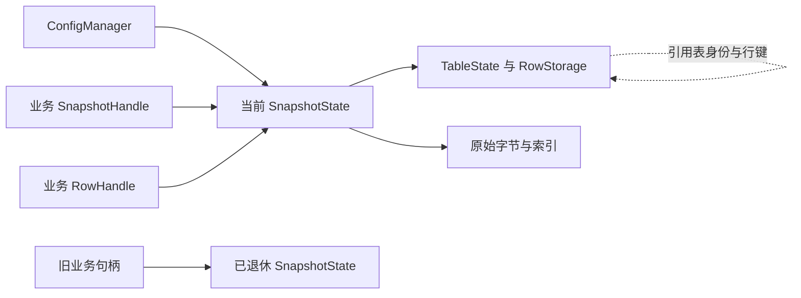

# 多语言服务器运行时设计与实施记录

**中文** | [English](server-runtime-design.en.md)

本文面向 ZrConfig 运行时、生成器和服务器接入的维护者，定义 C#、Java、Go、C++、Lua、TypeScript、Rust 的能力边界、公共契约、内存模型和实施验收。目标是让同一份配置在不同语言中具有一致的数据含义、版本一致性和错误行为，并保留各语言适合的编程方式。

**设计顺序：先补齐可靠的全量运行时，再增加按表选择与按行解码。引用、循环引用、校验、失败回滚和安全生命周期属于必需能力；单行卸载、自动缓存淘汰、增量修改和分布式版本协调暂不进入核心。**

**长期约束：生成的类、方法和导入入口是业务正式依赖的公共 API。普通数据更新、重新生成、生成器升级和内部性能优化，都不得要求业务批量修改现有调用。先固定已使用的契约，再扩展能力；兼容性无法证明的变化默认阻止写入，不用“升级了版本号”代替兼容实现。**

状态记录截至 2026 年 10 月 16 日。本文保留设计与实施依据，不作为接入教程：下表是已记录的实施进度，第 1 节是 2026 年 10 月 15 日制定方案时的原始基线，第 2 至 29 节是设计要求和验收门槛；其中的“当前”“尚未”均须结合该上下文阅读。接入方式与迁移命令见 [多语言生成与 JSON](server-generation.md)。尚未完成全部验收，不将任何跳过项记为通过。

## 阅读顺序

- 先看长期业务稳定性：[契约边界](#25-生成代码的长期公共契约)、[自动保护](#26-api-基线与生成保护流程)、[变更处理](#27-表结构与接口的演进规则)、[消费方验收](#28-面向真实业务的兼容验收)、[发布治理](#29-兼容发布与实施门槛)。
- 判断建设范围：[当前实现](#1-当前实现与明确缺口)、[优先级](#2-范围与优先级)、[不变量](#3-必须保持的系统不变量)、[术语](#4-概念与术语)。
- 实现生成器和公开 API：[命名](#5-命名与生成规范)、[API](#6-公共-api-契约)、[兼容身份](#7-目录与数据兼容契约)。
- 实现核心运行时：[生命周期](#8-生命周期与所有权)、[提交](#9-快照准备与提交协议)、[加载](#10-加载模式与验证范围)、[引用](#11-引用与循环引用)、[并发](#12-并发与取消)、[数据源](#13-数据源与格式扩展)。
- 语言适配与优化：[语言差异](#14-各语言实现要求)、[GC](#15-gc-与内存预算)、[性能](#16-性能目标与测量方法)、[诊断](#17-可观测性与错误模型)、[扩展](#18-扩展机制与长期维护)、[业务接入](#19-服务器业务接入)。
- 安排交付：[验收](#20-验收矩阵)、[实施](#21-实施顺序与变更归属)、[迁移](#22-兼容与发布策略)、[默认决策](#23-默认决策与尚需测量的选择)、[使用场景](#24-使用场景与最终验收问题)。

## 实施状态（2026-10-16）

以下是各轮本机实施记录。最新文档复验中，七语言功能检查通过，但与 GitHub 上一版之间的可信 API 迁移链检查未通过。维护者决定本次不补旧版兼容迁移，直接推送当前更新；具体命令与范围见 [本轮公开源码复验](release-and-acceptance.md#文档与公开源码复验2026-10-16)。

| 原方案范围 | 已落地内容 | 当前验收 |
| --- | --- | --- |
| P0 生成稳定性 | C# 实际声明与编译依赖闭包；原生独立声明模型和保守摘要；稳定 SymbolPlan、逻辑身份、退休名称、模块隔离、源名映射与列顺序固定 | 七语言旧消费方通过；列移动、两次改名、CLI 恢复映射及双格式字节一致性通过。原生声明模型不替代编译器绑定验收 |
| P0 迁移治理 | 临时候选执行真实消费命令；凭据绑定工具、冻结输入、候选、父契约及变更摘要；可信基线迁移链；旧工具写入保护 | 正式九表四次迁移均有七语言真实凭据；当前基线保存完整链。最新重复生成检查的 112 个生成物与记录文件内容、时间戳和清单不变，原有 Unity 元数据保持不变 |
| P1 基础运行时 | 独立 server-v1 家族保留旧入口；拥有快照的安全句柄；Prepare/Commit、失败保留当前、Clear/Close；数据源、期限、验证器、预算与身份冲突保护 | 七语言生命周期、屏障竞态、句柄存活与回收通过；C# 四个种子覆盖 96 轮交错及 256 次双格式位损坏 |
| P2 选择与调度 | 迭代 SCC 和依赖闭包；四种加载模式；类型化预热；等待者取消隔离、有界并发和队列；按语言提供异步或宿主调度入口 | 七语言及双 Catalog 通过；macOS arm64 最低与当前工具链实跑，Go race 通过 |
| P3 按行解码 | 固定原始字节与行索引；行/分组合并、失败回滚、显式引用读取；复杂字段路径；JSON 分配前限额；索引与临时解码预算 | 双格式、故障、热查询分配、TypeScript 同步/异步交错通过；C++ ASan/UBSan 与 TSan 通过 |
| P4 测量与优化 | 索引工作区成功后归还；分组扫描复用已缓存行；独立进程测量合成数据、正式九表、0/1/4 份保留快照、受控源及并发读者 | 历史构建三次独立重复共 1,176 个进程样本；后续运行库另完成 336 个进程复测；最新 Rust 冷加载实现再完成 336 个控制、热查询与正式九表进程，各报告分别保存构建摘要。初始化、目录图、竞争、取消和管理器锁采样通过；七语言万表端到端加载的 252 个独立进程通过，C++／Rust 各 84 个对比进程及 C++ 28 个长窗口进程完成，总计 2,296 个进程样本，原始噪声与失败记录保留 |
| 观测与交付 | 有界事件、错误上下文、资源计数、Prepare/Commit 阶段时间、完整表计数和完整快照身份；公开独立验收工程；跨平台最低/当前工具链 CI | 最新本机最低/当前七语言、C++ ASan/UBSan 与 TSan、完整 smoke、公开 verify-source 和布局检查通过；公开包的 414 文件清单及本地文档链接验证通过。源码分发包含独立构建、verify-source 和最低七语言验收入口，独立包结果按 ZIP 摘要记录；Windows/Linux/MSVC 实机结果尚未取得 |

上述记录对应此前各轮运行时实施；这次文档整理不改写正式 Excel。共用示例继续使用唯一 Data、Config、Rules 和 Output；新增验收源码放在 tests，临时工作簿和候选放在系统临时目录。生成物必须由生成器应用已验证候选，不手工改写。

已有测量与本机通过项仅代表对应构建、工具链和夹具。TypeScript/Lua 堆变化不等于分配次数；内存准入估算不等于实际堆硬上限；尚无同环境旧发布基线时，不宣称已通过 10% 性能回归门槛。源码分发遵循第 25 至 29 节的兼容范围，不附带未声明的跨工具链二进制 ABI 保证。

### 已有大目录与性能验收记录

以下保留此前测量结果，原始日志和构建摘要位于维护工作区的 `artifacts`，不随公开源码分发。它们不表示后续每个提交已重新完成同样的测量；复验入口见 [性能测量](server-generation.md#可重复的性能测量)。

大目录验收使用独立临时夹具：万表首轮双格式导出、完整版本激活及 80,275 个文件的重复生成稳定性检查通过。Java、Go、C++ 实际消费方分别完成约 539、395、2,185 秒的编译与链接。首次 Rust 优化库编译触发 3,600 秒超时；改进共享冷加载实现后，Rust 1.70 在相同 `-O` 优化级别下用约 3,051 秒完成编译，峰值 RSS 约 89.6 GB，消费程序另完成实际链接。TypeScript 默认 Node 堆上限下的失败也单独保留；编译进程设置 16 GiB 堆上限后用约 67 秒通过，峰值 RSS 约 7.7 GB，加载进程仍使用原来选项。七种语言随后完成 252 个独立进程，覆盖双格式和四种加载模式；全量场景每次均验证 10,000 表、10,261 行及查询校验和。编译内存与运行时配置内存分别记录。

改进版原生生成两次输出一致，共 70,271 个文件；仅 10,002 个 Rust 文件发生预期内部变化，10,006 个 Rust 文件中的 290,380 条公开声明完全一致，其余 60,269 个原生文件保持原内容。千表编译诊断、最低／当前七语言及五项 Rust 调度故障回归通过。Go 的万表编译固定消费模块名为 `zrconfig`，避免随机绝对路径重复进入泛型符号；该结果不承诺任意长模块路径均满足最低工具链的对象文件限制。Rust 的私有存储保持类型化，不使用反射、向下转换或 unsafe。新 C# 取消分类与 C++ 共享行调度的 336 个复测进程、最新 Rust 实现的 336 个复测进程及万表 252 个进程分别保存构建摘要；再加上 C++／Rust 各 84 个受控对比进程及 C++ 28 个长窗口进程，包含历史构建共 2,296 个已完成进程。并行编译期间的耗时不用于受控回归判断。对比的热查询分配计数均为 0；C++ 短窗口 p95 波动经更长预热和采样进一步检查，未确认超过 10% 的稳定退化。原始短窗口、长窗口、不同汇总口径和各项内存口径均随报告保留。

## 1 当前实现与明确缺口

### 1.1 能力现状

**本表为实施前基线，不是当前能力表。** 当前接入能力见 [服务器契约家族与显式加载](server-generation.md#服务器契约家族与显式加载)，已记录的实施进度见 [实施状态](#实施状态2026-10-16)。

| 能力 | C# 原始基线 | 六种原生目标原始基线 |
| --- | --- | --- |
| 二进制与 JSON | 支持；JSON 转为现有按行读取结构 | 支持；按选择的格式校验与解析 |
| 主键、组合键、分组查询 | 支持 | 支持 |
| 表引用与循环引用 | 引用访问时解析并缓存 | 全表构建后绑定；支持循环 |
| 按行解码与缓存 | 支持 | 尚未提供；查询返回预先构建的行 |
| 单表加载、全部加载 | 支持 | 主要入口一次加载全部生成表 |
| 异步、取消、预热计划 | 支持 | 尚无一致的公共能力 |
| 可注入数据源和加载诊断 | 支持 | 主要使用运行库内的文件读取 |
| 更新失败保留当前版本 | 支持；完整发布前校验需选择相应入口 | 支持；全量候选成功后发布 |
| 更新后继续使用旧快照 | 可选，默认仍让旧快照失效 | 已持有旧快照可继续使用；具体所有权有语言差异 |
| 停止管理器 | Dispose 会使当前快照和候选失效 | 缺少统一 Clear、Close 契约 |
| 公开的单行、单表卸载 | 没有 | 没有 |

C# 的 `Reload`、`ReloadPrepared`、`ReloadAll` 校验范围不同。当前完整表集合比较位于全量路径，不能把“读取清单成功”视为“完整数据版本已经通过校验”。C# 默认失效策略与服务器保留旧版本策略也不能混为一谈。

原生运行时目前以同步全量加载为共同基线。Java、Go、C++ 使用原子发布或等效同步；Rust 使用锁保护快照获取与发布；TypeScript 和 Lua 在各自执行环境中完成同步切换。跨进程、跨 Worker、跨 Lua 状态不具有共同提交点。

### 1.2 执行前发现的问题与当前处理

以下为方案启动时的问题与当时的处理记录；后续 SymbolPlan、所有权、错误分类及 API 保护进度以上方实施状态为准。

1. 原生加载器过去未严格比较完整表集合，额外 Ghost 表文件不存在也能成功加载。本次已补齐六种语言的提前集合校验。
2. 命名检查过去遗漏 Java `class`、Go `_Item`、C++ `Id`/`v_Id` 三类已复现问题。本次已修复并加入回归；完整符号规划仍待补齐。
3. “持有一条记录是否足以继续访问跨表引用”尚不一致。特别是 C++ 裸指针和 Rust 现有 Weak 引用依赖整个快照的存活。
4. 当前各语言未初始化、缺失查询、重载重入和关闭行为没有统一的可测试错误分类。
5. 原 SchemaSummary 只有结构摘要。本次增加独立 API 契约比较并接入事务，参数名/重载/返回类型变化可以阻止；完整依赖、方法行为与性能仍需后续契约和消费方验收。

这些问题应先固化为自动化回归，再扩展懒加载，以免把已有缺口带入更多状态。

### 1.3 源码归属

| 位置 | 责任 |
| --- | --- |
| `src/ZrConfig.Core/PortableSchema.cs` | 与目标语言无关的结构描述 |
| `src/ZrConfig.Core/NativeGenerator*.cs` | 名称规划、生成表、目录和语言适配 |
| `unity/ZrConfig.Sample/Assets/ZrConfig/Native` | 六种语言公共运行库的唯一维护源码 |
| `unity/ZrConfig.Sample/Assets/ZrConfig/Runtime` | C# 运行时唯一源码 |
| `unity/ZrConfig.Sample/Assets/HotUpdate/Config/Generated` | 可重建的生成产物 |
| `tests/ZrConfig.Tests` | 共用夹具、跨语言契约和运行时验收 |

不得直接修改 Generated 来实现功能；模板与生成器必须能重新生成相同结果。后续文件仍遵守 [项目目录约定](project-layout.md)，不另建服务端 Data、Rules、Output 或第二份手写注册表。

## 2 范围与优先级

### 2.1 分阶段能力

| 阶段 | 必须交付 | 明确边界 |
| --- | --- | --- |
| P0 正确性与契约保护 | 现有 API 基线、兼容检查门禁、命名闭包、严格表集合、现有行为回归 | 先锁定并保持业务已使用的公开 API |
| P1 服务器基础运行时 | 安全快照所有权、原子更新、统一错误、Clear、Close、基础数据源和诊断 | 默认全量加载和完整验证 |
| P2 表选择与加载调度 | 表依赖目录、选择闭包、预热计划、取消隔离、按语言接入异步调度 | 选择范围内整体一致，不混合版本 |
| P3 按行解码 | 索引驻留、单行状态、并发合并、显式引用解析、分组加载 | 默认固定原始数据，不承诺随机磁盘读一行 |
| P4 经测量证明有价值的优化 | 按需打开表、可选分组索引、范围读取、紧凑存储等 | 每项单独声明能力、代价和格式兼容性 |

每种语言分别发布能力清单。不能因为 Java 完成 P3，就把全部目标统一标成“支持懒加载”。某语言尚不支持某选项时，应在构造计划阶段报 `UnsupportedCapability`，不得悄悄降级成全量加载。

### 2.2 核心暂不提供

- 修改已发布记录、原地补丁和跨版本行对象拼接。
- 强制回收业务仍持有的快照、行、集合或字符串视图。
- 自动逐行 LRU、单行卸载、带外删除引用目标。
- 在配置属性 getter 中隐式执行网络读取。
- 内置 HTTP 服务、文件监控循环、自动轮询、数据库或分布式一致性协议。
- 自动翻译任意 C# 自定义转换器和业务方法。
- 把 GC 调用、finalizer 或 Weak 引用当作主动卸载的正确性机制。

这些边界允许以后扩展，但必须有独立设计和真实业务收益。

## 3 必须保持的系统不变量

1. **单次业务操作使用一个快照。** 请求、战斗或计算开始时获取一次；后续跨表引用始终在该快照内解析。
2. **数据版本不可变。** 相同版本身份下的表字节不可被覆盖；版本名相同而内容不同视为错误。
3. **候选不可见。** 清单、数据、索引、引用、预热任一步失败，都不能改变当前版本。
4. **一次提交覆盖整个快照。** 不允许 Item 来自版本 A、Skill 来自版本 B。
5. **已发布业务值只读。** 允许内部延迟缓存从未加载变成已加载，不允许字段值随访问变化。
6. **没有半成品行。** 正常查询只能获得完整解码并通过该层校验的记录。
7. **没有悬空访问。** 安全 API 返回的对象或句柄必须有明确的所有权；借用 API 必须明确有效期。
8. **空引用、缺失键和错误是不同结果。** 非零引用目标缺失不能返回正常空引用；未加载不能伪装成查无此键。
9. **读取不持有管理器更新锁。** 索引热查询不得经过文件 I/O、管理器锁或动态反射。
10. **资源使用有边界。** 文件尺寸、行数、容器、嵌套、并发、候选数量和加载预算都应可限制。
11. **失败分类稳定。** 自动化和运维依赖错误码及上下文字段，不解析人类语言错误消息。
12. **生成可重复。** 输入、目标端、生成选项相同时，名称、文件清单和源码内容稳定。
13. **公共契约不随实现漂移。** 已接受的类、成员、参数、返回、导入和行为不会因为模板重构、工具升级或新增无关表而变化。
14. **稳定性优先于名称整齐。** 已被业务使用的合法旧名称继续保留；新命名规范不能成为批量改名的理由。
15. **兼容检查不能自我批准。** 新生成结果先与受保护的旧契约比较；不允许先覆盖基线，再宣布没有差异。

## 4 概念与术语

| 名称 | 定义 | 不应混淆的含义 |
| --- | --- | --- |
| VersionId | 发布端提供的版本标识，按不透明字符串处理 | 不能靠字符串大小判断新旧 |
| ManifestDigest | 一次捕获的清单原始字节的 SHA-256，作为内部内容身份 | 不等于安全签名或结构哈希 |
| Generation | 单个管理器内单调递增的状态代数 | 不等于 VersionId；回滚也增加代数 |
| Catalog | 生成的全部表、Codec、依赖、结构指纹目录 | 不要求所有表已经加载 |
| Snapshot | 一个版本的固定结构、值和缓存所属域 | 不等于管理器，也不包含后续版本 |
| Candidate | 尚未发布的快照及准备进度 | 不能作为 Current 返回 |
| PreparedSnapshot | 已达到指定发布条件、等待提交的候选 | 不能无限期隐式保留 |
| TableDescriptor | 表标识、键、结构、依赖等静态元信息 | 不等于已解码的表对象 |
| TableView | 在一个快照内访问某表的只读入口 | 可指向尚未完成加载的表 |
| RowStorage | 内部不可变的行值及引用标识 | 不直接持有其他行的强所有权 |
| RowHandle | 能延长所属快照生命周期的公开行句柄 | 与没有所有权的借用视图区分 |
| RowView | 有已知持有者覆盖其使用期的借用视图 | 不可跨所有者销毁继续使用 |
| Clear | 从管理器撤下当前版本；管理器可再次加载 | 不承诺立即释放所有内存 |
| Close | 永久停止管理器并撤下当前版本 | 不销毁业务已合法取得的独立句柄 |
| Trim | 可选的内部冗余缓存整理 | 不删除业务值，不等于 Unload |

三种“懒”应分别记录：延迟读取表文件、延迟解码行对象、延迟创建派生索引。只实现第二种时，文档和指标必须写“按行解码”，不能宣传成“磁盘只读一行”。

## 5 命名与生成规范

### 5.1 分离数据名称与源码名称

协议中的表名、字段名、类型身份保持原样；语言关键字转义仅作用于生成源码。名称规划作为生成前置阶段一次完成，输出各语言 SymbolPlan，所有生成器共用计划，不在模板内临时拼接和修补。

规划输入包括原始全限定身份、符号种类、词法作用域、目标语言、命名策略版本和生成器保留符号。输出包含公开类型、访问器、私有存储、局部变量、模块、文件、引用辅助成员和分组入口的名称。

只有全部选定语言都通过规划后，才能进入生成事务。错误包含原始名称、冲突后的名称、作用域、语言和来源位置；不得生成一半后才让业务编译器发现错误。

### 5.2 新接口的命名习惯

| 项目 | C# | Java | Go | C++ | Rust | TypeScript | Lua |
| --- | --- | --- | --- | --- | --- | --- | --- |
| 类型 | PascalCase | PascalCase | PascalCase | PascalCase | PascalCase | PascalCase | 模块名 snake_case |
| 方法 | PascalCase | camelCase | PascalCase | snake_case | snake_case | camelCase | snake_case |
| 字段访问 | PascalCase 属性 | getX 或明确查询方法 | 导出方法 | snake_case 方法 | snake_case 方法 | camelCase 只读属性 | snake_case 查询函数 |
| 包与模块 | 项目命名空间 | 小写包名 | 小写包名 | zrconfig 或可配置命名空间 | 小写模块名 | 显式模块导出 | 显式 require 前缀 |
| 错误码展示 | 统一稳定标识，如 SchemaMismatch | 同左 | 同左 | 同左 | 同左 | 同左 | 同左 |

以上是尚未发布的新 API 家族和全新项目的设计建议，不是现有项目的统一改名计划。现有 `ItemCatalog`、`get_ItemCatalog`、`Get_字段名` 等合法访问方式在稳定契约内原样保留。现有家族新增成员沿用该家族已经固定的规则；升级生成器不能改变默认大小写策略。即使允许显式启用新命名，也必须通过第 26 至 29 节的迁移流程，不能仅弹出提示就重命名全部业务入口。

缩写拆词必须确定且与文化区域无关，例如 `XMLHttp` → `xml_http`、`ItemID` → `item_id`。若两个原名映射到同一符号，报冲突；禁止按发现顺序附加 `1`、`2`，避免新增一个表就改变旧 API。

### 5.3 转义与冲突检查

- 维护每个最低语言版本的关键字、受限标识和公共基类成员清单；升级清单本身需要回归和兼容检查。
- 公开关键字可以按已版本化规则追加安全后缀；转义后的完整符号集合仍须重新检查。`class` 与 `class_` 不能自动覆盖彼此。
- 引用生成的 `PeerId`、`GetPeer`、`LoadPeer`，分组 `FindByX`，以及管理方法、构造器、类型名都参与检查。
- Java 要检查 `Object` 的 final 方法和类型遮蔽；不要依赖通配 import 消除歧义。
- Go 要检查导出性、包级类型和函数重名、文件名前导 `_` 或 `.`、`_test.go`、GOOS/GOARCH 后缀等构建规则。
- C++ 不使用 `__` 或保留的前导下划线形式命名内部符号；内部字段放在独立 Storage 作用域，并统一验证。不能沿用容易撞名的 `v_原名` 拼接方案。
- Rust 检查 edition 关键字、模块、关联项、辅助方法以及 `self`、`Self` 等特殊名称；不能假定所有名称都适合 raw identifier。
- TypeScript 检查 `constructor`、原型相关名称、模块导出与类型命名空间；解析数据不能直接把任意字段赋给普通对象原型。
- Lua 的关键字、模块字段和元方法需要检查；原始字段名通过受控映射访问，避免把业务名注入代码片段。
- 内部符号按稳定字段序号或独立结构生成，例如 Storage 的 `field_0`；所有符号仍进入同一个作用域规划器，不能仅靠“看起来罕见”的前缀。

### 5.4 文件名与跨平台路径

Go 等可自由选择源码文件名的目标，首次规划新名称时可采用受控前缀和尾缀，例如 `table_item_gen.go`，避免 `_Item`、平台条件后缀和 Windows 设备名。已有合法文件名保留；修复非法文件名不连带改写其他表路径。Java 文件名必须与公开类名一致，使用规划后的类型名。其他语言按既有语言目录统一生成，不另开功能目录。

路径检查包括大小写折叠冲突、Windows 设备名、尾部空格和点、分隔符、路径长度预算。`Item` 与 `item` 即使在某台机器可以共存，也不允许产生跨平台冲突。超长名称给出诊断；不静默截断。

名称映射仅在已有生成元数据中扩展记录，不另建手写映射表。命名策略变化与公开 API 变化一起版本化，不改协议字段名或结构哈希的含义。

### 5.5 生成内容规范

统一 UTF-8、LF、稳定排序和生成头。注释必须处理注释终止符、Unicode 转义、换行、反斜杠及语言字符串边界。文档注释不能参与代码执行。

公共访问器应有表名、字段说明、空值语义和生命周期注释。生成代码不使用动态反射读取正常字段；复杂 Codec 可以拆成小函数，避免 Java 方法大小限制、编译器极深表达式和巨型初始化函数。

包名、命名空间、模块根允许配置，但不能改变协议身份。一个进程可以同时链接两个业务的生成物，其公共运行库和类型必须能通过命名空间隔离。

## 6 公共 API 契约

### 6.1 管理器

以下是逻辑接口；具体语言按第 5 节映射，不要求使用同一个异常或异步类型。

| 操作 | 语义 | 失败与副作用 |
| --- | --- | --- |
| AcquireSnapshot | 获得当前快照的持有句柄 | 未加载报 NotInitialized；关闭报 ManagerClosed |
| TryAcquireSnapshot | 正常未加载时返回空 | 关闭仍报 ManagerClosed；不能吞掉内部错误 |
| Reload | 准备并提交完整新候选 | 默认全量验证；失败保留旧快照 |
| Prepare | 固定版本并达到计划的发布条件 | 不修改当前版本；默认每管理器一个准备任务 |
| Commit | 一次性发布 PreparedSnapshot | 检查管理器身份、代数、关闭状态和候选状态 |
| Clear | 清除当前版本并增加代数 | 幂等可重用；过期候选不能重新发布 |
| Close | 永久关闭，停止新准备和获取 | 幂等；不撤销已有独立快照句柄 |
| GetStatus | 返回管理器状态、代数和在途阶段 | 允许关闭后读取终态；不返回可变内部对象 |

普通用户只需 `Reload`、`AcquireSnapshot` 和 `Close`。Prepare/Commit 服务于加载窗口、业务门禁和异步调度，不能强迫所有接入都手写两阶段发布。

Reload 返回提交结果及所发布快照。Prepare 返回必须提交或释放的候选句柄；C++/Rust 用 RAII，托管语言提供明确的取消/释放入口并有超时管理。管理器不能无界保留未使用候选。

### 6.2 查询与加载分离

| 操作 | 是否允许冷加载 | 返回契约 |
| --- | --- | --- |
| TryGetRow / Find | 否 | 已验证索引确定不存在才返回空；存在但未就绪报 RowNotLoaded |
| GetRow | 否 | 同上，缺失报 KeyNotFound |
| LoadRow | 是 | 加载指定行；缺失报 KeyNotFound；不自动加载全部引用链 |
| TryLoadRow | 是 | 只有键不存在返回空，I/O 或数据错误仍失败 |
| LoadTable | 是 | 该表全部行和计划要求的索引就绪 |
| LoadAll | 是 | 当前快照允许范围内全部表就绪；范围必须可查询 |
| FindGroup | 否 | 分组索引和结果行必须就绪；不存在返回空只读视图 |
| LoadGroup | 是 | 确保分组索引及匹配行就绪；不必解码非匹配行 |
| GetReference | 否 | 0 返回空；目标未就绪报 RowNotLoaded；非法非零目标报 MissingReference |
| LoadReference | 是 | 在原快照中加载目标；不递归展开目标的全部引用 |

`Try` 只消除预期的“没有这个键”，不能消除未加载、文件错误、关闭或格式错误。没有索引时无法断言键不存在，应报告 TableNotLoaded。

新契约通过新接口版本接入，**不改变现有 C# GetRow 隐式加载的行为**。旧 `find/get` 等保持当前版本语义，由适配层和文档说明；严禁同名方法在同一 API 版本中悄悄从常数查询变成 I/O。

本节列出的逻辑名称不能直接用于替换已生成入口。例如引入 LoadRow 不允许删除业务已使用的 GetItemCatalogAsync；增加安全行句柄不允许直接把原 Get 的返回类型改成 RowHandle。通过单独的能力入口、管理器 Profile 或明确的新 API 家族提供新增语义，旧调用保持其原返回类型与原行为。

全量模式下正常 Get/Find 总是内存查询；按行模式通过 Load 显式完成冷路径。属性 getter 只返回已就绪值、引用标识或只读引用描述，不执行网络 I/O，也不发起递归加载。

### 6.3 表、键、分组和遍历

生成的强类型表入口优先，动态表名查询作为工具扩展。主键值沿用现有精度、相等性和哈希规则；组合键直接传强类型分量或可复用的值类型键，不拼接字符串。

分组结果按导出逻辑行顺序返回稳定只读视图。空结果复用安全的空视图。需要分页时采用行号区间或快照绑定游标；游标包含快照身份，跨版本使用必须报错。遍历 APIs 明确是遍历已加载行还是全部行，不能用一个 Count 同时表示两者。

至少区分 `DeclaredRowCount`、`LoadedRowCount`、`IsFullyLoaded`。索引存在不代表行对象已经存在；Count 读取不能触发整表解码。

### 6.4 选项保持正交

管理器选项与生成选项分开。运行时选项按用途分组为 LoadPolicy、ValidationPolicy、ResourceLimits、Diagnostics、Scheduling，使用不可变值；禁止不断追加位置布尔参数。

原有 `preferJson` 保留兼容包装。新格式策略明确为 PreferBinary、PreferJson、RequireBinary、RequireJson；Prefer 只决定候选版本有多个合法格式时选择哪份，不允许某份损坏后静默回退。

所有选项在 Prepare 开始时冻结；业务修改外部 Options 对象不能影响进行中的加载。取消 token/context 是每次操作参数，不能作为管理器共享可变字段。

## 7 目录与数据兼容契约

Catalog 由同一 PortableSchema 派生，记录每表的协议名、结构哈希、主键/分组元信息、引用目标和能力要求。每个语言包只有一份生成目录，不要求业务额外注册每张表。

表数量很大时，目录应分段或采用紧凑静态数据，按需初始化 Codec。创建管理器或读清单不能自动实例化所有表对象；显式全量模式才遍历全部表。

新增依赖描述需要明确目标表身份，不能仅从展示用类型名称反推。表的运行时数字序号仅在固定 Catalog 内有效；若需要缓存或序列化，必须同时绑定 Catalog 指纹，不能作为跨生成版本稳定 ID。

默认执行严格表集合比较：清单集合等于 Catalog 集合，包括零行表。选择部分表加载仅改变驻留集合，不放宽完整清单的结构检查。缺失、额外、重复或分端不匹配均失败。

若未来需要只生成某些表的业务服务包，应增加显式导出 Profile 和对应清单身份，仍复用统一输入与输出管理。不能用 AllowUnknownTables 绕过集合校验，否则拼错名字和漏部署文件会再次被掩盖。

版本兼容至少区分：数据格式版本、结构指纹、Codec/转换器语义版本、生成器版本、运行时 API 版本、命名策略版本。注释和公开名称调整不应意外改变数据编码；字段布局或编码语义变化必须进入相应兼容指纹。

第一阶段继续使用现有二进制 v4 和 JSON 表格式。改成按行解码不应自动升级数据协议；只有新增范围索引、分块校验等确实无法由现有格式表达的能力，才单独设计格式升级和旧版读取策略。

### 7.1 版本身份与缓存键

内部 SnapshotIdentity 至少包含 SourceNamespace、VersionId、ManifestDigest、Catalog 指纹和加载计划指纹。SourceNamespace 是调用方提供或由适配器生成的稳定源身份，不把凭据放入标识或日志。管理器的 Generation 单独记录，不参与判定两份表字节是否相同。

第一版直接对捕获的清单原始字节计算 ManifestDigest，不先解析再由不同语言重新序列化。这样无需引入七种语言的 JSON 规范化差异，也不需要立即修改导出协议。相同 VersionId 下仅改清单排版也会改变身份，按不可变版本约定处理；未来若需要语义摘要，应定义独立算法版本，不能改变现有摘要含义。

表字节缓存键再包含所选格式、文件摘要和结构指纹。二进制与 JSON 不能只因版本、表名相同就共用解析结果。行缓存归属 SnapshotState；即使两个状态版本字符串相同，也不跨状态共享行对象和引用缓存。

VersionIdentityConflict 可以检测管理器或缓存仍记得的同版本冲突；跨进程、进程重启后和已淘汰历史的不可变保证仍由发布端负责。为检测冲突而保存的元信息也有容量边界，不能积累无界版本历史。

### 7.2 分端与兼容元信息

当前格式缺少某项独立身份字段时，只能通过已有结构/内容契约判断，不能声称识别所有“结构完全相同但业务端不同”的误部署。若要求严格区分 C/S、业务 Profile 或 Catalog 家族，应在清单扩展版本中增加显式身份，并对旧清单给出明确的兼容策略。

新增必需字段、编码能力或摘要算法通过可识别的清单版本/能力声明发布；旧运行时必须明确拒绝不理解的必需能力。可忽略的诊断元信息和影响解释的字段分开，不允许未知必需能力被静默忽略。该升级单独验收，不把源码 API 变化与数据格式升级绑定在一次提交里。

## 8 生命周期与所有权

### 8.1 所有权图

目标结构如下。实线表示持有关系，引用字段保存目标身份，不形成行之间的所有权环。



SnapshotState 不反向持有 Manager，不形成“旧行 → 旧快照 → 管理器 → 新快照”的链。Manager 不保存强引用历史列表；历史版本监控使用弱引用、事件或外部标识。

### 8.2 安全句柄与借用视图

公共安全行句柄绑定 SnapshotState 与行号。它能继续解析同版本引用，其有效性不取决于 Manager 当前指向哪个版本。一个长期保留的行句柄可能保留整个快照，这是明确的内存代价，文档必须说明。

C++ 使用持有共享状态的 RowHandle，Rust 使用拥有 Arc 的句柄；内部 RowStorage 仅保存行值及目标键/行号，不能存回持有自己的 RowHandle。这样即使 A 引用 B、B 引用 A，也没有 shared_ptr/Arc 强环。

Java、Go、C#、TypeScript、Lua 可以让公开记录或包装器持有所属状态。GC 可以处理这类不可达对象环；需要控制的是长寿命业务引用造成的滞留。Java、TypeScript、Lua 的行包装器按已加载行缓存，热查询复用，避免每次查询分配包装器。

C++ 的借用视图只在外部 SnapshotHandle 覆盖的作用域内有效，不能逃逸或跨异步任务丢失所有者。Rust 借用视图通过生命周期绑定快照；跨任务需拥有句柄。默认安全入口与显式 Borrow 入口要在类型和文档上可区分。借用路径减少引用计数开销，不能以性能为由把裸指针作为唯一公共契约。

只读集合、分组视图、字符串视图和迭代器同样需要绑定所属快照。不能只修复行指针而留下悬空的 string_view、span 或 group iterator。调用方若要跨版本长期缓存少量业务值，应显式复制为独立 DTO，并只保留需要的标量和键。

### 8.3 操作后的可见性

| 场景 | 新请求从 Manager 获取 | 已取得的安全句柄 | 进行中的候选 |
| --- | --- | --- | --- |
| 首次加载前 | NotInitialized | 不存在 | 可准备 |
| Prepare 中 | 原快照或 NotInitialized | 继续有效 | 对外不可见 |
| Commit 成功 | 新快照 | 继续读取原快照 | 转为已发布 |
| Prepare 失败 | 原快照不变 | 继续有效 | 释放私有资源 |
| Clear | NotInitialized | 继续有效 | 取消或标记过期，禁止迟到提交 |
| Close | ManagerClosed | 继续有效 | 取消或标记过期，禁止迟到提交 |
| 释放最后一个所有者 | 不影响其他版本 | 对应状态可回收 | 不适用 |

Clear 和 Close 在语义上完成的是撤下管理器所有权。不能返回“所有内存已释放”，也不应同步等待所有请求结束。

### 8.4 C# 兼容迁移

现有 Unity 使用者可能依赖 Reload 后旧行失效，以及 Dispose 让当前快照失效。保留旧接口和默认值，不将服务器语义直接覆盖到旧 ConfigManager。

新增明确的服务器接入 Profile 或版本化管理 API，采用保留句柄语义。迁移期间两种策略必须在类型/构造选项和文档中可见。仅设置当前 `retainPreviousSnapshots: true` 仍不能完整等价于本方案，因为当前 Dispose 仍会使当前快照失效，资源源也由调用方管理。

不提供“全局强制销毁所有行”按钮。若应用要停止旧请求，应在业务请求层取消并排空，再释放句柄；配置运行时不能安全撤销已借出的任意内存引用。

### 8.5 外部资源与源的存活期

基础运行时优先使用自己拥有的不可变字节和普通托管/原生内存。文件句柄按读取操作打开和关闭，不能每张常驻表永久占用一个文件描述符。

全量解码且引用验证完成后，若记录不依赖原始字节视图，可以释放源、解析树和原始字节。若采用零拷贝字符串或范围视图，必须由 SnapshotState 持有对应字节；不能提前归还缓冲池。

按行解码第一版默认固定允许范围内的字节，使退休快照的后续解码不依赖旧版本目录是否被删除。真正延迟文件读取需要 SourceVersionPin 能力及部署端协作，见第 13 节。单纯持有一个数据源对象不能阻止外部系统删除文件。

托管语言 GC 何时发生不可控。外部租约必须有明确释放方案；finalizer/清理回调只能补偿遗漏并提交轻量清理任务，不能承担提交、强制解锁或保证准时删除磁盘版本等职责。

## 9 快照准备与提交协议

### 9.1 管理器状态

主状态只有 Empty、Ready、Closed；准备进度是独立状态，不阻止 Ready 版本被读取。Closed 不可恢复；Clear 后可以再次 Reload。

默认同时只允许一个准备任务。并发 Reload/Prepare 返回 ReloadBusy；提供异步排队能力时必须显式开启并限制队列长度，不能在隐藏的锁队列中堆积多个完整候选。

### 9.2 准备流程

1. 校验选项、能力、取消和预算，登记操作 ID，捕获 Manager 身份及 Generation。
2. 一次性读取 current 清单，固定 VersionId 和清单内容；后续不再重读 current 来决定某张表路径。
3. 校验格式、路径、完整表集合、目标端、结构指纹、计数和资源限制。
4. 计算选定表与依赖闭包，决定验证范围、数据格式和加载计划。
5. 通过固定版本的数据源读取；校验实际字节及摘要，解析/扫描，构建必要索引。
6. 按策略解码记录、验证引用并执行预热。运行必要的候选验证器。
7. 再检查取消、期限、预算和源绑定，形成 PreparedSnapshot。
8. Commit 时在短临界区检查状态与 Generation，发布指针并增加 Generation。
9. 锁外释放管理器对旧版本的持有，投递结果事件；返回已提交结果。

Prepare 不写导出文件，也不修改发布端 current.json。运行时内存提交与导出工具的磁盘发布是两个独立操作，不能混用成功标志。

### 9.3 提交点与竞态

提交前取消：返回 Cancelled，当前版本不变。提交点已通过后取消：仍返回 Committed，不能抛“取消失败”造成调用方误以为没有更新。结果至少包含 Committed、Generation、VersionId、操作 ID 和阶段耗时。

Clear、Close 或另一次成功提交使旧候选的预期 Generation 失效。迟到的准备任务即使完成，也只能释放资源并返回 StaleCandidate。候选只能提交一次，只能交给创建它的 Manager；重复提交和跨管理器提交分别报明确错误。

只要状态比较和发布位于同一同步边界，就无需让读取者参与准备锁。Generation 使用足够宽的无符号计数并检查溢出；不能回绕后重新接受陈旧候选。VersionId 按不透明字符串处理，回滚到旧版本也是新的 Generation。

默认不跳过同版本重载。若启用复用，仅能在完整版本身份、Catalog 指纹、加载策略及验证要求一致时复用；相同 VersionId 对应不同摘要报 VersionIdentityConflict。不能只比较版本字符串就绕过校验。

### 9.4 回调与发布后错误

Changed/LoadCompleted 事件在提交锁外发送。订阅者异常只记诊断，不回滚已提交快照，不把成功提交变成 Reload 失败。

事件包含提交代数，按管理器顺序投递。重入回调可能再次 Reload/Clear，通知层不得在新代数之后投递一个被误认为当前的旧事件。事件队列有界，快照载荷只保留投递期间需要的所有权；慢消费者不能无限保留历史快照。

必要的业务校验通过提交前 validator 完成；它只能读取候选，不对外发送消息或修改业务状态。可能失败的发布后回调不能充当发布前门禁。

### 9.5 提交的最小伪代码

```text
Prepare:
    gate 内登记唯一操作，并捕获 generation 与 manager identity
    gate 外固定版本、读取、验证、构建候选
    返回 PreparedSnapshot；失败则只清理本操作资源

Commit(prepared):
    gate 内:
        检查未关闭、候选归属/状态、generation、取消及期限
        previous = current
        current = prepared.snapshot
        generation += 1
        prepared 标记为 Committed
        清除本候选登记
    gate 外:
        释放 previous 的管理器所有权
        投递携带 generation 的事件
        返回 Committed
```

实现中取消检查与提交点要有定义清楚的顺序；不能在成功交换后再次抛取消或关闭错误。过期操作的 finally 只能清理自身登记，不能清除后来操作的候选。大状态析构、源释放与用户代码不得落在 gate 内。

## 10 加载模式与验证范围

### 10.1 支持的组合

加载范围与验证范围分别记录，但不开放任意组合制造难以理解的状态。第一版只提供以下清晰预设：

| 预设 | 发布前工作 | 发布后冷访问 | 适用情况 |
| --- | --- | --- | --- |
| ServerDefault | 全部表解码、索引及引用完整验证 | 纯查询 | 常驻服务器默认 |
| SelectedTables | 严格验证完整清单；选定表依赖闭包全部解码并验证 | 闭包外报 TableNotSelected | 服务只使用配置的一部分 |
| LazyRowsStrict | 固定允许范围字节；扫描完整值、键与引用；仅保留预热行对象 | 延迟构建行对象 | 对象常驻成本高、访问稀疏 |
| LazyRowsOnAccess | 固定允许范围字节；验证摘要与索引；行值访问时验证 | 冷行可能报数据错误 | 明确接受延迟发现错误的场景 |

LazyRowsStrict 的全量扫描依然需要启动 CPU 和字节读取；它节省的主要是行对象及派生对象常驻内存。严格扫描可以生成临时值或直接遍历编码，但不能省略约束检查后仍称为完整验证。

摘要正确仅表示数据和清单一致，不证明每个值、主键或引用正确。LazyRowsOnAccess 不能宣称“候选全量验证后原子发布”。其诊断要持续展示验证覆盖率及运行期间发现的错误。

### 10.2 按表选择和依赖闭包

依赖图的节点是表，边由结构中声明的表引用形成。第一版采用保守闭包：只要某字段可引用 B，选择 A 就包含 B，即使当前数据中该字段全为 0。这样计划稳定、可提前解释，避免为了决定是否读 B 而先扫描全部 A。

对图计算强连通分量，将互相依赖的一组表视为一个规划单元，再处理分量间的有向无环图。图算法使用迭代或受控栈，复杂度应为 O(表数 + 依赖边数)，不能通过重复递归搜索变成平方级。

循环表组不意味着必须递归构造所有引用对象。它决定选择、准备和未来资源释放的边界；行级引用仍按标识解析。

计划预览列出用户选择、自动包含的依赖、预期行数和数据尺寸。闭包外的访问报 TableNotSelected。第一版不在已发布快照中悄悄扩展选择范围；需要更多表时用新计划创建同版本新快照并提交。

### 10.3 按行加载状态

每个允许表区分 Unopened、Opening、Indexed、LoadingAll、Ready、Faulted；每行区分 Absent、Loading、Ready、Faulted。索引未建立时无法分配行号，不能把任意业务键直接用作无限增长的失败缓存。

同一快照、表和行的并发请求共享一个加载任务。Decode 先构造局部完整值，再一次性提交到行槽；正常读取看不到默认字段填了一半的对象。热路径读取 Ready 槽，不分配任务对象。

加载 A 行只读取 A 的值和引用标识，不在 Decode 中加载 B。这样 A→B→A 不会造成递归解码、锁等待环或互相等待的 Future。

发布候选内的任何失败都会废弃整个候选。已发布的懒加载快照中，取消某次 LoadTable 不必删除已经合法完成的行缓存，但不能把表标为 Ready；这类缓存单调增长，不改变业务值。

不可恢复的数据错误记录为该表/行的终态错误；I/O 短暂失败和取消按策略允许重试。结构损坏可将表标为 Faulted 并使后续表操作失败；已经交付的不可变行值不被强制销毁。该快照的健康状态降为 Degraded，是否停止服务或回退由业务决定，运行库不得暗中切换版本。

### 10.4 整表加载与分组索引

LoadTable 复用已完成行，只处理未完成行；不能再构造第二套对象破坏同一行身份。只有全部行和规定索引成功后才设置 IsFullyLoaded。

主键与引用目标索引是基础索引。分组索引可在后续阶段支持按需创建，但必须把扫描全部相关字段的成本暴露出来。索引保存行号或连续范围，不复制记录。

LoadGroup 先确保分组索引，再加载匹配行。若现有格式无法直接得到分组值，可能需要全表字段扫描；不把该操作声称为 O(命中行数)。巨大分组应支持分页或迭代，不能强制分配同样巨大的临时结果列表。

### 10.5 JSON 的特殊成本

现有 JSON 不具备独立行随机访问所需的可信偏移与分块校验。按行模式可选择一次解析并转换为内部索引数据，随后释放解析树，或保留受控的行片段结构；需测量时间和峰值内存后选择。

禁止同时长期保留 JSON 文本、完整 DOM、转换后二进制和全部行对象。转换时要包含重复成员、UTF-8、整数精度、对象成员、多态和资源上限检查。64 位整数、decimal 的字符串编码继续沿用现有契约。

二进制 v4 可以复用按行读取的思路，但新增原生实现仍须验证索引、行区间、边界和解码消费长度。拥有行偏移不等于获得每行独立完整性认证。

## 11 引用与循环引用

### 11.1 引用表示

保持现有协议：表引用保存目标 int32 Id，0 表示无引用；非零值是否有效由目标表索引判断，不另加“负数一定非法”的隐含规则。目标表必须满足现有全局唯一整数 Id 约束。

暂不扩大到组合键引用、数组内引用或任意对象图引用。要支持这些形式，必须扩展 PortableSchema、编码、错误路径、依赖扫描和全部语言测试，而非只让某个生成器接受类型。

内部引用保存目标表序号和目标 Id，可在验证后缓存目标行号。序号与行号绑定 SnapshotState，不能跨快照复用。公开 API 可以提供原始 Id、只读引用描述、已加载查询和显式加载四种入口。

### 11.2 全量模式

准备分为三个步骤：先创建全部记录和主键索引，再验证每个非零引用，最后完成只读封装并发布。绑定阶段不递归复制目标记录，不把循环图序列化成无限嵌套对象。

一次引用查询定位同一快照内目标。空引用不加载目标表；缺失非零目标的错误包含源表、源行键、字段、目标表和目标 Id。

如果语言兼容层继续暴露直接对象引用，必须同时遵守快照持有规则；新内部存储层仍不形成原生引用计数强环。

### 11.3 按行模式

LoadRow(A) 完成 A 自身；LoadReference(A.Peer) 加载 B 自身。B 的 Peer 再指向 A 时命中原槽。A 的初始构建不等待 B，因此不存在“发布 A 之前必须发布 B、发布 B 之前必须发布 A”的死锁。

严格模式在准备阶段通过索引及扫描确认目标存在，即使目标行对象尚未构建。按访问验证模式在访问非零引用时验证目标，错误不能被降格为 null。

引用解析必须从行持有的 SnapshotState 开始；禁止在 getter 中调用 Manager.Current。缓存只属于一个快照，不使用以 Id 为键的进程全局引用字典。

### 11.4 图遍历工具

可选 PreloadReferences/VisitReferences 使用显式工作队列与 visited 集合，键为快照内的表序号和行号。提供 MaxVisitedRows、MaxDepth、MaxDecodedBytes、取消和进度；默认预热计划不自动展开无限引用闭包。

调试输出默认只打印引用 Id，不递归打印完整目标。深度、集合元素和字符串展示长度有限制；业务 Equals、Hash、ToString 也不能沿循环引用递归。

## 12 并发与取消

### 12.1 同步边界

管理器门只保护状态、代数、候选登记与指针发布。表门只保护任务登记、缓存提交和状态转换。耗时 I/O、解码、哈希、用户扩展和事件回调都在锁外执行。

优先避免同时持有多个锁。确有嵌套时统一为 Manager → Table → Row，完成通知在解锁后发送；禁止持有表 A 的锁去加载表 B。不能靠递归锁掩盖引用环。

发布通过对应语言的安全内存可见性机制完成。只有指针写入原子而行字段没有安全发布，仍然不合格。Rust 当前快照获取的 RwLock 和 C++ shared_ptr 原子操作也不能被宣传为“保证无锁”。

### 12.2 请求合并和取消隔离

行解码任务以 `(SnapshotIdentity, TableOrdinal, RowOrdinal)` 合并；同一版本文件读取以固定源身份、版本和内容身份合并。不同版本不能因为相同文件名误用缓存。

取消一个等待者只取消它自己的等待，不取消其他调用者共享的任务。最后一个等待者离开后是否取消底层操作由策略决定；取消后仍到达的结果需检查任务代数，避免覆盖后来启动的新任务。

内部同步与异步入口共享缓存和状态机，但同步入口只使用真实同步数据源。不能在 UI、事件循环或同一调度器线程里阻塞等待自己的异步任务。只支持异步的数据源遇到同步冷加载时报 SyncNotSupported。

取消检查点至少包括读取块边界、解析/扫描批次、行批次、索引构建批次和提交前。不会逐标量调用复杂取消逻辑；批次尺寸应兼顾吞吐和取消响应。不可中断的系统调用要说明限制，并在返回后拒绝过期结果。

### 12.3 超时和重试

区分调用者等待超时、底层 I/O 超时、候选准备期限和整个服务关闭期限。使用单调时钟计时。错误分类区分 Cancelled、DeadlineExceeded 和 SourceUnavailable。

重试仅用于明确的临时源错误，并有次数、总时间和退避上限。哈希不匹配、结构不匹配、重复键和缺失引用不自动重试。重试必须固定原版本，不能重新读 current 后换成另一个版本来假装成功。

### 12.4 关闭与异步清理

Close 先撤下状态并阻止提交，再请求在途任务取消。可选 CloseAsync/WaitForIdle 等待任务结束；等待超时只表示后台清理未结束，不允许把对象恢复成 Ready。

不能在线程池任务自己的回调中同步等待它退出。任务、候选、等待者和事件订阅之间不得残留互相持有的闭包；完成后清除取消注册、回调和临时缓冲引用。

## 13 数据源与格式扩展

### 13.1 最小源接口

核心只依赖固定版本读取能力。逻辑边界包括读取清单、绑定不可变版本、读取表字节、取消和错误映射。同步读取、异步读取、范围读取、版本固定租约是独立 capability，不能靠返回空字节表示不支持。

适配器至少说明：数据源是谁创建和关闭，返回字节是谁拥有，缓冲何时可复用，线程安全范围，取消语义，重试责任以及版本内容的稳定性。Runtime 接受自有不可变字节，或具有明确存活期的 ByteLease；不接收读取后随时会被复用的共享缓冲。

默认提供文件源与内存源。网络、对象存储、压缩包、加密、Unity AB 通过同一边界接入；不把第三方 SDK 加到基础运行库。C# 现有 IConfigSource 的共享请求责任继续由适配层承担，新语言实现应明确同一责任归属，避免上下两层各自重试与重复缓存。

### 13.2 版本固定

读取清单后将版本路径固定为该版本；每表使用清单中记录的名称和摘要。文件正在替换、长度变化、短读、内容哈希变化都失败。部署端应发布完整不可变目录后再切 current。

真正的按需打开表需要解决退休快照继续读旧文件的问题。可选方案只有明确契约的两类：运行时提前固定所有可能访问的字节，或部署端提供有效期覆盖快照使用期的版本租约。默认选择前者。

不能靠“保留最近两个版本”推导任意长请求仍安全。跨进程版本删除需要外部协调；进程内引用计数不自动保护部署目录。源无法保证可用性时应明确 SourceUnavailable，绝不能读新版本的同名文件补偿。

### 13.3 校验与路径边界

摘要对实际使用的内容计算。双格式选择一份时校验所选文件；“验证全部发布附件”作为独立发布验收模式，不能声称每次加载默认都读了两份。

SHA-256 用于内容完整性，不能证明来源可信。若部署场景需要签名，在适配或清单认证层增加可信根、签名版本和密钥轮换；没有该需求时不向基础运行库强加密钥管理。

仅接受受控相对路径；拒绝绝对路径、上级跳转、空段、非法分隔符和名称碰撞。文件源还要处理链接逃逸与读取期间替换，采用受控根目录及可实现的平台文件访问策略。不能只做字符串前缀比较就宣称目录隔离。

### 13.4 未来范围读取

整文件哈希无法对尚未读取的片段完成验证。要减少字节读取，需要经过认证的分块摘要或等效格式，并处理行跨块、压缩块、缓存粒度和偏移溢出。

范围读取属于独立协议演进，必须有旧格式兼容、读放大测量和损坏夹具。在这些条件满足前，按行模式只承诺减少解码/对象驻留，不承诺减少网络或磁盘字节。

## 14 各语言实现要求

### 14.1 C#

保留现有 Unity、无注册表查询、Codec、自定义 awaitable 和同步/异步源接口。服务器 Profile 可增加完整 Catalog 和保留句柄规则，不要求 Unity 默认启用完整预加载。

热路径避免装箱键、LINQ、捕获闭包、临时数组和每次创建异步任务。冷热路径分开，已就绪查询直接返回；异步加载沿用项目兼容的完成类型，不为与其他语言“外观一致”而替换现有 ConfigOperation。

后台解码仅在 Codec/转换器线程安全且不访问 Unity 主线程 API 时启用。上下文恢复、WebGL 限制和适配器资源句柄仍按现有契约。跨平台测试必须包含真实接入方要求的 Unity/IL2CPP 范围，不能用桌面 .NET 结果替代。

### 14.2 Java

保持当前最低 Java 17 的约束，不依赖更高版本才有的线程能力。共享任务通过明确 Executor 调度，不默认占用未知业务 common pool；异步接口可使用 CompletableFuture，但共享底层任务与调用方取消包装分开。

构建完整对象后通过 AtomicReference 或等效安全发布机制交付。Record、数组和集合需要深层只读边界；final 只能保护字段重新赋值，不能使数组内容只读。不可把内部可写数组直接返回。

热查询使用已生成的强类型访问器和行号索引。避免每次组合键装箱、构造 List、stream 或 Optional 包装；正常缺失的表达方式需与分配目标一起设计，缓存空结果或采用可复用查询入口。

记录保存所属快照时，应用缓存一行即可滞留整版数据。诊断应能识别长寿命快照和旧版本，但不能为了统计而强持有全部快照。Cleaner 只作外部资源遗漏兜底，不用 System.gc 实现卸载。

### 14.3 Go

保留 Go 1.19 最低目标；快照发布使用标准库支持的安全原子引用或短锁。业务先取得一次快照，查询不再经过管理器锁。

Load/Reload/引用解析等可能失败的正常 API 返回 error，不用 panic 表示源故障、坏配置或取消。现有可能 panic 的 Get 保留兼容语义；新接口不传播解析器内部 panic，边界转换也不能吞掉真正的程序缺陷。

context.Context 属于单次请求。一个等待者取消不能取消其他等待者共享的读取。共享任务、等待者计数和发布应使用可测试的状态机，不把首个调用者的 context 当作所有人共同的生命周期。

尽量保存值、行号和紧凑切片，降低指针数量与 GC 扫描负担；减少 interface{}、临时 map 和反射。是否发生逃逸由基准和编译器结果决定，不能仅凭“结构体值类型”宣称零分配。

公开 []T 或 map 仍可修改底层数据；使用只读视图、迭代或明确 Copy 方法。复制仅在调用 Copy 时发生，不在每次 Get 中发生。不要用 unsafe 暴露内部结构来换取未测量的收益。

### 14.4 C++

保持 C++17 基线，不使用 C++20 的 atomic<shared_ptr>、协程或 span 作为必要依赖。可使用 C++17 可用的 shared_ptr 原子函数及自有只读范围视图。

SnapshotState 统一拥有表、行、索引和必要字节。行间保存非持有引用描述，安全 RowHandle 持有 SnapshotState。不能构造 SnapshotState → RowHandle → SnapshotState 的 shared_ptr 环。

热查询提供借用路径；拥有路径可能产生引用计数原子操作，但复制 shared_ptr 通常不新建控制块，不能把“无堆分配”误解为“零成本”。实际成本单独基准测量。

容器在发布前完成容量规划；已交付的行地址、字符串视图和索引不能因 vector 扩容而失效。按行模式使用稳定槽、分块存储或索引间接访问，不能在已经公开的连续 vector 末尾随意追加可移动记录。

析构不得抛异常。释放大快照可能在最后一个请求线程执行，需测量尾延迟；如提供延迟销毁执行器，队列必须有界，并规定关闭、排空和执行器寿命。不能为了缩短延迟把析构任务永久泄漏。

兼容现有异常式入口；若业务要求禁用异常，作为独立 capability 提供 Result 风格并做单独构建验收，不通过宏切换出未经测试的路径。公共头避免污染宏和全局命名空间，测试 Windows min/max 等常见宏环境。

### 14.5 Rust

保持 Rust 1.70、edition 2021 的现有基线；基础运行库不强依赖 Tokio 等执行器。异步适配必须声明执行器和线程边界，不能把阻塞文件读取简单包装成 async fn 就称为非阻塞。

全量读使用 Arc<SnapshotState> 和借用视图；逃逸使用拥有 Arc 的 RowHandle。RowStorage 不保存指向自己的 Arc，引用描述经所属快照解析，代替把 Weak 升级失败当作正常空引用。

现有 Weak 方案继续在兼容层使用时，文档仍要求持有整体快照；新安全接口中的非零引用不能因调用者只持有单行而静默变为 None。真正的空引用和损坏目标必须分别返回 Option 与 Result 错误。

惰性槽需要支持共享加载、取消重试和错误分类，不能把一次取消永久写入 OnceLock。全量只读槽可用一次初始化结构；懒加载使用经过验证的状态封装，锁投毒处理必须返回错误，不使用无条件 unwrap。

避免为优化引入自引用结构和 unsafe。借用范围要通过类型表达；跨线程能力由 Send/Sync 条件和实际 Codec 保证。生产与基准使用相同安全实现，不能只测试一个另写的简化读路径。

### 14.6 TypeScript 和 Node

保持当前 TypeScript 5.8、Node 22、现有模块输出作为兼容基线。若添加 ESM，明确 package exports、文件扩展名和双包加载问题，不在普通重生成中切换模块制式。

同步加载仅适合启动或允许阻塞的时段。异步文件读取可以移走 I/O 等待，但 JSON 解析、哈希和对象构建仍可能阻塞事件循环；必须测量 event loop delay。

可选方案为可分批让出的解析/构建器，或 Worker 内完整运行配置消费者。Worker 不能直接把带方法、私有字段和冻结约束的快照无损共享给主线程；跨 Worker 传输要明确定义可克隆数据及主线程重建成本。每个 Worker 的管理器独立，业务协调版本。

readonly 属于编译期约束。对象和数组要有运行时只读策略；Object.freeze(Map) 不阻止 set，字典需封装查询接口。解析对象使用安全的自有成员访问和受控构造，不传播原型链成员。

64 位整数保持 bigint，decimal 保持精确表示，不能为了 Map 键方便转换为 Number。缓存行和集合视图，避免热路径创建数组、Promise、闭包或迭代中间对象。返回 Promise 的异步入口可以有分配，单独测量。

### 14.7 Lua

继续以 Lua 5.4 的 64 位整数/双精度构建为目标；LuaJIT 和 Lua 5.1 不在兼容声明中。模块前缀可配置，同一进程多个 Lua 状态各自管理快照。

无外部调度器时仅提供同步能力。协程让出不自动提供异步文件 I/O；异步适配必须说明何处 yield、由谁恢复、取消如何传递以及恢复时如何检查任务代数。

只读代理和迭代器按对象缓存；不在每次字段读取时分配新代理。冻结、遍历、诊断使用显式栈和 visited，避免长链或环耗尽调用栈。

保留现有 NULL 哨兵来表达数组中的空值，不能用 nil 制造长度和位置变化。ulong、decimal 的精确表示不改为浮点。弱表不作为唯一记录仓库，否则 GC 时机会改变配置能否被查询。

底层 rawset/debug 可以绕过只读边界，属于宿主信任约定；对不可信脚本应由宿主提供隔离 API。运行库不修改全局 GC 策略，热点测试暂停 GC 仅用于测量，不能进入生产加载流程。

## 15 GC 与内存预算

### 15.1 内存分层

至少区分以下量，避免只报告“配置文件有多大”：

- 原始字节与可选映射页。
- 行偏移、主键、引用目标和分组索引。
- 已解码记录、字符串、数组、字典和多态对象。
- 公共包装器、句柄与任务状态。
- 解析树、排序、校验、格式转换等峰值临时内存。
- 当前快照、业务持有的退休快照和未提交候选。
- 进程其他业务堆、分配器保留区和运行时自身开销。

近似峰值模型为：`全部存活旧状态 + 新候选最终状态 + 当前准备临时空间 + 并发加载临时空间 + 业务及运行时余量`。同一个状态被多个句柄持有只能计一次，不能将句柄数量乘以快照大小。

例如当前状态 150 MiB、退休状态 80 MiB、新候选 190 MiB、准备临时空间 120 MiB，则配置相关峰值约 540 MiB；这是假设示例，尚未包含业务堆、分配器和误差。不能据此给出所有服务器通用的安全堆比例。

### 15.2 预算类型

| 预算 | 应在哪个阶段检查 |
| --- | --- |
| MaxManifestBytes、MaxTables | 读取及解析清单前后 |
| MaxTableBytes、MaxBundleBytes | 按声明预检，并按实际读取累计 |
| MaxRows、MaxContainerElements、MaxDepth | 解码前和解码中持续检查 |
| MaxDecodedRows、MaxEstimatedDecodedBytes | 分配行/批次前预留预算 |
| MaxConcurrentReads、MaxConcurrentDecodes | 调度准入 |
| MaxPreparedCandidates、MaxPendingRequests | 创建候选或等待者之前 |
| MaxEstimatedLiveBytes | 新候选准备/提交准入及诊断 |
| MaxPreparationDuration | 单调时间检查和取消 |

并发任务要先原子预留额度，再分配或提交；仅在结束时累加计数可能让多个任务同时越限。失败与取消归还预留额度。长度乘法、行号换算和累计字节需要溢出检查。

现有格式保护上限继续有效；部署可进一步收紧，不能借选项突破协议的整数和结构安全边界。对象堆大小在托管语言中通常只能估计，因此 MaxEstimatedLiveBytes 是准入估算，不是进程硬内存上限。容器/进程限制由部署层保证。

### 15.3 减少对象与临时空间

加载按表或有界批次处理；需要完整图验证时保留轻量索引和引用描述，不必让所有表 DOM 同时存在。解析完成尽早解除临时树和任务闭包引用。

只在快照内做字符串去重或共享只读片段，并先测量收益。进程全局 interning 可能使每次更新的新字符串永久增长，默认不启用。业务标签、键和小整数是否压缩属于可选存储优化，不改变公开数值语义。

数组池只用于不再被任何记录/视图引用的临时缓冲。规定可回池的最大尺寸和池容量；异常及取消路径也归还。返回池前按需要清除对象引用，避免旧快照被池间接保留。

不要为每个标量创建装箱对象；JSON 解析可在后续优化中采用流式 token 读取。优化前先确认严格校验不被绕过。

### 15.4 回收与背压

GC 语言在最后一个强引用消失后“可回收”，不保证立即回收或 RSS 立即下降。C++/Rust 的状态销毁可确定发生，但分配器仍可能保留已释放页。验收应同时看活对象/已跟踪分配与 RSS，不把 RSS 不下降直接判成泄漏。

长期请求持有旧版本时，运行库只能诊断或拒绝新的高峰更新，不能偷偷使合法句柄失效。可以设置候选准入预算、更新最小间隔和上层请求期限；这些策略必须由部署配置明确选择。

托管语言无法低成本精确统计所有对象别名的数量。可选显式请求租约用于观测，不作为默认行句柄正确性的替代。监控中的退休快照数和内存估算要注明统计口径与延迟，不能宣称精确 GC 可达性。

## 16 性能目标与测量方法

### 16.1 热路径目标

已取得快照后的命中主键、组合键、已建立分组查询和已解析引用：不读取文件、不构造字符串键、不复制集合、不经过 Manager 锁、不触发解码。能够使用值或借用视图的语言，目标为运行库路径零堆分配；需要包装器的语言复用已缓存包装器。

获取快照、复制拥有句柄、创建迭代器、调用异步包装和构造业务查询键分别测量。引用计数、哈希、字符串比较和读取屏障仍然有成本；不能笼统写“零 GC、零开销、无锁”。

平均 O(1) 哈希查询不是最坏情况保证。哈希攻击面、装载因子、探测次数、重哈希和退化行为需要有边界；String/Decimal 等复杂键的成本包含键长度或规范化处理。

### 16.2 指标

| 类别 | 必测指标 |
| --- | --- |
| 启动与更新 | 清单读取、读表、哈希、扫描、解码、索引、引用验证、提交和总耗时 |
| 查询 | 主键命中/缺失、组合键、分组、引用、快照获取的吞吐与 p50/p95/p99 |
| 冷加载 | 首行、首次分组、整表完成时间；合并请求数和重复解码次数 |
| 内存 | 稳态活内存、加载分配、临时峰值、更新峰值、原始字节及索引驻留 |
| 并发 | 读写争用、锁等待、取消响应、慢源/慢读者影响 |
| 运行时 | GC 暂停或分配统计、Node 事件循环延迟、C++/Rust 最后释放延迟 |
| 构建 | 生成时间、源码体积、编译时间、产物大小、首次类型初始化 |

### 16.3 基准输入

保留现有九表示例及 AllTypes10k，另外在测试临时目录生成窄大表、宽表、长字符串、嵌套集合、高基数和低基数分组、长引用链、密集环、万表小数据及稀疏访问夹具。压力尺寸按环境内存选择，不把协议上限直接当常规测试规模。

至少比较全量、选择闭包和按行模式；二进制与 JSON；首次启动和已预热；零旧快照与多个旧快照；单读者与并发读者；正常源和受控延迟/失败源。

按行模式必须报告 1%、10%、100% 访问覆盖率的收益和反转点。若最终访问所有行，可能增加状态、分支和缓存开销，应如实保留测量结果。

### 16.4 测量要求

Release 构建、独立进程、固定随机种子、记录 CPU/系统/内存/工具链/运行时/GC 选项。冷启动和热查询分开，JIT 预热和计时窗口分开。结果通过校验和消费，防止优化器删除查询。

每个环境做多次独立运行，保存分布与原始结果；比较相同版本工具链、负载和后台条件。采样分析器不能证明“绝对零分配”。Java/.NET 使用合适的分配计数与分析证据，Go 记录 allocs/op 和 bytes/op，C++/Rust 用分配器计数，Lua 记录受控 GC 条件，TypeScript 堆差值仅证明趋势。

拟议回归门槛：热查询不得新增稳定的逐次分配；同环境多次重复确认吞吐或 p95 恶化超过 10%、稳态/峰值配置内存增加超过 10% 时阻止合入，除非给出功能收益、噪声分析和更新后的预算。10% 是初始工程门槛，建立稳定基线后按指标调整，不代表业务延迟 SLO。

生产 SLO 必须从具体服务确定，例如最大可接受更新时间、事件循环停顿、峰值内存和取消响应；未测量前不填写虚构的“百万 QPS”或固定毫秒承诺。

## 17 可观测性与错误模型

### 17.1 错误分类

| 分类 | 典型错误码 | 是否通常可重试 |
| --- | --- | --- |
| 调用状态 | NotInitialized、ManagerClosed、ReloadBusy、StaleCandidate、AlreadyCommitted | 按调用状态处理 |
| 功能与计划 | UnsupportedCapability、SyncNotSupported、InvalidPlan、TableNotSelected | 修改计划或实现 |
| 源与期限 | SourceUnavailable、ReadFailed、Cancelled、DeadlineExceeded | 有界策略允许 |
| 文件和协议 | InvalidManifest、TableSetMismatch、UnsupportedFormat、IntegrityMismatch、InvalidEncoding | 不自动重试 |
| 结构和数值 | SchemaMismatch、InvalidValue、DuplicateKey、MissingReference | 修复数据或代码 |
| 查询 | TableNotLoaded、RowNotLoaded、KeyNotFound | 显式加载或修正键 |
| 资源 | LimitExceeded、BudgetExceeded | 调整范围/预算或释放业务持有 |
| 身份 | VersionIdentityConflict、CatalogMismatch、ForeignCandidate | 修复部署或调用 |

每个错误包含 stage、operationId、versionId、table、rowKey、fieldPath、相对文件位置及 cause 中适用的部分。字段路径保留数组下标、字典项和多态成员上下文。默认不复制整行和巨型 JSON 进入错误消息。

不同语言使用 exception、error、Result 或 Lua 受保护调用，但稳定 code 和上下文字段一致。异常栈属于诊断附件，不作为兼容协议。进程级不可恢复故障和 OOM 不承诺一定能转换成正常加载错误。

### 17.2 诊断指标与事件

默认廉价状态可读，详细诊断显式启用。至少提供 current version/generation、准备阶段、已声明/已加载行数、完整表数、读取字节、持有原始字节、索引估算、分配估算、合并次数、错误分类和阶段时间。

时间包含等待还是独占 CPU 必须在字段说明中区分。RetainedRawBytes 不能命名为 TotalMemory。生成阶段已知行数和尺寸属于计划值，实际驻留属于测量值，不能混用。

不默认记录每次查询、每个主键或每行解码日志。监控标签仅使用稳定、可控基数的语言、阶段、错误分类和有限表名；版本与操作 ID 放日志/追踪上下文，避免指标维度无限增长。

监听器在锁外执行，队列有界、可取消订阅，不反向阻塞热查询。失败事件和成功提交事件恰好描述一个结果；采样或丢弃低优先级事件时记录计数。

## 18 扩展机制与长期维护

### 18.1 扩展点

| 扩展点 | 允许负责的内容 | 不应获得的权限 |
| --- | --- | --- |
| Source | 获取固定版本字节、压缩/解密外层封装 | 修改已发布表或绕过内部结构校验 |
| Scheduler | 调度读取后处理与批次恢复 | 重复执行任务或吞掉错误/取消 |
| CandidateValidator | 对候选施加业务约束 | 原地修改候选字段、发布业务副作用 |
| DiagnosticsSink | 接收有界诊断事件 | 在热查询锁内执行 |
| Codec | 在声明的布局中读写值 | 访问 Manager.Current、递归触发表加载 |
| StoragePolicy | 经能力声明的内部存储优化 | 改变查询结果、精度和只读语义 |

扩展接口要小、显式，并允许简单函数适配。每个接口定义线程安全、可重入、取消、异常、所有权和执行次数；用测试替身验证，不依赖某个框架的默认行为。

### 18.2 新语言接入

新增语言实现 NamePlanner、类型映射、Codec、表查询、快照管理及契约适配器，运行相同的规范化测试用例。不得复制业务解析规则到语言后端，也不在 PortableSchema 中夹带该语言特有对象。

Capability 清单由生成器和运行时共同校验，记录支持的加载模式、格式、同步/异步源和查询类型。代码生成可通过不代表该语言运行时已通过运行验收。

### 18.3 索引和存储扩展

首先保持当前查询语义。后续可提供排序索引、稀疏索引、列式存储或字符串池，但使用同一强类型接口和数值等价规则。默认先用行号、紧凑数组和明确容量规划，避免提前实现复杂通用查询引擎。

只在同一快照内共享对象。跨版本共享原始只读字节可在内容身份一致时单独评估；行对象和已绑定引用默认不共享，因为它们属于不同版本的引用图。复制写入或增量快照不进入当前阶段。

### 18.4 协议和依赖演进

升级最低语言版本、模块制式或第三方依赖均属于明确的兼容变化。基础运行库尽量维持标准库依赖；选择异步框架适配器时由业务显式依赖，不强迫同步用户引入整个框架。

数据向后兼容、生成源码兼容和二进制 ABI 兼容分别声明。C++ 模板/头文件的源码分发不自动保证跨编译器 ABI；Java 包名、Rust crate、Go package 和 TypeScript 模块名变化都需要迁移说明。

## 19 服务器业务接入

业务启动先完成计划要求的 Reload，再开放依赖配置的入口。一次请求取得一次快照，所有调用链显式传递句柄或把它放在有界请求上下文中，避免深层函数重新获取 Current。

长战斗或长任务继续持有原版本；新请求使用新版本。记录任务的 VersionId 和必要的 Catalog/内容身份，便于回放。持久化业务数据保存表键和版本标识，不保存进程行地址或内部行号。

更新过程先在后台准备，必要时通过业务校验门禁，再在适当的逻辑边界提交。切换快照不会自动更新已经由配置推导出的业务缓存、寻路图或规则树；这些派生资源应与快照组成一个上层不可变业务状态，一起准备和切换。

跨进程、跨机器、跨 Worker 的一致更新由部署或业务协调。进程内原子发布不等于全服同时更新。协议兼容窗口、版本探针、灰度和回滚由服务层管理；运行库提供准确的版本及加载结果。

关闭顺序建议为：停止新业务请求，关闭管理器以阻止新获取/重载，等待已有业务任务与在途准备结束，释放业务句柄及订阅，最后关闭外部数据源和调度器。若旧任务需要继续冷读取，源必须存活到这些任务结束。

## 20 验收矩阵

### 20.1 共用契约夹具

由现有 .NET 测试入口在系统临时目录生成同一套数据，各语言编译/执行自己的最小驱动，并输出规范化结果供对比。结果比较协议值、错误码和版本状态，不比较对象地址、语言异常文案或 GC 精确时机。

64 位整数和 decimal 在对比结果中使用精确字符串；浮点按协议要求比较，包含正负零、边界和合法往返；字符串按现有大小写敏感、文化无关契约比较，不擅自 Unicode 归一化。字典顺序只有协议明确要求时才参与比较，分组行顺序按照已定义的查询契约比较。

避免七套手写期望分别维护：共用输入、期望和故障描述；语言驱动只做调用映射。每个失败断言都检查当前快照身份、代数和可查询值，不能仅检查“出现异常”。

### 20.2 必测项目

| 主题 | 用例与判定 |
| --- | --- |
| 命名 | 全部语言关键字；`class`、`_Item`、`Id/v_Id`；公开/私有/辅助符号碰撞；大小写、设备名、长路径、缩写、转义后重名 |
| 生成确定性 | 输入遍历顺序变化、重复生成、不同文化区域及换行；文件计划稳定；错误不留下部分生成物 |
| 多业务包 | 同一进程两个 Catalog，包/命名空间隔离，无全局注册串表 |
| 表集合 | 额外 Ghost、缺表、重复表、零行表、错目标端、错 Catalog；全部在适当准备阶段拒绝 |
| 值契约 | 全整数边界、decimal、Unicode、空串/null/空集合、枚举别名、多态、矩阵、字典、组合键和分组 |
| 二进制损坏 | 截断、尾部非法内容、长度溢出、行区间越界/重叠、错误计数、错误哈希及结构不匹配 |
| JSON 损坏 | 重复字段、未知/缺失字段、错误数值字符串、非法 UTF-8、过深嵌套、异常大 token 和总元素预算 |
| 引用 | 空引用、缺失目标、自引用、两表/多表环、长链、重复目标 Id、非引用表允许的 Id 情形 |
| 旧快照 | 更新后持有旧快照、只持有安全行句柄、只持有安全集合/字符串视图；引用仍属旧版本 |
| 关闭 | Empty/Ready/Preparing 各阶段 Clear/Close；重复调用；Close 后禁止新获取，旧句柄仍合法 |
| 竞态 | Prepare 与 Clear/Close；两个 Reload；过期候选；重复 Commit；跨管理器 Commit；回调重入 |
| 取消 | 读取前、读取中、解码中、提交前、提交后；一个等待者取消不影响其他等待者 |
| 失败恢复 | 八类以上坏版本；每阶段故障注入；旧版本不变；下一次合法更新可以成功 |
| 懒加载 | 未打开、索引已开、行已就绪、同一行并发、取消后重试、整表复用已有行、无半成品返回 |
| 分组加载 | 索引未开、空组、巨大组、部分行已加载、分组排序与遍历、循环引用不递归展开 |
| 选择闭包 | 保守依赖、强连通分量、范围外拒绝、闭包计划稳定、未选择表不创建行对象 |
| 数据源 | 短读、读取期间文件改变、源关闭、版本删除、迟到结果、缓冲复用、路径与链接边界 |
| 预算 | 单项超限、累计超限、并发预留、取消归还、溢出；不以 OOM 作为唯一超限检测 |
| 不可变性 | 行、数组、字典、分组、矩阵和引用不得经正常公共 API 修改 |
| 诊断 | 开关不改变业务结果；字段口径正确；无高基数泄漏；事件异常不逆转成功提交 |
| 回收 | 重复加载/失败/取消/清理，释放所有句柄后活资源回归；长持有可解释；无共享所有权环 |

### 20.3 语言与平台验证

Java、Go、Rust 测试并发读与更新；Go 增加 race 检查；C++ 在支持平台使用 ASan/UBSan，并在可用环境增加线程检查。Rust 用分配计数和必要的解释/检查工具覆盖所采用的安全结构；工具可用性单独记录，不能把未运行写成通过。

TypeScript 验证同事件循环取消/事件顺序、深层只读和事件循环停顿；Worker 适配有独立测试。Lua 验证元表/代理的正常只读边界、长链、环、NULL 位置和调度器重入；不把单状态测试写成线程安全证明。

至少在 Windows、Linux、macOS 的项目支持组合上编译/运行目标语言；同时验证声明的最低版本和一组当前维护版本。C++ 包含 MSVC 与 Clang/GCC 的适用组合，文件名与路径测试必须覆盖大小写不敏感文件系统。

### 20.4 稳定性与内存测试

进行受控的多轮热更新：不保留旧版本、保留一个旧版本、保留多个旧版本、仅保留单行句柄、持续失败更新和连续取消。释放后检查活对象/原生分配、文件句柄、任务、订阅和缓冲池引用。

测试中可主动 GC 辅助确认可回收性，生产代码不可依赖它。GC 未及时发生不能直接判失败，应有合理等待和运行时适配；原生引用计数环则应由确定性的所有权测试直接发现。

故障测试使用屏障控制交错，不主要依赖 sleep。尤其覆盖提交前取消与提交后取消，保证结果和实际版本状态一致。进行不同种子的随机交错和损坏输入测试，失败种子可复现。

### 20.5 完成标准

一个阶段完成必须同时满足：公开契约写入文档、所有声明支持的语言通过对应夹具、兼容接入可用、生成确定性成立、性能报告包含新增路径、失败和资源清理被覆盖。

还必须用受支持旧版本的消费方源码原封不动地编译并运行新生成物，验证静态调用、方法绑定和行为。只编译新生成代码自身、只比较 SchemaHash、只运行跟着生成器同步修改的示例，都不足以证明业务兼容，详见第 28 节。

`--portable-only` 跳过外部工具链不能作为七语言完成证明。`--portable-native` 必须实际执行全部六种原生目标。平台、工具链、未测范围和测量口径随验收报告保存。

## 21 实施顺序与变更归属

### 21.1 P0 固化现有正确性

先采集现有有效生成物的公开 API 与消费方用例，建立稳定基线和兼容门禁，再将三类命名问题与额外清单表问题加入现有跨语言测试。实现 SymbolPlan 时优先保留基线中已有名称，只修复非法或冲突的新方案。复用现有 NativeGenerator、PortableSchema 与公共运行库模板，保持生成事务和手写文件保护。

验收：原有示例仍编译/读取；坏名在生成阶段明确拒绝或按规则转义；Ghost 清单在六种语言中失败；二进制/JSON 查询和旧快照行为没有退化。此阶段不顺带统一全部公开命名风格。

### 21.2 P1 统一基础管理与所有权

先做 C++/Rust 的最小所有权原型，验证循环、行/集合/字符串句柄逃逸及最后释放行为，再固定其余语言公共语义。内部 Prepare/Commit 状态机先服务于 Reload；高级公开接口可以稍后开放。

交付 Clear/Close、统一错误上下文、不可变源字节、严格全量验证、基础诊断和版本身份。C# 新服务器接入显式选择安全保留策略，原 Unity API 不改变。

验收：全量运行时无半成品、无迟到发布、无悬空引用；旧安全句柄在更新和关闭后按契约工作；无 Manager 历史强持有；兼容入口继续通过原测试。

### 21.3 P2 选择、预热与调度

扩展 PortableSchema 的引用依赖，生成唯一 Catalog，提供依赖闭包预览和 SelectedTables。实现语言对应的源/调度扩展、共享请求取消和高级 Prepare/Commit。

先建立同步状态机，再让同步/异步共享核心。C++17、Rust 标准库和 Lua 没有统一默认执行器，明确能力边界；提供宿主适配，不复制未经验证的线程池。

验收：选择闭包精确遵循规则、范围外明确拒绝、异步等待不阻塞执行环境、并发/取消/关闭竞态有屏障测试、异步失败不影响原快照。

### 21.4 P3 按行解码

从二进制固定字节开始实现行状态、单次提交、基础索引与显式引用解析，再接 JSON 转码或受控解析路径。按行与整表共享 RowStorage，避免两套缓存。

优先建立 LazyRowsStrict 的正确性，随后开放显式 LazyRowsOnAccess。缓存只增长到允许范围，不加入逐行淘汰。按需分组索引独立测量，通过后再开放。

验收：实际解码行数可验证、命中缓存不解码、不构造无关行、环不死锁、复杂类型完整校验、100% 访问场景成本如实记录。

### 21.5 P4 以测量决定优化

只有真实负载显示原始字节驻留、分组索引、编译体积或数据源 I/O 是主要瓶颈，才分别推进范围读取、压缩块、索引选择、列式结构或目录分段优化。

每项优化单独提交协议影响、内存收益、CPU 成本、回退策略和验收范围。没有测量证据时继续使用较简单实现。

### 21.6 仓库检查

维护源码归位到现有 Runtime/Native/Core；测试源码归位到 tests；编译样例复用 samples/Projects；正式样例复用现有 Data/Config/Rules/Output。文档只在 docs 中维护并更新导航。

文档和布局变更运行 `bash scripts/maintain.sh check-layout`。生成器、构建或导出入口变更再运行 `bash tests/smoke.sh`，按变更执行 runtime、references、indexes 和 portable-native 专项。Windows 使用现有 PowerShell 入口。

性能报告放 artifacts/performance，临时工作簿、坏数据、生成源码和工具链验证放系统临时目录或测试 obj。不要把每种运行时的试验代码复制到正式生成目录中保留。

## 22 兼容与发布策略

### 22.1 分清修复与破坏性变化

严格清单校验和正确生成符号属于正确性修复，但可能暴露过去被默许的坏数据或不合法名字；发布说明要列出受影响条件。不得为了兼容错误行为继续忽略未知表。

统一命名、Get/Load 分离、原生安全句柄类型、C# Dispose 语义及新模块输出属于公开 API 变化。普通升级中保留原入口、类型和行为，优先以独立新增入口提供能力。确需无法兼容的变化时，才通过显式新契约主版本迁移，并执行第 26 至 29 节的影响分析和业务验收；编译期提示不能替代兼容实现。

不能在 Generated 内长期生成两套独立运行时和两个数据缓存来维持兼容。旧入口在能保持完整行为的前提下转发到同一核心；薄适配入口可以长期保留，不以“整理代码”为由删除。若旧类型、身份、生命周期或返回值无法由薄适配保持，就明确列为破坏性变化，不能只换一个同名包装器假装兼容。确需并行主版本的工程应通过不同包/模块边界隔离，属于显式迁移阶段，不能隐式替换同一符号。

### 22.2 业务迁移步骤

1. 在现有接入上补齐完整校验和命名修复，先获得稳定的全量基线。
2. 把请求读取改为一次获取、显式传递快照；移除深层 Current 获取。
3. 清查缓存的裸行、分组和字符串视图，换成安全句柄或独立业务值。
4. 为长任务定义持有期限；为配置派生缓存建立同版本组合状态。
5. 选择新管理器生命周期，验证 Clear/Close 与外部源关闭顺序。
6. 有真实内存或启动压力时再启用 SelectedTables/LazyRows，观察覆盖率与错误时机变化。

先在隔离测试中双加载并比对结果，再灰度服务实例；双加载会增加内存，不在紧张生产实例中无预算启用。回退生成 API 与回滚数据版本分开准备，不能认为旧运行时一定读得了新协议数据。

### 22.3 文档发布

现状文档只列已实现、已测试的能力。按语言维护能力表和最低版本，示例代码来自编译通过的测试或共享样例。本文的拟议接口在实现验收后再逐项转入接入教程，不提前宣传。

保留迁移说明和必要的弃用周期；周期由实际使用方与发布版本决定，不在没有使用统计时承诺任意日期。新的缺省值必须有升级提示。

## 23 默认决策与尚需测量的选择

### 23.1 可直接按此实施的默认值

| 事项 | 默认决策 |
| --- | --- |
| 服务器加载 | ServerDefault，全量加载并验证 |
| 文件格式 | PreferBinary；所选文件损坏直接失败 |
| 清单匹配 | 严格匹配整个生成 Catalog |
| 已发布值 | 深层只读；缓存可单调补全 |
| 生命周期 | 新服务器 API 保留已有句柄；旧 API 保持原语义 |
| 并发更新 | 每管理器一个准备任务；冲突立即 ReloadBusy |
| 加载并发 | 初始读/解码并发各为 1；测量后由宿主调大 |
| 扩展范围 | 不在已发布选择快照中隐式增加表 |
| 按行模式数据 | 首版固定允许范围字节，不依赖版本目录长期存在 |
| 懒加载缓存 | 按快照隔离、单次提交；不自动逐行淘汰 |
| 源和任务 | 用户创建的外部服务由用户管理，租约/字节按接口转交 |
| 事件 | 锁外、有界、可取消订阅；监听器异常不影响提交 |
| 历史 | Manager 不保存强引用版本列表 |
| GC | 不主动强制 GC；不全局修改 GC 策略 |
| 依赖 | 核心维持现有语言标准库约束 |
| 文件布局 | 复用现有目录、模板、注册目录和生成事务 |
| 公开 API | 默认严格兼容；已发布名称、签名、行为和路径固定 |
| 新增名字冲突 | 保留旧名字，阻止有冲突的新项；不自动重命名旧项 |
| 生成器升级 | 保持项目固定的契约家族及命名策略；先比较后写入 |
| 契约基线 | 纳入项目版本控制；丢失或不一致时停止稳定模式生成 |
| 弃用入口 | 默认保留；过了时间或升级版本号不会自动删除 |

没有真实负载时，不设置看似精确的全局内存 MB 或更新时间门槛。现有协议安全上限继续执行，部署必须根据服务预算配置更小的限额；候选、任务和事件队列的数量始终有界。

公开 Prepare 属于高级资源 API：调用方必须提交、取消或释放。Manager 最多登记一个候选，不建立候选历史；准备期限和已准备候选有效期分别定义。期限到达后禁止提交。需要准时释放的接入必须提供可工作的生命周期调度器；纯同步接入不能声称后台期限到达时会自动执行清理。

### 23.2 实现前或基准后决定的事项

| 选择 | 决策依据 | 暂定保守实现 |
| --- | --- | --- |
| Java 行包装/存储布局 | 对象数、缓存局部性、API 易用性 | 缓存包装器，私有不可变字段 |
| C++/Rust 拥有句柄与借用入口 | 正确性原型和热点成本 | 安全拥有入口加显式借用 |
| JSON 按行的内部表示 | DOM 峰值、转码时间、行访问率 | 复用现有协议语义，避免多份长期驻留 |
| 分组索引何时建立 | 分组使用率和构建峰值 | 全量模式预建，懒模式按显式计划 |
| 并发度和批次大小 | 源延迟、CPU、内存与取消响应 | 有界串行基线 |
| Node CPU 调度 | event loop delay 与重建成本 | 同步启动基线；异步能力单独声明 |
| 原生最后释放线程 | 析构尾延迟与执行器可靠性 | RAII 同步销毁，必要时加有界延迟释放 |
| 生产预算 | 配置体积、重载频率、请求持有时间 | 先测完整峰值再配置 |

这些选择不影响核心不变量。需要在对应阶段提交前记录决定和证据，不允许每个语言后端自行改出不同的引用或版本语义。

### 23.3 明确接受的代价与风险

安全行句柄可能保留整个快照；严格懒加载仍需全量字节和验证 CPU；原子更新需要新旧状态同时存在；GC 回收不保证立刻降低 RSS；宿主源在退休快照仍需要它时不能提前关闭；分布式服务仍需要上层协调。

这些代价通过选择闭包、预算、短请求持有、独立业务 DTO、调度和诊断控制。不得通过静默丢弃引用、混合版本、跳过校验或强制回收活对象来消除。

## 24 使用场景与最终验收问题

### 24.1 普通常驻服务器

```text
启动：Reload(source, ServerDefault) 成功后开放业务入口。
请求：snapshot = AcquireSnapshot()
      从 snapshot 的强类型表查询；引用也在 snapshot 中解析。
      请求结束后释放 snapshot 和行句柄。
更新：构建候选 → 完整验证 → 一次提交。
      新请求得到新版本，旧请求完成原版本计算。
关闭：Close() → 排空业务请求 → 释放外部源和执行器。
```

这里的伪代码表达调用顺序，不是当前某语言可以直接复制编译的 API。

### 24.2 服务只用部分表

```text
用户选择：ShopOffers。
目录依赖：ShopOffers → ItemCatalog → 其他被声明引用的表。
准备：显示并加载整个依赖闭包；验证完整清单身份。
请求：闭包内正常访问；闭包外返回 TableNotSelected。
扩大范围：准备新的选择计划，再整体提交。
```

移除某张表通过新选择快照实现。旧请求仍可持有旧闭包，内存随后回收；不在原快照内删除其正在使用的表。这是当前阶段替代单表强制卸载的明确路径。

### 24.3 大表稀疏访问

```text
准备：固定允许范围字节，建基础索引，完成选定验证级别。
首次 LoadRow(1001)：完整解码该行并提交到槽。
重复 GetRow(1001)：命中已有行，不再解码。
LoadReference(peer)：只加载目标自身，遇到环仍复用已有槽。
LoadTable：补齐剩余行，复用已有对象。
结束：释放快照持有，整版存储可回收。
```

若最终几乎所有行都会访问，应与 ServerDefault 比较；延迟加载未必更快或更省内存。需要逐行淘汰时先重新评估业务是否应直接保存配置句柄，而非在现有契约上强加 LRU。

### 24.4 每个阶段合入前必须回答

1. 这个 API 在哪一层可能分配、读取、等待或失败，调用者能否从名称和返回值判断？
2. 一条行、一个分组或一个字符串视图逃逸请求后，由谁保证其数据仍有效？
3. 引用环会不会形成所有权环、递归解码或锁等待环？
4. 取消、关闭与提交发生在同一时刻时，实际版本与返回结果是否一致？
5. 清单是否严格匹配，未读的数据到底经过了哪一级校验？
6. 一个慢请求保留旧版本时，下一次更新的峰值内存和背压策略是什么？
7. 现有 C#、Unity 和六种原生语言的兼容入口是否保持原有契约？
8. 是否有可重复的跨语言、坏数据、并发和性能证据，而非只生成成功？
9. 旧业务源码完全不改时是否仍能编译、绑定到原目标并得到原语义，是否覆盖公开构造函数、扩展方法和导入路径？
10. 普通配表或工具升级是否会触发 API 改名、改参或改返回值；检测是在写入之前完成，还是已经覆盖后才发现？

只有这些问题得到实现和测试的共同回答，才能把对应能力从“设计支持”改为“正式支持”。

## 25 生成代码的长期公共契约

### 25.1 稳定性的明确承诺

生成代码一旦被业务接入，就按正式 SDK 维护。默认承诺的方向是：**已经使用稳定契约的旧业务源码，在更新数据、重新生成或兼容升级工具后，不修改调用即可重新编译，并保持原有调用语义。** 有意改变业务数据会改变查询结果中的值，但不应顺带改变调用方式、错误类别、所有权或调度规则。

无法保证任意表结构修改都不影响业务。删除被使用字段、改变主键或把整数改成对象，本身可能改变业务含义。运行库的责任是提前识别、阻止普通生成覆盖、尽可能提供真实兼容入口，并把不可兼容部分局限在明确受影响的契约，不能让变更静默扩散到其他表。

新业务使用新增 API 后，不保证它能反向运行在旧生成物上。源码兼容、编译产物兼容、数据兼容和行为兼容分别声明，不能用一个“版本兼容”复选框包办。

### 25.2 兼容性维度

| 维度 | 需要稳定的内容 | 典型破坏 |
| --- | --- | --- |
| 源码 | 可见类型、成员、继承、参数、返回、约束和调用形式 | 旧源码不能编译或绑定到其他重载 |
| 行为 | 缺失值、错误、顺序、空值、加载时机、线程和生命周期 | 还能编译，但从不阻塞变成阻塞或从失败变成返回空 |
| 链接与加载 | 承诺支持的程序集、包、模块、符号及模块导出 | 文件存在却无法 import/require/include 或链接 |
| 数据 | 协议版本、字段编码、结构、键和值范围 | 旧服务错误解释新数据 |
| 性能 | 公开成本类别与已验收预算 | Get 新增 I/O、逐次分配或全表扫描 |
| 扩展 | 用户实现的源/调度接口、partial、包装和回调 | 为接口新增抽象成员导致所有适配器重写 |
| 工具 | 语言版本、编译开关、模块制式、输出入口 | 普通生成要求业务升级编译器或修改构建脚本 |

默认以“旧源码重新编译”作为七语言共同保证。若接入方分开发布 .NET/Java 二进制、C++ 动态库或插件，再单独声明并测试二进制兼容矩阵；源码分发不自动获得跨编译器、跨标准库或跨运行时 ABI 保证。

### 25.3 必须纳入冻结范围的表面

稳定契约包含公开且可被调用的完整闭包，而非只有教程中的几行示例：

- 命名空间、Java 包、Go import path/package、Rust crate/module、TypeScript 导出、Lua require 路径以及 C++ 公开 include 路径。
- 记录、表、快照、管理器、键、枚举、分组、只读容器、Decimal、Optional 和引用句柄类型的全限定身份。
- public/protected 成员、构造函数、工厂、静态入口、属性与方法的区别、读写性、常量、运算符、接口/trait 实现和扩展方法。
- 参数顺序、类型、名称、默认值、可空性、值/引用/指针方式、泛型约束及重载集合。
- 返回类型，包括容器元素类型、可空结果、错误返回、借用寿命、异步返回类型及是否需要释放。
- 必需的公开类型依赖、继承关系、sealed/final、值类型/引用类型、零值合法性，以及公开构造是否受支持。
- 缺失键和空引用规则、记录身份、分组次序、并发保证、取消、回调、错误种类及资源存活期。
- 项目明确依赖的序列化属性、反射名称、类型标签和调试/分析器元信息。

SchemaHash、VersionId、Count 等属性的**入口和语义**稳定，不冻结它们本应随数据变化的值。文档注释和内部局部变量不属于业务 API；它们仍受生成确定性与安全转义约束。

### 25.4 从当前实际生成物建立起点

以 ItemCatalog 为例，C# 当前不只有 `Get(int)`：还公开 ItemCatalogConfig 构造函数、ItemCatalogConfigTable 构造函数、GetCodec、TryGet、GetById、GetItemCatalogTable 重载、GetItemCatalog/Async 扩展方法和 Codec 类型。业务可能直接构造记录作测试，也可能把方法组传给委托；这些都需要进入基线。

Java 的嵌套 Table 类型与 rows 返回类型、Go 的指针返回与 List 类型、Rust 的借用与关联方法、C++ 的指针和引用限定、TypeScript 的字段和模块导出、Lua 的点调用形式同样属于实际契约。

不能事后仅凭“名字像内部方法”就把已导出的符号排除。初次治理时先完整盘点可见符号，保守纳入；有证据属于受控实现细节时再说明使用范围并安排迁移。新实现从开始就通过可见性隐藏内部成员，不让维护者只靠注释要求业务自觉不调用。

无效且从未成功编译的符号不能作为可用契约承诺；修复时给出范围和原因。某个表存在非法名称，不构成重命名整个项目其余有效 API 的理由。

### 25.5 契约家族与版本轴

| 标识 | 作用 | 升级规则 |
| --- | --- | --- |
| GeneratorVersion | 工具和模板实现版本 | 升级不自动改变项目固定 API |
| RuntimeImplementationVersion | 运行库实现修复与优化 | 必须满足所声明的契约范围 |
| ApiContractFamily | 一个长期支持的 API 家族 | 现有项目保持原家族，新家族显式接入 |
| ApiContractVersion | 该家族的公共契约演进 | 破坏性变化必须新主版本及迁移计划 |
| NamingPolicyVersion | 新符号初次命名规则 | 已固定符号不重新计算名称 |
| ApiDescriptorFormat | 兼容基线元数据格式 | 老工具不能安全理解时停止写入 |
| WireFormat 与 SchemaHash | 数据解释与布局兼容 | 与 API 兼容分别判定 |
| ToolchainProfile | 最低语言、模块、编译环境 | 不能跟随生成器默认值无提示抬升 |

项目配置固定 ApiContractFamily、命名策略、包/模块根和工具链 Profile。缺省值只用于真正的新项目；已有项目缺少新配置项时，必须从有效基线/当前输出导入原约定，不能解释为“采用最新风格”。

SemVer 式主次补丁编号是说明机制，不是兼容证明。接口变更不能因为打了 major 标签就自动获准覆盖；签名没变也不能因为打了 patch 标签就忽略生命周期、异常或分配变化。

### 25.6 稳定入口与内部实现分离

生成器先规划固定的公开表面，再生成其后的 Codec、索引、RowStorage 和缓存实现。索引从 map 改数组、字段存储从对象改列式、解码任务重新调度，都不应重新决定公开名称和返回类型。

优先使用具体只读外观或小型适配层，不为所有行默认增加动态代理和虚调用。未来的运行时能力通过管理器、计划或独立能力对象提供，不持续向每个业务行添加控制方法而占用字段名空间。

尚未发布的新接口可以提前设计稳定的只读容器、工厂或 Builder。已发布入口继续返回原来的 List、Group、指针或记录类型；不能以“更抽象、更安全”为由直接替换。兼容外观必须保留记录身份、引用含义和性能类别，不在每次调用中复制整行。

业务无需为所有配置调用再写一套手工封装才能获得稳定性。对跨系统边界、持久化和长期业务抽象，可按需使用业务 DTO 或服务接口；这属于业务设计选择，不能把生成器的兼容责任转嫁给所有模块。

### 25.7 名称永久绑定与局部影响

初次接受的逻辑符号保存稳定 SymbolId 和公开名称绑定。SymbolId 不使用工作簿绝对路径、列号、遍历序号、当前字段内容哈希或全局排名。可由项目身份与初次逻辑身份按固定规则产生后保存；绑定后重命名必须通过显式映射保留 SymbolId。

移动工作簿、重排无关表、增加另一种生成语言、增加无关类型或改变注释，不改变已有符号名称。排序只影响确定性输出，不重新分配既有身份。

新增符号与旧公开名、兼容别名或已退休保留名碰撞时，旧名优先，生成失败并要求调整新项。不能给所有重名类型重新附加命名空间或改变后缀。删除后保留的 SymbolId 与别名不可偷偷分配给另一个业务含义。

合法旧命名即使不符合新风格，也继续保留。新的最低语言版本使旧名字变成关键字时，优先保留原工具链支持或使用可证明兼容的表达；确实无法表达的变化按工具链/契约迁移处理。

### 25.8 行为与性能也是契约

对每个入口记录操作类别：纯内存查询、可能冷解码、可能 I/O、可能阻塞、异步等待，以及所属快照、缓存身份和失败时机。类别升级为更重的操作是兼容风险，必须报告并通过消费方验收。

Getter 从预绑定引用变成隐式加载、Find 从返回空变成抛异常、Get 从返回旧行变成返回当前版本、分组从导出顺序变成哈希顺序，都属于行为变化。即使签名一字未变，仍不能当作普通重构发布。

不承诺每次 CPU 指令数相同；承诺不悄悄新增 I/O、逐次堆分配、全表扫描或削弱线程/生命周期保证。允许有明确证据的内部优化，但遵守第 16 节的性能预算和回归规则。

### 25.9 各语言容易漏掉的兼容点

| 语言 | 必须额外检查 |
| --- | --- |
| C# | 命名参数、可选默认值、方法组/扩展方法绑定、nullable 警告、接口成员、程序集/命名空间、partial、构造函数和属性变方法 |
| Java | 重载选择、装箱/泛型推断、擦除后冲突、checked 异常、嵌套类型、public 字段与 getter、包名和既有 class 文件链接 |
| Go | value/pointer receiver 方法集、接口满足关系、具体返回类型、零值语义、可比较性、导出字段与复合字面量、package/import path |
| C++ | 重载解析、const/ref/noexcept 限定、模板与默认参数、聚合初始化、公开头路径、隐式转换、对象布局和所声明工具链内的 ABI |
| Rust | 借用与生命周期、泛型/trait 约束、Send/Sync 等自动 trait、公开字段构造、穷尽匹配、返回 impl Trait、feature 和 crate/module 路径 |
| TypeScript | 结构类型、对象字面量、required/optional/readonly、联合类型、重载、d.ts 与实际 JS 导出一致、ESM/CommonJS 入口 |
| Lua | 点调用与冒号调用、位置参数、返回值个数/次序、nil 与 NULL、模块字段、元方法、错误抛出与受保护调用方式 |

这些检查以项目声明的工具链为准。新增重载、新增枚举值、给接口新增方法、为结构增加字段，都可能使原来合法的业务源码出现歧义、不能构造或不再穷尽；默认归类为“待分析”，不能仅按 AST 的 Added 标记自动通过。

## 26 API 基线与生成保护流程

### 26.1 基线内容与唯一归属

沿用现有 Config/.schema.json 的用途，在版本化摘要中增加 apiContract 分区，保存各语言、目标端及契约家族的稳定描述、名称绑定、策略指纹、兼容别名和退休记录。它是唯一的契约元数据来源，不新增每种语言手写的 API 清单，也不要求配表人员编辑它。

这是对当前 SchemaSummary 的拟议扩展；当前代码尚无该能力。不能仅增加 JSON 字段就认为升级完成：必须同时修改读写、比较、事务、导出一致性检查、旧工具拒绝策略和恢复流程。发布包里的数据 schema 摘要与项目生成用 API 元数据应分别序列化，避免无意把庞大开发基线塞进所有运行时清单。

当前已接受的契约由项目版本控制保存；候选描述只在内存或临时目录中存在。普通生成只有在兼容检查成功后才允许把合法新增项合入已接受描述，不能删除旧承诺。历史发布标签保留原基线，不在根目录复制一串 baseline-v1/v2 文件。

### 26.2 API 描述至少包含什么

```text
ApiContract
  descriptorFormat, projectIdentity, family, contractVersion
  language, target, namespace/moduleRoot, toolchainProfile
  namingPolicy, capabilitySet, runtimeCompatibilityRange
  symbols[]
    symbolId, sourceBinding, qualifiedPublicName, kind, visibility
    declaringType, bases/interfaces/traits, constructionPolicy
    parameters[]: name, type, order, nullability, default, passMode
    returnShape, genericConstraints, modifiers, overloadIdentity
    behaviorContractId, ownershipKind, errorContract, costCategory
    publicModulePath, supportedExtensionPoints
    introducedIn, aliases[], retirementState
  descriptorDigest, acceptedParentDigest
```

此为概念字段，不是现有项目配置语法。语义上有顺序的字段如参数、组合键和声明的返回值列表保留顺序；无顺序的符号集合采用固定排序。描述不包含时间戳、绝对本机路径、随机遍历序或每次生成都变化的运行编号。

行为条款由运行库维护并以稳定标识引用，能力清单对应自动化测试。生成器可以提取签名，但不能自动证明全部行为；行为变更需要人工说明和运行测试，不以“行为条款 ID 没改”为自动通过理由。

sourceBinding 指向逻辑表/字段身份，不将可移动的工作簿路径或列号写入 API 身份；物理位置只用于诊断。descriptorDigest 不包含自身哈希，修订审计信息与纯 API 内容摘要分开。相同语义描述的再次生成复用原元数据，不推进版本、父摘要或记录时间，否则会导致每次生成都产生差异。发布版本由发布流程推进，不由生成次数决定。

### 26.3 三层比较

1. **数据结构比较**：继续比较编码、表、字段、主键、引用和分组，判断哪些数据需要重新导出、哪些服务需要同步部署。
2. **公共 API 比较**：比较规范化符号及依赖闭包，分类名称、签名、类型、导入、构造和行为条款变化。
3. **生成文件比较**：报告源码、运行库、元数据和文件清单的实际差异，用于确定性、手写保护与事务写入。

三者缺一不可。SchemaHash 相同但公开名字改变，仍可能破坏全部业务；API 不变但字段顺序导致二进制布局变化，仍必须重新导出；只有模板注释变化则不应要求业务升级契约版本。

API 指纹用于快速判断“相同”或定位差异，不能把不相等直接等同破坏，也不能只保留一个哈希而失去解释变化的能力。真正判定需要可审阅的逐符号差异。

### 26.4 默认兼容级别

| 级别 | 例子 | 默认动作 |
| --- | --- | --- |
| NoPublicChange | 数据值、说明、内部索引实现、非公开局部名变化 | 按原生成事务执行，相关行为/性能测试仍需通过 |
| ProvenCompatibleAddition | 无冲突的新独立表入口或能力接口，旧消费样例通过 | 可纳入同家族基线，不增加逐次人工确认 |
| CompatibilityReviewRequired | 新重载、构造变化风险、枚举扩展、工具链变化、只读声明变化 | 在生成预览中阻止直接应用，先消除风险或走精确例外流程 |
| Breaking | 删除/改名、参数/返回/约束改变、生命周期削弱、模块迁移 | 普通生成拒绝；保留旧入口或准备显式新主版本迁移 |
| Unknown | 缺失/损坏基线、未知描述版本、无法提取公共符号、必要的高风险消费者验证缺失 | 按未证明兼容处理，不按首次生成覆盖 |

用户有意改表不会自动降低检查级别。工具可以给出“新增字段导致公开构造函数变化”的具体建议，不能因为这是常见配表操作就绕过接口兼容。

### 26.5 先验证后写入的流程

```text
固定输入、项目配置、工具实现和受保护基线
  → 校验元数据格式、来源和策略版本
  → 继承已有 SymbolId/公开名，只规划新增符号
  → 生成候选结构摘要、API 描述及源码
  → 三层比较和兼容分类
  → 按风险运行语言编译/消费方检查，形成可审阅计划
  → 验证计划授权范围，普通兼容变更直接继续
  → 获得现有生成写锁，复核输入、基线、输出和工具指纹
  → 在同一事务提交源码、文件清单、Schema 与 API 基线
```

语言工具链验证在临时位置执行，不能先覆盖 Generated 再尝试回滚编译错误。开发机没有某语言编译器时，可以完成静态兼容分析并标注证据缺口；发布 CI 必须补齐对应语言的强制消费方验收，不能把跳过当成通过。高风险变化缺少必要证据时保持阻止状态。

事务覆盖支持模板、源码、API 元数据、原生文件登记及已有需要一起更新的绑定。取消、写入失败和过期计划恢复原状态，保留既有 Unity .meta GUID；不能让新基线配旧源码，或新源码配旧基线。

### 26.6 普通生成确认不能越权

现有 `--accept-changes` 用于已有生成流程的输入目录/退役文件确认，不能自动成为允许破坏 API 的万能开关。App 的普通生成按钮、导出中的自动生成、批处理和 validate 共用同一门禁，不提供某个入口可以绕过的捷径。

确需接受破坏性迁移时，形成单独的精确迁移凭据，绑定旧基线摘要、新候选摘要、变更条目、目标契约版本、语言/目标端、工具指纹和消费方验收结果。输入、基线或工具变化后凭据失效；不提供永久 `AllowBreaking=true` 供脚本长期开着。

这是未来生成产品的迁移流程，普通兼容生成继续自动执行，不要求用户每次配表都确认。凭据表达的是对具体已审阅变化的接受，不是让工具代替业务负责人决定所有未知消费者都可升级。

### 26.7 防止通过重写基线绕过检查

CI 同时读取目标分支/发布标签中的可信基线和当前工作区候选，不能只比较 PR 自带的“新基线与新代码”。基线删除、家族变化、旧符号消失或元数据格式退回，都属于显式变更。

与当前父提交比较可阻止本次退化；还需验证所有仍受支持主版本/发布基线的消费方用例，防止每次小变化都通过后累计破坏较早客户。支持集合由项目发布策略记录，不无限承诺所有实验版本。

不同分支同时增加字段/别名时按 SymbolId 和契约语义合并。两个分支占用同一公开名、以同一 SymbolId 表示不同含义或互相覆盖退休记录，必须重新规划。Git 文本合并没有冲突不代表 API 合并正确。

### 26.8 基线丢失与旧项目导入

真正的新项目在没有生成物、契约记录或已发布证据时可首次建立基线。已有 Generated 而基线丢失时默认停止稳定生成，优先从版本控制恢复，不自动当作新项目重置名称。

旧项目首次纳入治理，应读取实际有效生成物与项目设置，提取公开签名，编译代表性业务消费样例，再建立原样契约。手工修改过的 Generated 要报告差异；不覆盖手写内容、不把未知修改自动认证为可复现模板产物。

导入前先修复无法编译的局部坏名，并记录原因为何没有有效可保留契约；其他有效名称原样导入。动态反射、Lua 字符串调用、外部项目引用等不能仅靠本仓库搜索证明不存在，导入报告注明已扫描范围和需要登记的消费入口。

### 26.9 工具降级与可重复生成

固定项目使用的工具版本/发行指纹与命名策略，升级先在临时位置预演。旧工具不知道新的 apiContract 字段时，可能直接覆写丢失它；不能靠“新 JSON 有版本号”保证所有旧二进制都拒绝写入。

维护入口和 CI 要检查基线与工具能力，拒绝不支持的旧写入器；已有项目发布物应说明最低可写生成器版本。直接运行绕过入口的旧工具产生的契约丢失，仍由 CI 与受保护基线检出，不被静默接受。

同一工具、输入、配置和基线重复生成应无差异，未变化文件不重写、不变更时间戳、不触发 Unity 全量导入。增加无关表只允许更新该表、必要共享类型及目录聚合等确有依赖的产物；不能让所有既有类型重新编号或改名。全局 Catalog 身份变化引起的必要元数据差异需单独说明。

### 26.10 日常生成的成本控制

稳定性检查应是默认保护，而不是让每次改一个数值都重编译七种语言。按风险执行：API 与源码都未变时复用有效编译证据，仍执行必要数据校验；仅注释变化时执行词法/确定性检查；公开面或运行库行为变化时执行受影响的编译和消费方测试；生成器/共享运行库发布时执行完整支持矩阵。

验证缓存键包含工具/模板实现摘要、实际候选源码摘要、运行库及依赖指纹、编译器与选项、契约基线、消费方样例版本和验证规则版本。只用 SchemaHash 或 ApiDescriptor 哈希命中缓存不安全，因为同签名的实现仍可能出错。

缓存丢失只增加验证成本，不取消保护；没有可用证据时报告实际未测范围。并行执行只用于独立验证，最终比较和生成事务仍统一决策。高风险变化不能以“开发机没装工具链”作为默认放行理由。

## 27 表结构与接口的演进规则

### 27.1 常见变更判定表

| 输入或实现变化 | API 默认判定 | 数据与部署影响 | 应采取的方式 |
| --- | --- | --- | --- |
| 修改已有行的值 | 无公开 API 变化 | 新数据版本；业务内容变化 | 正常导出和更新 |
| 添加/删除数据行 | 无公开 API 变化 | 查询命中、分组和引用可能变化 | 数据校验，不为行值生成新方法或改变类型 |
| 修改说明、工作簿路径、工作表顺序 | 无公开 API 变化 | 保持逻辑表身份；说明不改编码 | 只改相应注释/来源定位 |
| 新增无关表 | 候选兼容新增 | 严格 Catalog 要求配套新代码与数据 | 旧 API 不动；检查目录和符号冲突 |
| 新增字段 | 需分析构造、结构类型和匹配规则 | 结构哈希通常变化，配套重新导出 | 保留既有调用；无法无损兼容则明确迁移 |
| 重排列 | 公共参数与成员身份应不变 | 现有编码顺序可能变化 | API 按固定绑定生成，数据单独校验 |
| 改字段/表名 | 逻辑身份与公开名分开分析 | 协议名可能变化 | 显式源名映射，优先保留原公开名 |
| 改字段类型/空值性 | 高风险或破坏性 | 范围、编码与错误语义变化 | 新字段/新入口，或明确新契约 |
| 改主键或组合键次序 | 高风险或破坏性 | 索引和唯一性规则变化 | 旧查询仅在仍有同义唯一索引时保留 |
| 改分组名称/字段 | 高风险 | 结果集/顺序/参数含义变化 | 保留真实旧索引或使用新查询名 |
| 新增枚举值/多态分支 | 需检查消费方穷尽匹配 | 新值可能不被旧服务理解 | 能力/版本门禁，不能只看数值可编码 |
| 删除表/字段/语言/目标端 | 删除相关公开表面 | 部署清单与业务依赖变化 | 普通生成阻止，走退役流程 |
| 内部索引/解析器优化 | 签名通常不变 | 行为与性能可能变化 | 保持契约并执行对应回归 |
| 改命名风格/包名/模块制式 | 破坏性 | 导入、链接和构建变化 | 普通升级不执行；显式新家族/迁移 |

“新增表保持旧 API”不等于旧二进制可直接加载含新表的完整清单。严格 Catalog 模式仍可能拒绝它；这是正确的数据兼容防线。通过滚动部署匹配的生成代码和数据，或显式导出 Profile 解决，不为减少部署步骤放宽清单校验。

### 27.2 新增字段与公开构造函数

当前 C# 公开位置参数构造函数容易随 Excel 字段增加而变化。已接受的构造函数签名与参数含义必须保留；新增字段不能直接让所有测试、模拟数据和业务工厂重新填一组参数。

能否保留旧构造取决于新字段是否有**经契约确认的构造默认值**。空单元格的导出默认规则不能自动等同业务直接构造对象的默认规则。新字段需要必填的业务含义、无法从旧输入推导时，旧构造不可能无损创建有效完整对象，应明确列为破坏性变化。

有合法默认值时，旧构造委托到统一实现，使用固定的默认规则。新增参数通过明确的新工厂、Builder 或无歧义重载提供；不能为了保留签名让旧构造无条件抛异常，或偷偷制造本来不允许的半有效记录。

新 API 家族从起点就控制构造表面：运行时加载使用内部构造；业务需要测试记录时使用稳定工厂/Builder，并定义新增字段规则。既有 public 构造不能直接降为 internal/private；优化建模只用于新契约或显式迁移。

TypeScript 增加 required 属性会破坏用户对象字面量，Rust/Go/C++ 的公开字段或聚合构造也有对应风险。不能只检查查询方法还在，就把新增字段判为完全兼容。

### 27.3 列顺序与参数含义

公开构造和组合键查询的参数序列按已接受的逻辑字段绑定固定，不随 Excel 列位置重新排序。内部解码可以按新编码布局读取，再按逻辑身份赋值。

尤其检查“参数类型相同但含义对调”的变化。例如 `Get(regionId, itemId)` 与 `Get(itemId, regionId)` 都可能是两个 int，编译器无法发现错误。API 描述除了类型，还需保存参数名与 sourceBinding，并用取值明显不同的消费样例检验映射。

如果调整的是主键的业务定义，而不只是展示列位置，应按主键变更处理。不能因为可以重排两个参数，就声称旧查询在新的唯一性规则下仍然等价。

### 27.4 重命名与别名

明确区分源名称、协议名称、公开名称和展示说明。日常需要改善说明时优先修改说明；源字段重命名可通过显式映射继续绑定原 SymbolId 和旧公开名。映射由工具预览和维护在唯一契约元数据中，不依赖相似度自动猜测。

确实需要新的公开叫法时，可在证明签名和语义等价后增加别名，同时保留旧入口。别名与原入口读同一个存储/索引，返回同一个记录身份或原契约允许的等价视图，不维护第二份表数据。

别名按逻辑符号绑定，不形成 A→B→C 的链式转发；所有别名直接指向当前统一实现。名称占用永久记录，避免旧模块调用旧名时突然得到另一含义。多次重命名不能自动清除最早仍受支持的入口。

类型别名的能力因语言而异。C# 的局部 using 别名不能给外部程序集提供一个同等公开类型，Java 包装类也不能普遍保持原 final 类的类型身份。保留旧公开类型作为实际兼容类型，优先为新访问入口取别名；无法保持赋值、构造、反射和运行时身份时，明确为类型迁移。

Go/C++/Rust/TypeScript 提供的某些别名或 re-export 可以帮助保留名称，但仍需验证目标工具链、类型/值空间、模块路径及承诺的二进制边界，不能一律按文本替换处理。

### 27.5 类型变化与数值转换

`int → long` 并非自动兼容：方法组、泛型、重载、接口实现、二进制签名以及消费方赋值都可能改变。decimal/string/枚举转换更不能只因为“转换得出来”就修改原入口。

若保留旧窄类型入口，必须有可证明的值域约束并继续验证；新数据超出旧范围时，不能截断、溢出、夹取或返回默认值。数据一旦需要超出旧契约的范围，明确升级使用新入口或新契约。

可空性变化、可写变只读、List 变只读视图、同步返回变 Promise/Future，以及裸记录变 RowHandle，都按实际签名和行为变化分类。新增能力优先新名字或独立能力对象，不改变旧方法返回。

### 27.6 主键、分组与引用目标

改变主键可能同时改变 Get/Find/TryGet 的参数、唯一性、比较规则和缓存身份。只有原来的键仍唯一且有业务意义时，才可保留独立的旧查询索引。复用别的键并返回“第一条”不属于兼容。

分组旧名若继续存在，必须保持相同筛选条件、参数含义和约定顺序。新增索引并不允许顺便改变旧分组含义；保留旧索引的内存与构建成本单独计入预算。

表引用从 A 改到 B，即使底层仍是 int32 Id，也可能改变 getter 返回类型和业务语义。不能用相同数字 Id 查另一张表来掩盖变化。引用的空值规则、目标键约束及所属快照同样进入兼容差异。

### 27.7 删除与退役

删除字段/表不能只靠留下一个永远报错或返回零的旧入口实现“接口还在”。若承诺旧行为，必须保留足以实现它的数据、派生规则或经过批准的兼容源，并验证其有效性；否则属于真正删除。

退役先停止新消费，再登记替代方式和依赖，保持受支持旧版本可用。旧入口移除前需要明确的新主契约、已知消费方迁移结果、外部未知消费风险处理和回退方案。版本号变了、时间过了或“本仓库 rg 没搜到”都不足以单独授权移除。

取消某种生成语言或切换 C/S 目标会删除/改变该语言或目标的公开表面，应进入兼容门禁，不能被普通文件清理掩盖。重新启用时沿用保留的契约身份，不自动按最新版风格重建。

同一公开名退役后不得重新用于含义不同的新表/字段。确需复用只在明确隔离的新契约家族中进行，避免旧二进制或字符串调用误命中。

### 27.8 新重载与扩展点

新增重载可能让 `null/default`、数字字面量、泛型推断、方法组或 C++ 转换选择变得歧义；新增实例方法可能遮蔽 C# 扩展方法，Rust 新方法可能影响 trait 方法解析。这些变化可能编译失败，也可能编译成功却调用了不同代码。

优先使用意图明确的新方法名，或向稳定的 Options/能力对象增加受控选项。即便使用 Options，也不能无声改变旧默认值；已编译调用方内嵌的可选默认参数需要专门覆盖。

用户可实现的接口保持小且稳定。需要新功能时增加独立 capability 接口和显式探测，不给 IConfigSource 等现有接口追加所有实现必须提供的成员。默认接口实现、trait 默认方法等即使语法允许，也要验证调度与解析影响。

C# partial 和语言扩展模块在手写区域维护。新生成成员要检查已知手写扩展冲突，保护现有源码；未知外部扩展通过消费者测试和发布说明处理，不能自动删除或重命名手写方法。

### 27.9 行为修复与真实错误

兼容性不要求永远保留数据损坏接受、越界读取、错误引用绑定或内存不安全行为。修复必须说明旧触发条件、原结果与新错误，并将影响分类为行为修正；对于合法输入，维持原入口和结果。

不能以“修复”笼统豁免所有变化。例如补齐 Ghost 表集合校验可以使原来被错误接受的清单失败，但不能顺带把所有缺失查询从 null 改为异常。正确性修复、API 重设计和风格清理分开审查。

新异常类型与错误码先在独立的新契约或可兼容包装中提供；当前业务 catch 的公开异常类别、Go error 判断和 Lua 返回/抛错方式需要保留或明确迁移。错误消息文字可改善，但如果历史上没有结构化错误而业务可能解析文字，需记录风险并先提供结构化替代，不宣称零影响。

## 28 面向真实业务的兼容验收

### 28.1 三份证据相互独立

兼容验收同时比较“已接受契约”“候选生成器计划描述”“实际生成并编译出来的公开表面”。生成器自身的 ApiDescriptor 不能是唯一证据，否则模板忘记输出旧方法但描述仍保留，就可能被误判为兼容。

编译器/语法模型提取实际符号，验证名称、可见性、参数、返回和导出；消费方测试验证调用解析和行为；性能测试验证成本类别。对于动态语言，增加运行时导出/调用探针，不能只检查类型声明文件。

签名黄金文件是辅助证据，不是唯一验收。正常开发不能用“更新全部 golden”把破坏性变化自动合法化；受保护基线仍来自可信目标分支或发布记录。

### 28.2 冻结消费方样例

为每个受支持契约家族保存小而真实的业务使用样例，纳入现有 tests 工程和统一测试入口。样例使用公开 API，避免引用生成器内部实现；明确归属的语言片段可以集中管理，不复制七套独立数据定义和完整旧运行库源码。

至少包含：

- 取得快照、主键/组合键/分组查询、遍历、空结果与引用链。
- 显式声明变量类型、方法组/函数指针/委托、命名参数与可选参数调用。
- 公开构造函数、业务测试记录、对象字面量/结构构造和业务包装类型。
- 用户实现的数据源、调度器、诊断接收器与现有扩展接口。
- C# partial/扩展、Rust trait 消费、Go 接口满足、C++ 模板调用及语言对应扩展方式。
- 既有 import/require/include、顶层与深层导出、程序集/模块引用。
- catch/error 判断、取消、事件、旧行存活和 Clear/Close 等对应已支持生命周期行为。
- 已登记的反射、序列化、脚本字符串方法名、枚举穷尽匹配及业务配置缓存使用。

冻结样例在候选验证中原样使用，不随新生成器改名。新增能力增加新样例，旧样例继续运行；删除旧样例本身属于支持契约退役，需要解释，不能用于让测试恢复绿色。

### 28.3 必跑版本组合

| 组合 | 目的 | 默认要求 |
| --- | --- | --- |
| 旧消费源码 + 旧生成物 | 校验测试基准本身有效 | 在建立/更新支持基准时确认 |
| 旧消费源码 + 新生成物 + 匹配的新数据 | 验证不改业务调用的源码与行为兼容 | 每次候选发布必跑 |
| 新消费源码 + 新生成物 | 验证新增能力 | 涉及新增功能时必跑 |
| 未重编译旧消费产物 + 新库 | 验证承诺范围内的二进制兼容 | 仅对声明支持该部署模式的组合必跑 |
| 新运行库 + 支持窗口内旧生成物 | 验证运行库可以独立升级的承诺 | 只要宣称可独立升级就必跑 |
| 不兼容的新数据 + 旧 Catalog | 验证明确拒绝错误部署 | 必跑，不要求勉强读取 |
| 旧工具 + 新契约元数据 | 验证降级保护/CI 拒绝 | 在元数据升级与支持策略变动时必跑 |

数据值有意改变时，不要求业务计算输出与旧版本完全相同；验证相同操作语义、相同字段绑定和对应新数据的正确结果。结构变更时使用匹配的新数据执行旧消费源码，另测旧数据的兼容或明确拒绝；不能把旧协议读取失败误记为 API 调用不兼容。

### 28.4 针对生成稳定性的变形测试

使用同一逻辑输入施加以下变化，检查允许变化与禁止变化：

| 变化 | 应保持的内容 |
| --- | --- |
| 文件系统枚举顺序、工作表顺序、工作簿在 Data 内移动 | 原有逻辑身份、公开名称、方法签名 |
| Excel 描述变化、换行/注释变化 | API 指纹及行为不变；相关源码注释可变化 |
| 只改数据行和数值 | 类/方法/类型身份和命名不变；输出版本数据变化 |
| 添加无关表、类型或生成语言 | 原有符号不变；必要目录聚合可变化 |
| 添加会撞名的新字段/方法/类型 | 保留旧名并拒绝新冲突；不自动给旧项加后缀 |
| 重排列但保持字段身份 | 固定的公开参数含义不变；数据布局另行判定 |
| 工具版本、模板格式化或内部优化变化 | 固定契约不变；实现差异及行为/性能单独验证 |
| 同一输入连续生成两次 | 第二次零实际写入、字节一致、GUID 与时间戳不变 |
| 预览后输入/基线/工具变化 | 原计划失效，不应用陈旧兼容结论 |
| 基线被删除、改成空或换家族 | 停止稳定模式写入，不静默重新初始化 |

增加差异检测的故障注入：故意删一个 getter、修改参数顺序、改返回容器、取消某个 re-export、加入歧义重载、改默认值或把查询接到另一个字段。兼容检查必须对这些变体失败，证明保护机制确实能抓住预期风险。

### 28.5 警告与静默绑定变化

消费方按实际支持配置运行，包括项目需要的 warnings-as-errors、nullable/strict 检查和静态分析。新增 Obsolete/Deprecated 警告、改变注解或新增最低版本要求，可能直接让 CI 失败，属于发布影响，不能以“只是警告”忽略。

检查编译成功但绑定变化：方法组最终解析的符号、扩展方法是否被新实例方法覆盖、同类型参数是否交换语义、旧默认值是否改变、枚举/多态分支是否进入新路径。可用编译语义信息或刻意设计的运行断言验证，不能仅靠退出码 0。

生成器性能改造也要执行消费方测试。例如新增包装器使 ReferenceEquals/对象键行为变化、返回临时复制集合、回调线程改变或借用不再有效，都可能不体现在简单签名比较里。

### 28.6 真实业务与未知消费者

在既有测试/构建配置中登记可接入的真实消费工程及其受支持契约，优先选高依赖模块、工具脚本和自定义适配器。只执行受信任项目明确配置的构建流程，Excel 内容不能引入任意构建命令。

本仓库测试通过只能证明声明的契约和覆盖的调用模式，不能穷举所有外部程序。动态调用、反射和未登记私有工程无法仅靠静态搜索证明安全。发布报告列出已验证的消费范围、无法证明的变化及处理方式；高风险未知变化保持阻止，或由明确迁移流程承担，不能写成“全业务绝对兼容”。

通过保持旧签名与实现语义、收紧变更类型、固定编译环境和保留旧消费用例来降低未知范围风险；不通过要求所有消费方同时修改代码来完成一次普通运行时升级。

## 29 兼容发布与实施门槛

### 29.1 可读的变更报告

生成预览增加 API 影响摘要，按语言、契约、表和严重性分组。报告至少包括旧/新签名、变更原因、数据兼容影响、受影响的已知调用、能否保留旧入口、迁移方案、实际执行的验证与证据缺口。

例如在 ItemCatalog 新增必填字段后的报告应表达：

```text
范围：C# / 当前稳定契约 / ItemCatalogConfig
旧构造：(int id, string name, int maxStack, int rarity, bool enabled)
候选构造：上述参数后增加 int quality
问题：旧构造消失；旧业务 new、工厂和构造函数绑定会失败
级别：Breaking
处理：保持旧构造并给出合法的构造默认规则，或走显式契约迁移
其他影响：字段/结构哈希变化，需要匹配的新数据
当前动作：不写入 Generated，不更新已接受基线
```

这只是未来报告示例，不表示当前示例数据正在新增该字段。正常无公开变化的生成仅给简明结果，不用巨大报告打断普通配表。

### 29.2 弃用的实际规则

默认长期保留成本可控的兼容入口，不设“到期自动删除”。维护成本包括别名占用、构建体积、测试数量和旧索引驻留，公开记录后再决定是否值得迁移。

先在文档和契约元数据中标记替代方式。编译期弃用警告默认不突然强加给既有稳定配置；消费方可显式启用迁移诊断，或在协调好的发布中采用。将警告升级为错误本身也需要兼容处理。

新模块可通过可选静态检查限制使用已退役入口，旧模块仍可按支持窗口工作。移除需要明确列出支持集合变化、已知消费者迁移、外部公告和回退条件；不能只有一个日期或版本号。

### 29.3 迁移应局部且可验证

优先迁移一个业务边界或模块，再扩展，不把新运行时能力与全工程改名绑定。新旧入口在语义相同的部分共用存储；语义无法统一时用显式契约边界区分，防止同名类型在依赖图中混用。

可提供基于语言语法/符号的迁移工具，输出可审阅补丁和未能处理的调用；不对业务目录做全局字符串替换。只读影响分析、补丁生成和真正应用分开，保留版本控制回退路径。

工具不能自动改写所有外部消费仓库或承诺找全反射调用。跨仓库需要各消费方按其发布流程接入；升级授权限定在明确选择的范围，不包含隐式修改其他模块。

### 29.4 工具升级与回退

1. 固定当前工具、契约基线和代表性消费工程，建立可恢复的版本控制状态。
2. 新工具在临时目录生成候选，比较结构、API、源码和运行库行为。
3. 对支持集合运行旧消费源码、必要的旧二进制及性能验收，形成报告。
4. 兼容升级按同一契约事务应用；破坏性升级继续保留旧输出，直到迁移方案和精确变更被接受。
5. 生成物、契约元数据、工具固定配置与配套数据部署作为一致的发布单元保存。
6. 回退时恢复匹配的工具/生成物/契约/数据组合，不能只退工具而留下它无法理解的新元数据。

回滚已发布数据仍遵守已有兼容检查。API 升级回退不自动撤销业务持久化或已经发送的消息；这类业务变化由消费方单独设计补偿，不能把配置回滚当作通用事务撤销。

### 29.5 先于运行时扩展的交付门槛

将以下工作放在 P0，而非等六种语言都扩展完成后再补：

1. 采集当前有效公共表面，尤其是构造、扩展方法、支持类型和模块路径，导入项目固定契约。
2. 定义 ApiDescriptor、逻辑身份与名称绑定，扩展现有摘要而不另建平行维护来源。
3. 在 ModelGenerationPlan 中加入兼容分类和写入前门禁，保持已有过期检查与事务回滚。
4. 保存旧消费源码，建立真实编译/行为/绑定验证，加入命名和公共 API 破坏的故障注入。
5. 将命名修复与内部优化限制在兼容门禁允许的范围，再开始 P1 至 P3 的新增能力。

阶段验收至少要求：相同输入重生成不改契约；增加无关表不改旧符号；旧消费源码原样通过；故意删除/改参/改返回被阻止；冲突不重命名旧项；基线损坏或过期不覆盖输出；普通生成确认无法越过 API 门禁；新增能力通过独立入口交付。

第 1 至 24 节的具体运行时设计均受这组规则约束。内部可以改索引、缓存、调度和所有权实现，但只要会改变已被业务依赖的公开类型、调用方式或行为，就必须先提供真实兼容方案；做不到时明确隔离为迁移项目，不能混进普通生成更新。

### 29.6 兼容层的性能与维护边界

兼容层应在生成时确定转发目标，正常查询不通过反射、字符串查找或逐次构造适配对象。必要的别名通常直接转发到相同查询实现；要求返回对象身份一致时复用原对象或受控缓存，不能每次包装出新身份。

保留旧主键/分组索引等确实需要额外存储的情况，在计划中单独列出内存、启动和热路径成本。不能在保留旧方法名的同时，把原 O(1) 查询退化成全表扫描而不报告；成本无法满足原契约时应选择显式迁移。

兼容方法、别名、构造适配和旧消费测试都由同一契约描述生成或关联管理，不手工复制另一套维护源码。公共方法数量及编译体积持续测量，但不能因超出内部整洁偏好就删除稳定入口。

固定公共契约不等于永久停留在旧生成器。实现修复、平台适配和性能优化持续进入同一契约家族，通过行为与消费方验收后升级；只有实际破坏公开承诺的部分才需要新的迁移边界。

相关现状资料：[多语言接入](server-generation.md)、[运行时接入与预热](project-development.md)、[表查询与分配](table-indexes.md)、[验证入口](../tests/README.md)、[目录约定](project-layout.md)。
